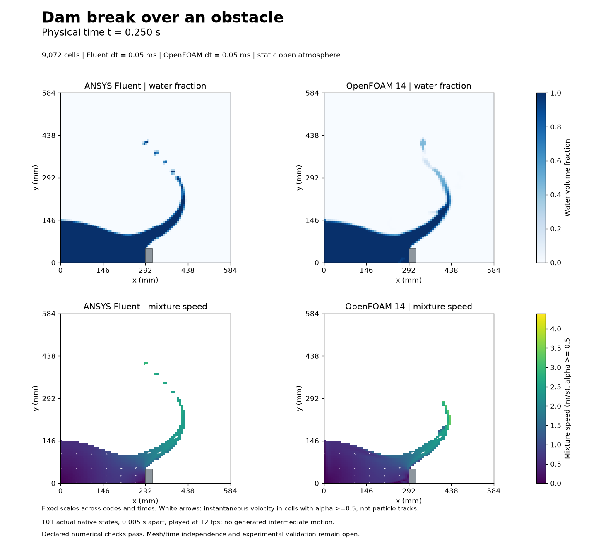
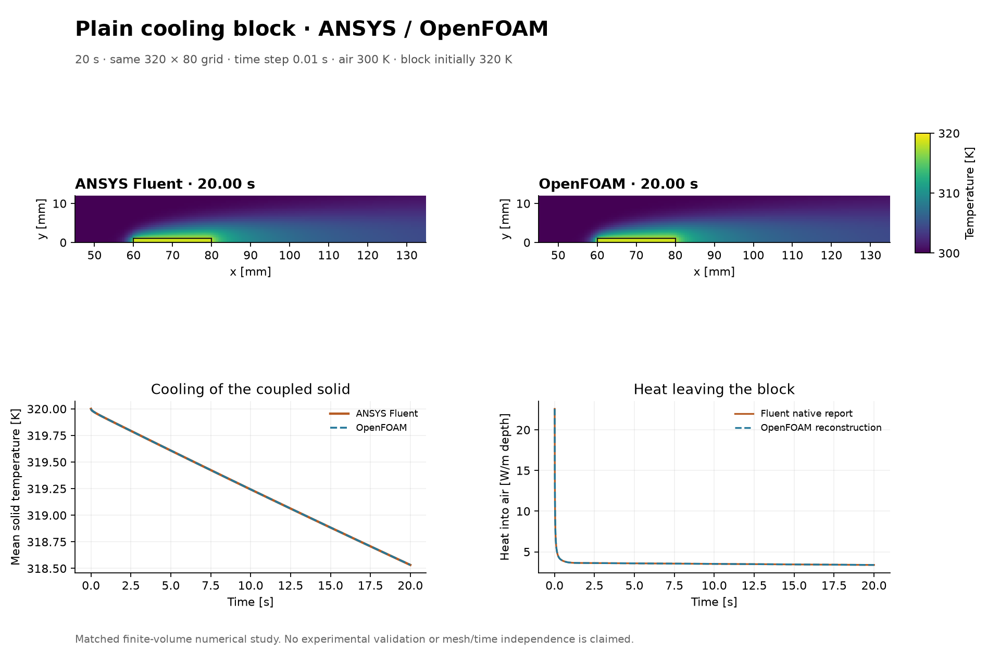

# CFD Learning Lab

An AI-assisted computational fluid dynamics portfolio using ANSYS Fluent and OpenFOAM. The collection documents **46 numbered studies**, with simulation results, methods and numerical checks.

**[Browse the full study index](docs/STUDY_INDEX.md)**

[Aerodynamics and wakes](docs/STUDY_INDEX.md#aerodynamics-and-wakes) · [Internal flows](docs/STUDY_INDEX.md#internal-flows-and-transport) · [Heat transfer](docs/STUDY_INDEX.md#heat-transfer) · [Compressible flow](docs/STUDY_INDEX.md#compressible-flow) · [Free-surface flow](docs/STUDY_INDEX.md#free-surface-flow)

## Selected results

| Study | What the simulations showed | Figures and video |
| --- | --- | --- |
| [Cylinder wake](lessons/20-cylinder-benchmark/convergence-v001/README.md) | The two solvers gave mean shedding periods of 0.33467 s and 0.33488 s over the last six cycles. | [Force histories](lessons/20-cylinder-benchmark/convergence-v001/forces-and-pressure.png) · [Video](lessons/20-cylinder-benchmark/convergence-v001/cylinder-developed.mp4) |
| [Dam break over an obstacle](lessons/35-dam-break-over-obstacle/full-production-v001/README.md) | Both solvers formed a jet as the water crossed the obstacle. Breakup details differed on the shared grid. The declared checks passed over the selected 0.5 s trajectory in each solver. | [Numerical checks](lessons/35-dam-break-over-obstacle/full-production-v001/numerical-checks.png) · [Video](lessons/35-dam-break-over-obstacle/full-production-v001/dam-break-development.mp4) |
| [Cooling an aluminium block](results/cooling-block-plain-v001/README.md) | The block cooled from 320 K to about 318.533 K over 20 s in both solvers. Their final mean temperatures differed by about 0.00050 K. | [Energy checks](results/cooling-block-plain-v001/figures/paired-prefix-energy-checks.png) · [Video](results/cooling-block-plain-v001/cooling-block-plain-comparison.mp4) |
| [Finite-wing convergence investigation](lessons/29-wing-mesh-sensitivity/formulation-investigation-v001/README.md) | All five Fluent trials missed the continuity target. Residual maps show where the imbalance was concentrated downstream of the wing. | [Residual maps](lessons/29-wing-mesh-sensitivity/formulation-investigation-v001/figures/three-actual-residual-maps.png) · [Convergence histories](lessons/29-wing-mesh-sensitivity/formulation-investigation-v001/figures/qualification-numerics.png) |

| Dam break at 0.25 s | Cooling block at 20 s |
| --- | --- |
|  |  |

## Methods and limitations

Each study describes its numerical checks and records any missed targets. Some studies vary the mesh, time step or domain size to measure how individual results respond. Experimental validation remains open.

[Study updates](docs/SHOWCASE_IMPROVEMENTS_2026-11-08.md) · [Reproduction notes](docs/REPRODUCING.md) · [Corrections](docs/ERRATA.md) · [Project history](docs/PROJECT_HISTORY.md)

## Contributions

The project owner chose the topics and directed the progression of the studies. Codex prepared meshes and scripts, ran the solver workflows and numerical checks, and prepared the figures and study records. ANSYS Fluent and OpenFOAM computed the simulation fields.
