# CFD Learning Lab

An AI-assisted CFD model portfolio using ANSYS Fluent and OpenFOAM. The priority
is actual simulations, numerical checks and clear solver-derived figures.
Explanations are brief; formal lesson checkpoints are no longer required.

[Re = 100 wake benchmark comparison](lessons/20-cylinder-benchmark/README.md): actual paired forces and shedding frequency compared with a published periodic reference.

## Latest visual model: two moving walls in a square cavity

Both solvers compute two counter-rotating cells at Re = 100. The flow returns left through the middle; the paired runs passed their numerical checks. See the [double-lid cavity record](lessons/21-double-lid-cavity/README.md).

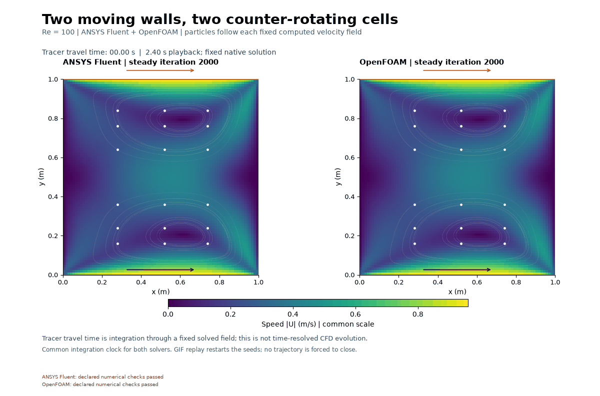

## Previous visual model: a tracer pulse through a T-junction

Completed 2026-11-02

The [actual paired pulse](lessons/19-tracer-tjunction/README.md) records 800 scalar steps to 20 s on 4,400 shared cells, using each solver's own frozen Re20 inlet flow. Both solvers show a dye pulse travelling down the upper branch, turning into the outlet channel and fading as unmarked fluid replaces it. Own primary checks: ANSYS Fluent PASS; OpenFOAM PASS. The GIF uses 101 actual concentration fields. Actual80/81 inlet samples, reconstructed scalar conservation, distinct native residuals and preserved failed controls accompany the record. No complete washout, physical validation or mesh/time independence is claimed; owner reflection remains unprovided.

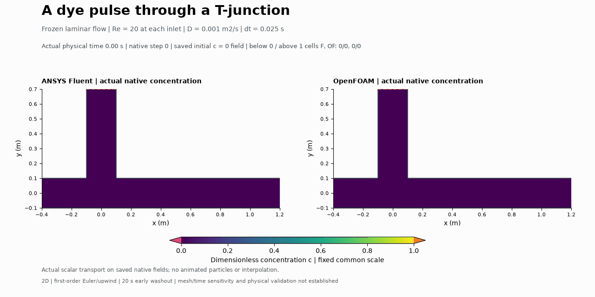

## Previous visual model: rotating-cylinder startup

Completed 2026-11-02

The [actual paired startup](lessons/18-magnus-cylinder/README.md) records 500 actual momentum steps to 10 s on 8,192 shared cells at Re = 20, with clockwise wall rotation and nominal spin ratio 1. Both codes show accelerated upper-side flow and a slower asymmetric lower wake at 10 s. Own primary checks: ANSYS Fluent PASS; OpenFOAM PASS. Native forces, actual surface pressure and separate artifact diagnostics are retained. No prescribed lift sign, ideal-flow accuracy, periodicity, physical validation or mesh/time independence is claimed.

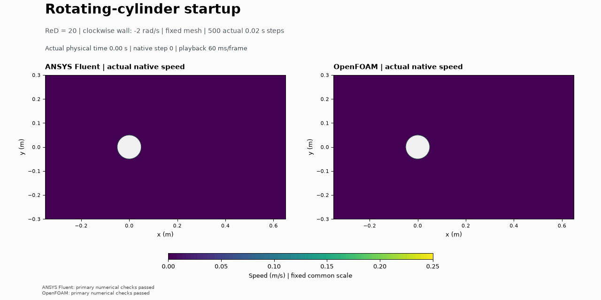

## Previous visual model: offset tandem-square wake

Completed 2026-11-02

The [actual paired wake](lessons/17-tandem-offset-wake/README.md) records 800 actual momentum steps to 40 s on 9,472 shared cells at Re = 100. The first square produces a low-speed wake that reaches the offset second square; the final native maps and profiles show interacting downstream velocity deficits. Finite-time lift histories vary during the run; sustained periodicity is not established. Own primary checks: ANSYS Fluent PASS; OpenFOAM PASS. Separate native body-force histories, prescribed unsolved initialization and exact derived-copy diagnostics are retained. No periodicity, physical validation or mesh/time independence is claimed.

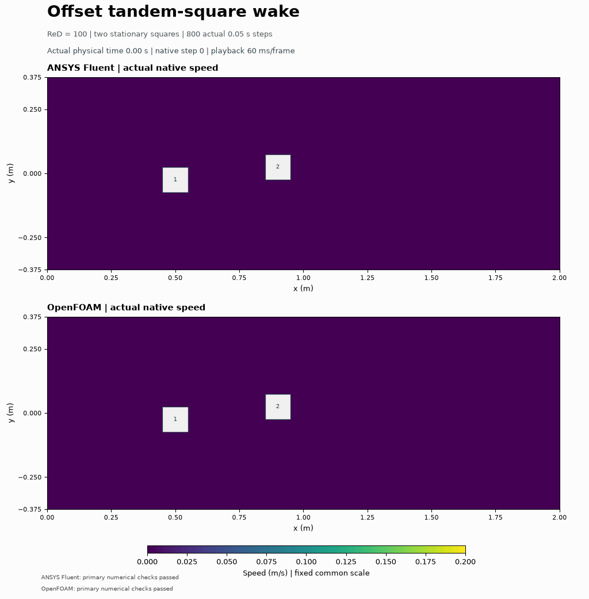

## Previous visual model: annular Couette spin-up

Completed 2026-11-02

The [actual paired annulus](lessons/16-annular-couette/README.md) records 400 actual momentum steps to 20 s on 1,536 cells at Re = 20. Motion spreads outward from the spinning inner wall; both solvers settle to very similar circular shear profiles. Own primary checks: fluent PASS; openfoam PASS. The original OpenFOAM 10-outer pressure-coupling miss and explicit 30-outer-only budget amendment remain recorded. Its separate derived-copy preservation diagnostic and raw wrapper postcheck remain false, despite actual CFD completion. Actual native frames retain genuine plateaus; no physical validation, mesh/time independence, torque balance or 3D Taylor-vortex claim is added.

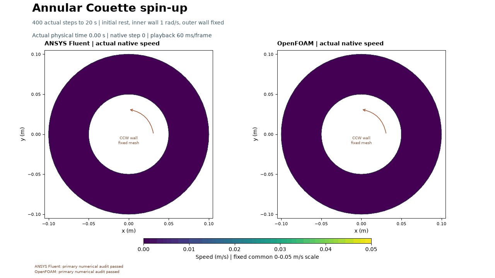

## Previous visual model: heating a flowing channel

The [paired heated channel](lessons/15-heated-channel/README.md) shows actual
computed temperatures over 3 s while each solver's own flow stays fixed.
Primary checks: Fluent **PASS**; OpenFOAM **PASS**.
Two auxiliary OpenFOAM gradient diagnostics remain unresolved (509/600 and
357/600 failed steps); see the model record.
Native and reconstructed energy diagnostics remain separate; initial unsolved
heat is unavailable. No physical validation or mesh/time independence is claimed.

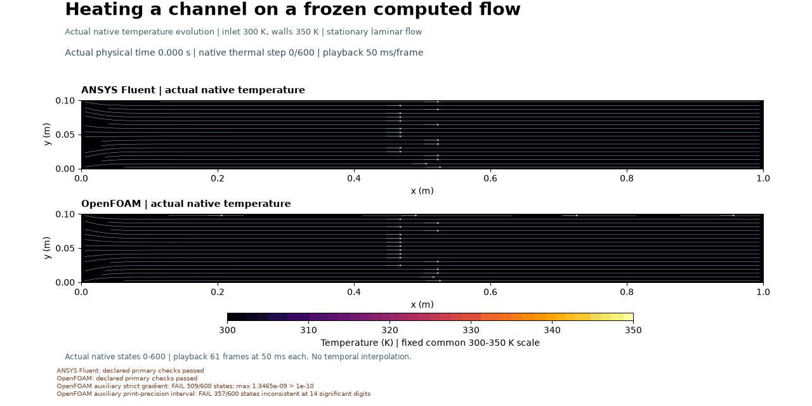

## Previous visual model: a square obstacle and its wake

The [paired confined square wake](lessons/14-square-obstacle-wake/README.md) uses
15,900 shared cells at Re = 20. Own checks: Fluent **PASS**; OpenFOAM
**PASS**. The separate paired drag target is **PASS**
(0.154048% difference, target 1%). All misses remain explicit. The GIF traces
fixed steady fields; no transient shedding or physical validation is claimed.
Completed 2 November 2026.

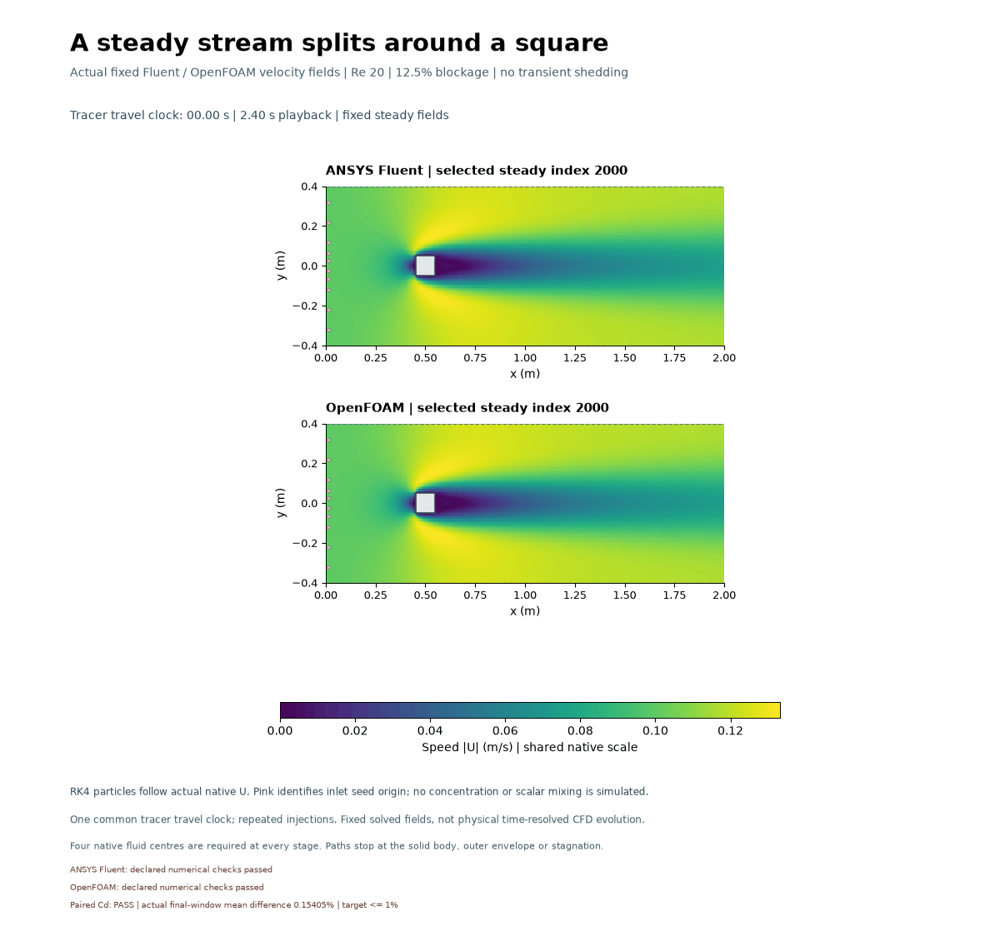

## Previous visual model: heat spreading through a solid slab

The [paired thermal slab](lessons/13-solid-conduction/README.md) shows actual
transient solid temperatures over 200 s on 2,000 cells. Fluent **PASS**;
OpenFOAM **PASS** for declared numerical checks. Final analytical
PDE errors and all early-time errors are retained. No physical validation or
mesh/time independence is established.

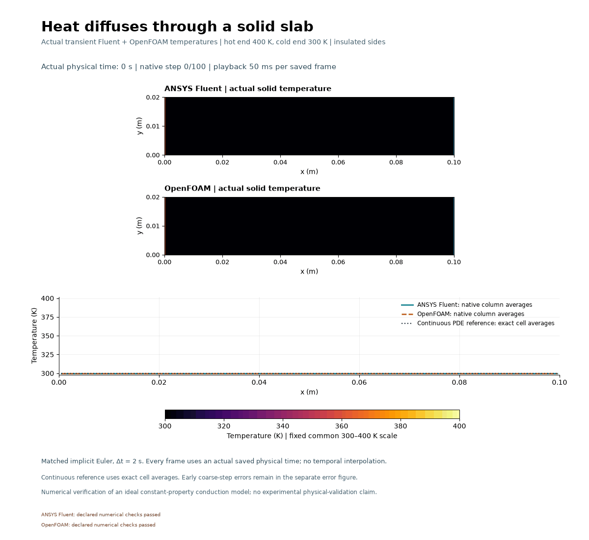

**Completed calculation:** [Cylinder review](lessons/01-cylinder-review/README.md),
including 100 extra iterations and force-stability checks. The [cylinder domain study](lessons/02-cylinder-sensitivity/README.md) is also
complete through radius 320D. The first [matched Fluent–OpenFOAM cylinder calculation](lessons/04-cross-solver-cylinder/README.md)
passed numerical checks with a 0.0806% Cd difference. The airfoil's first remesh
candidate was rejected; a repaired 383,562-cell candidate reached minimum
orthogonal quality 0.502614 and passed its zero-incidence Fluent checks.
The [three-mesh airfoil comparison](docs/AIRFOIL_MODEL_STATUS.md) is now complete
through 944,026 cells, with a 0.00435% medium-to-fine Cd change. The matching OpenFOAM model has now saved 5,000 iterations, with a 1.749% Cd difference. It remains a failed diagnostic; the airfoil status records the exact checks. Airfoil domain sensitivity remains open. The owner chose automatic continuation after each
actual Fluent image; optional unanswered predictions/reflections remain blank.

## Previous visual model: a compressible nozzle

The [paired nozzle](lessons/09-nozzle/README.md) uses 9,600 shared cells and actual
saved Mach/pressure fields. Tracers visualize fixed snapshots. Declared checks:
Fluent **MISS (retained diagnostic)**; OpenFOAM **MISS (retained diagnostic)**. Misses and numerical diffusion remain
explicit; physical validation is unestablished.

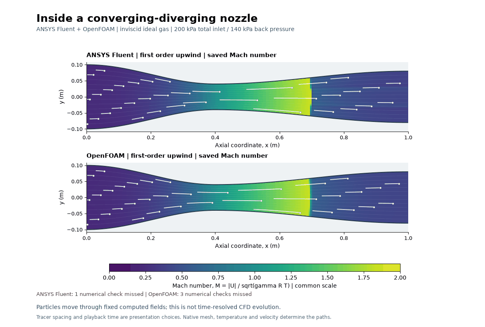

## Previous visual model: a finite-span wing

The [full-span 3D wing](lessons/08-finite-wing/README.md) uses 169,800 cells in
Fluent and OpenFOAM at illustrative Re_c=400. This GIF animates tracers through
saved **steady** fields. Declared numerical checks: Fluent **MISS (retained diagnostic)**;
OpenFOAM **PASS**. Cross-code force differences remain unresolved.
Failed targets remain visible; physical validation and
mesh independence are unestablished.

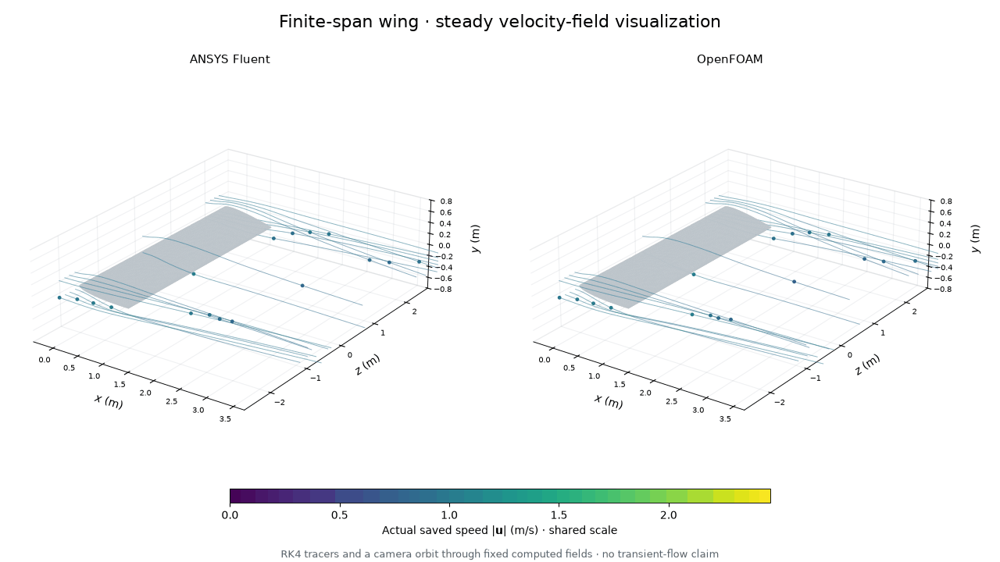

## Previous visual model: cylinder vortex shedding

The [transient cylinder](lessons/07-vortex-shedding/README.md) is saved through
4 s in Fluent and OpenFOAM at nominal Re=100 on 21,598 cells. Actual matching
frames show alternating vortices and oscillating forces. The original 2 s
pilots missed their residual targets and remain diagnostic. Stronger-iteration
continuation checks: Fluent **FAIL (retained diagnostic)**;
OpenFOAM **PASS**.
These are bounded numerical checks, not mesh/time independence or validation.

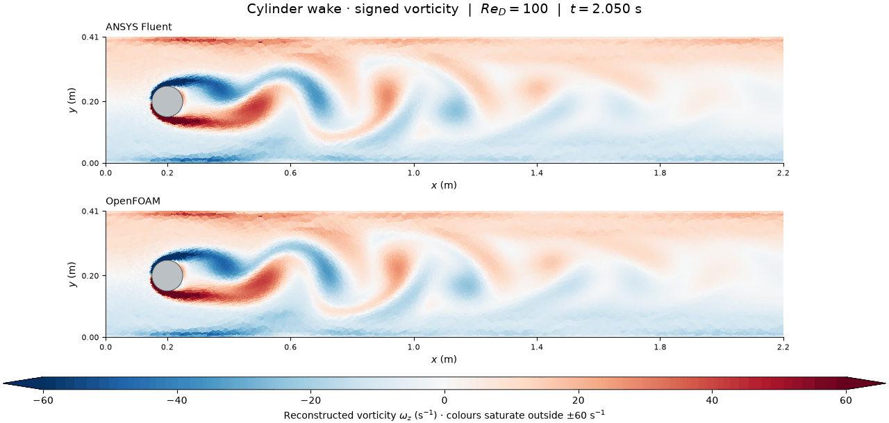

## Previous visual model: flow behind a step

The [backward-facing step](lessons/06-backward-step/README.md) is now saved in
ANSYS Fluent and OpenFOAM on the same small 8,800-cell mesh at Re_h=100. Both
show a recirculating pocket: blue is flow moving backward beneath the main
stream. Final residuals, mass balance and saved-endpoint stability checks pass;
an additional Fluent last-100 residual diagnostic narrowly fails and remains
explicitly recorded. This is a numerical demonstration on one mesh.

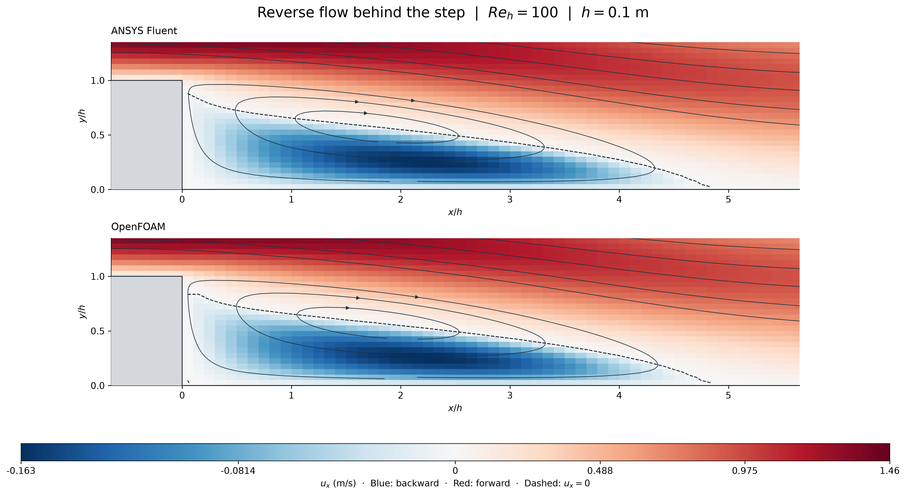

## Previous visual starter model: channel flow

[Laminar channel flow](lessons/05-channel-flow/README.md) is complete in ANSYS Fluent and OpenFOAM on a small 7,680-cell mesh. The actual fields show slow flow near the walls and a faster centre; downstream speed reaches about1.50m/s. Numerical and analytical checks pass. The fine-airfoil continuation is on hold while the portfolio returns to basic visual models.

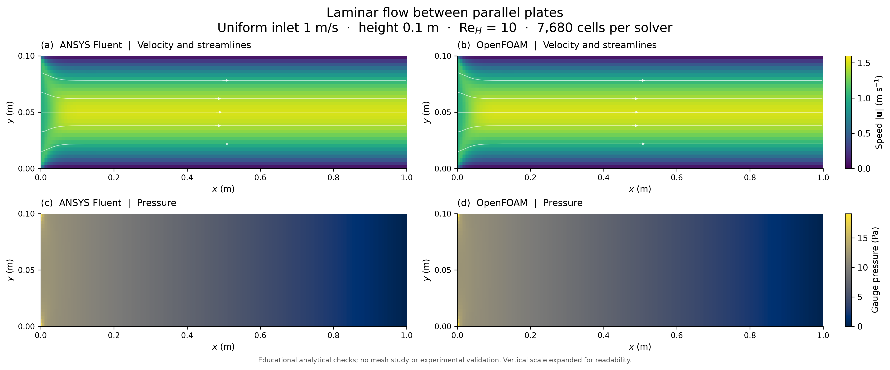

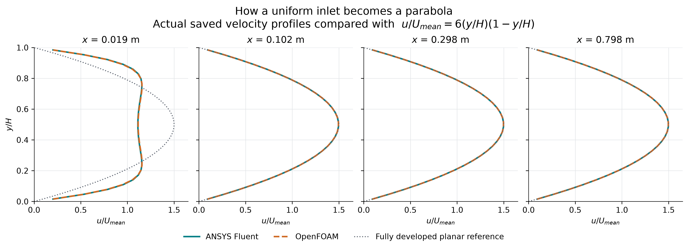

## Existing calculations

| Case | Cells | Re | Lift coefficient | Drag coefficient |
|---|---:|---:|---:|---:|
| Cylinder, coarse | 24,576 | 20 | not tabulated | 2.0721663 |
| Cylinder, medium | 55,296 | 20 | not tabulated | 2.0728375 |
| Cylinder, fine | 98,304 | 20 | not tabulated | 2.0731574 |
| NACA 0012, 0 degrees | 61,440 | 100 | -0.00001746 | 0.41608387 |
| NACA 0012, 5 degrees | 61,440 | 100 | 0.26789722 | 0.42587812 |

Recorded on 1 November 2026 using Fluent Student 2026 R1. These are converged
educational demonstrations with preliminary numerical checks. Medium-to-fine
cylinder drag changed by 0.01543% at fixed outer radius. This is sensitivity of
one output on one mesh family; it is not an error bound or physical validation.
The original airfoil mesh has minimum orthogonal quality 0.0658879. Its repaired
mesh family improves quality and has a completed three-mesh Fluent comparison.
The cylinder now has a saved-case force-stability check and a controlled
domain-radius comparison through 320D. Airfoil domain sensitivity and further verification, transient
stability and matched benchmark comparison remain open.

## Methods

The original cylinder and airfoil demonstrations use steady, two-dimensional
incompressible laminar flow with illustrative properties. Transient-cylinder
conditions and time integration are documented in its linked model record.
Density and incoming speed are 1 in SI units; diameter/chord and unit span are
1 m. Viscosity is 0.05 Pa s for the cylinder and 0.01 Pa s for the airfoil.
The circular outer boundary has radius 20 m, an upstream velocity inlet and a
downstream zero-gauge-pressure outlet; bodies are stationary no-slip walls.
Coefficient reference density, speed, length and area are one in SI units.
Documentation reports the coupled pressure-based solver and second-order
pressure/momentum; verify these on replay. The material name `air` does not make
these illustrative properties representative of atmospheric aircraft conditions.

The airfoil uses the [scaled closed NACA 0012 geometry](https://tmbwg.github.io/turbmodels/naca0012_val.html).
Only that geometry definition was borrowed; these low-Re laminar cases do not
reproduce that resource's turbulent validation conditions. Incidence was imposed
by rotating the airfoil clockwise relative to horizontal inflow.

## Evidence and learning record

- [Initial audit](docs/INITIAL_AUDIT.md) and [machine-readable audit](results/baseline-audit.json).
- [Lesson sequence and workflow](docs/LEARNING_WORKFLOW.md).
- [Original project history](docs/PROJECT_HISTORY.md): Concorde and ornithopter
  remain work in progress; the tutorials do not validate either aircraft.
- [Reproduction](docs/REPRODUCING.md), portable scripts, numerical reports and
  native Fluent images in `scripts`, `results` and `images`.
- Prediction and reflection records belong to the owner; pending entries are
  left explicitly pending.

## Contributions and limits

The owner selected topics, directed progression and specified the learning and
storage workflow. Codex selected/implemented the original numerical setups,
generated meshes and scripts, operated Fluent and OpenFOAM, checked outputs and drafted the
records. ANSYS Fluent and OpenFOAM computed their respective numerical fields; Codex prepared the academic figures from saved data. Current
setup and audit work was performed by Codex. There is no claim of independent
owner implementation, research novelty, experimental validation or admission
endorsement. Personal contributions are added only when actually performed.

## Storage and publication

The active local project root is on E:. This repository contains reviewable
methods, code, small results and images. Native simulations, source imports,
Python dependencies, private copy receipts and larger exports are kept outside
the checkout. Original projects are preserved. Never commit credentials,
connection files, licence files, installed dependencies or private application
information. No third-party redistribution licence is asserted for original
aircraft assets or ANSYS binaries.

Target repository: `Ocin12345/cfd-learning-lab`. GitHub connector search and the
accessible-repository listing found no existing repository with that name on
1 November 2026. Publication has not occurred; inspect the complete local
contents before that step.

## Academic presentation and paired solvers

The owner requested side-by-side Fluent/OpenFOAM work and academic figures.
Use the same accepted geometry, mesh, physical conditions and coefficient
references wherever feasible; record numerical-method differences explicitly.
Run one Fluent session and one OpenFOAM case concurrently only when resource
admission passes, starting with two processes each. Otherwise schedule the cases
sequentially. Code agreement supplements the checks; it is not physical validation.

See the [figure standard](docs/FIGURE_STANDARD.md) and the revised figure/caption
sets in `images/2026-11-01-academic-v003` and
`images/2026-11-01-cross-solver-v004`. Editable plotting code, source data and
hashes accompany the figures. Vector PDFs remain in the versioned local exports
directory. Earlier figures and native solver exports are preserved.

The next [paired airfoil domain study](docs/AIRFOIL_DOMAIN_STUDY.md) is complete through the recorded saved states. R40 Fluent Cd 0.4146461; OpenFOAM Cd 0.407369962. The cross-code difference is 1.75478%, against the unchanged 0.5% comparison target. Exact inner-grid preservation and all numerical/diagnostic outcomes are recorded.

The [paired lid-driven cavity](lessons/10-lid-driven-cavity/README.md) records actual Re100 native fields: Fluent PASS; OpenFOAM PASS. Fixed-field tracers and all numerical misses are labelled.

## Paired T-junction - 1 November 2026

The [actual Re20 inlet merge](lessons/11-t-junction/README.md) records Fluent PASS; OpenFOAM PASS, unchanged 2,000-iteration caps and all numerical misses. Seed colours identify entry only; no scalar mixing or transient evolution is simulated. No validation, reflection or publication claim is added.

## Paired planar channel bend - 1 November 2026

The [actual Re20 channel bend](lessons/12-channel-bend/README.md) records Fluent PASS; OpenFOAM PASS, unchanged 2,000-iteration caps and all numerical misses. Tracers visualize fixed fields. No scalar mixing, transient evolution or 3D secondary flow is simulated; no Dean-vortex, validation, reflection or publication claim is added.
