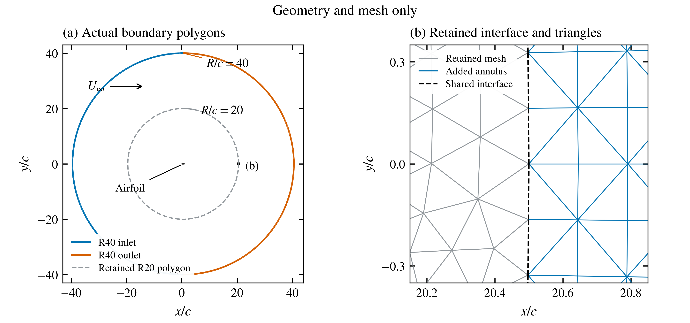
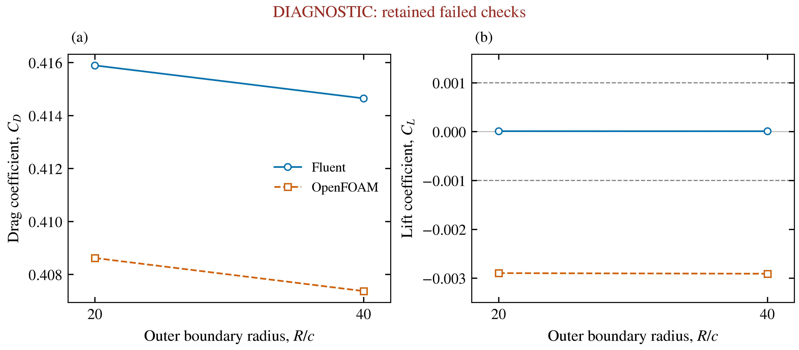
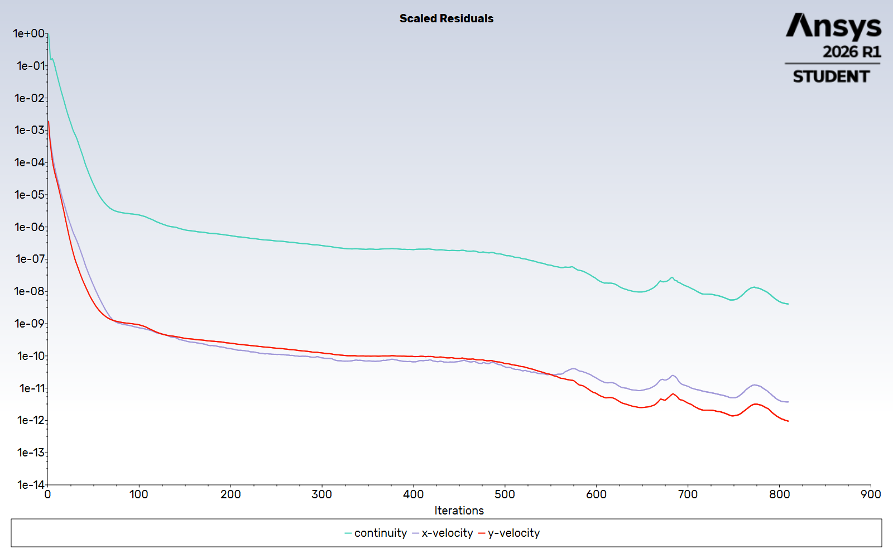
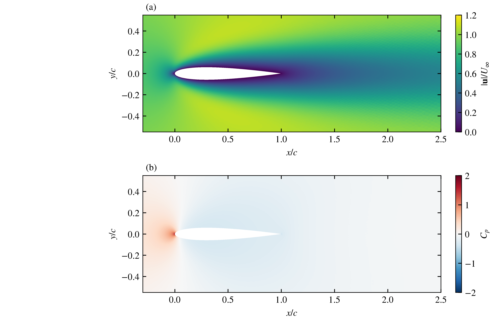
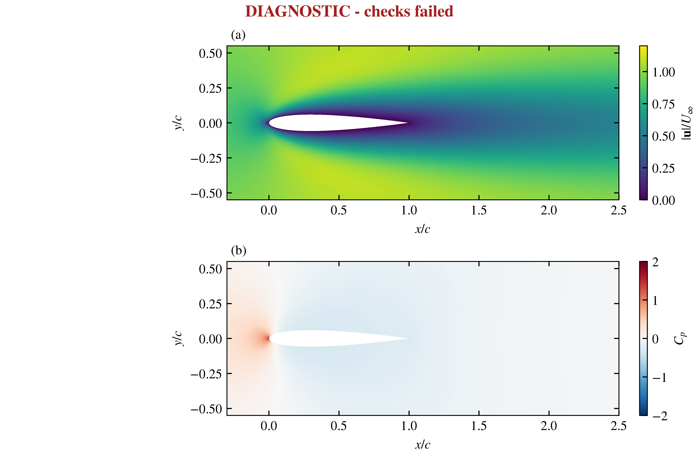
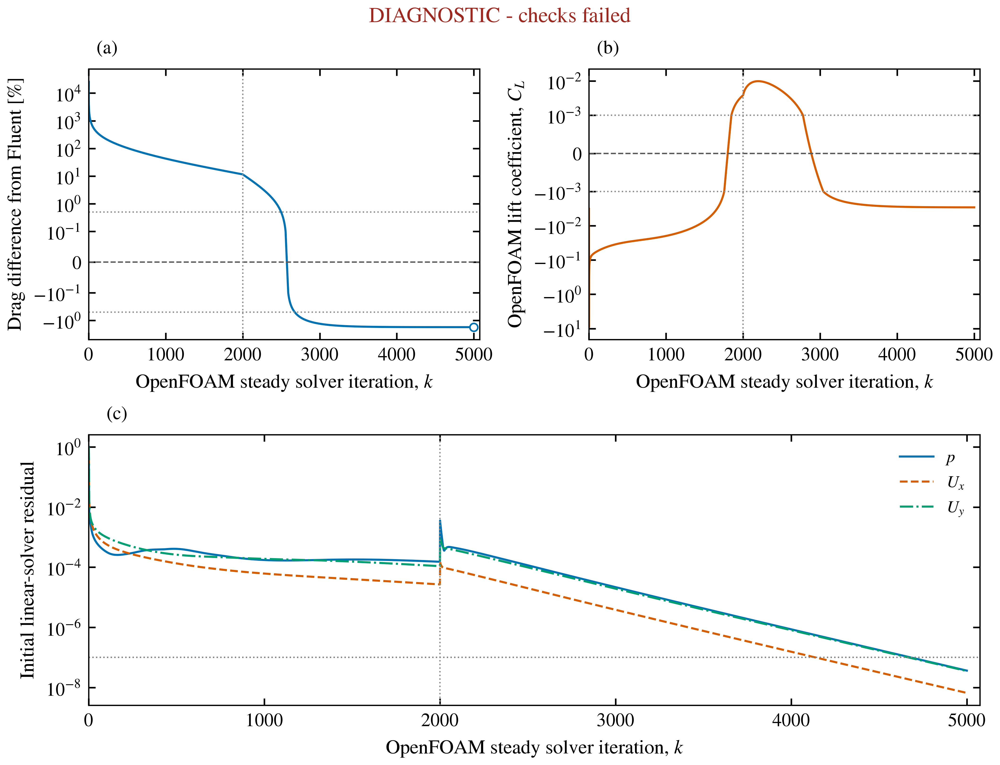

# Airfoil domain-radius comparison

The owner requested the next real calculation in both ANSYS Fluent and
OpenFOAM, with actual images and automatic routine continuation. This case
keeps Re=100, zero incidence and the original accepted medium inner mesh, and
extends the nominal outer radius from 20c to 40c about (x/c,y/c)=(0.5,0).
Unit density, speed, chord, reference area and span are unchanged; viscosity is
0.01 Pa s. The flow model is planar, steady, incompressible and laminar, with a
stationary no-slip airfoil, upstream horizontal velocity inlet and downstream
zero-gauge-pressure outlet. These illustrative properties are not flight conditions.

## Geometry and mesh

The old 383,562 triangles and 192,550 node IDs/coordinates are retained exactly.
The successful mesh adds 147,456 triangles and 73,728 nodes in 96 radial layers,
for 531,018 cells and 266,278 nodes. Rings use 2**(j/96) scaling and preserve the
original straight polygon/subdivision geometry. All 768 former outer edges are
conformal interior faces; all 770 wall edges remain. Independent emitted-file,
area, orientation, connectivity, prefix, boundary and hash checks passed.

The first unstructured annulus attempt (v001) failed Fluent orthogonal quality
at 0.0485061, below the predeclared 0.2 threshold, before any flow iterations.
Its rejected case and prepared, unsolved OpenFOAM input remain preserved.
The replacement radial mesh(v002) passed actual Fluent quality at 0.502614 and
full OpenFOAM `checkMesh -allGeometry -allTopology`. Mesh-only angle/cosine
metrics were never substituted for either solver's native checks.

## Computed results

| Solver | R/c | Cells | Cd | Cl | Numerical convergence | Lift diagnostic |
|---|---:|---:|---:|---:|---|---|
| Fluent | 20 | 383,562 | 0.41589053 | 9.154234e-06 | pass | pass |
| OpenFOAM | 20 | 383,562 | 0.4086185961 | -0.002897496 | pass | fail |
| Fluent | 40 | 531,018 | 0.4146461 | 8.413374e-06 | pass | pass |
| OpenFOAM | 40 | 531,018 | 0.4073699618 | -0.002909661 | pass | fail |

Within each code, signed Cd change from R20 to R40 is
-0.299221% for Fluent and
-0.305575% for OpenFOAM.
R40 Fluent Cd 0.4146461; OpenFOAM Cd 0.407369962. The cross-code difference is 1.75478%, against the unchanged 0.5% comparison target.
Current R40 failed acceptance checks: openfoam.zero_angle_lift_diagnostic.
The separate cross-code target failed.
All failed criteria remain visible, including failures in the R20 baseline.

Fluent first saved iteration 700 after its 600-iteration cap and 100 observations.
It then retained those fields in a fresh versioned continuation, reached the
configured 1e-8 stopping target at 710 and observed another 100 iterations to 810.
Final scaled residuals are [4.0687e-09, 3.7464e-12, 9.4802e-13]; relative mass imbalance
is 8.00426e-13. Last 20 Cd range is zero at printed
precision; the Cl absolute range is 3.83e-11. Input hashes,
retained iteration 700 residuals, no-hybrid control flow, native stopping marker,
all 202 force reports and direct saved-HDF surface-force integration were
independently verified. Numeric coefficient references are unchanged; the benign
reference-zone display-label difference after reload is recorded separately.

OpenFOAM starts from uniform U=(1,0,0), p=0, uses two MPI ranks and the same
SIMPLE-consistent least-squares/linear-upwind/corrected-diffusion methods as R20.
It saved 2000 at U relaxation 0.7, then 2500 at 0.9, and continued to
5000 at 0.9. Every checkpoint, dictionary and full startup log is
preserved, with hashed continuation records and unchanged accuracy thresholds.
Final maximum initial residuals are {'Ux': 6.5953896850602e-09, 'Uy': 3.5293620577875e-08, 'p': 3.6435368299569e-08}, with pressure
the maximum across all correctors. Last 100 relative Cd range is
2.79705e-06, Cl absolute range 2.44414e-06,
maximum absolute Cl 0.00290966, and reconstructed
relative mass imbalance 1.17684e-12.

The [unchanged native exports](../images/2026-11-01-airfoil-domain40-fluent-native-v001/caption.md) retain solver labels and display ranges. The following computed-field figures use common nondimensional colour scales.

## Pressure and viscous force accounting

| Domain | Solver | Pressure Cd | Viscous Cd | Total Cd |
|---|---|---:|---:|---:|
| R20 | Fluent | 0.075748609 | 0.34014192 | 0.41589053 |
| R20 | OpenFOAM | 0.074858246 | 0.33376035 | 0.408618596 |
| R40 | Fluent | 0.075492411 | 0.33915368 | 0.4146461 |
| R40 | OpenFOAM | 0.0745995741 | 0.332770388 | 0.407369962 |

Serial saved-field postprocessing reproduced the original OpenFOAM Cd, Cl and
moment coefficients within the unchanged absolute 1e-8 equivalence tolerance,
with zero flow iterations and unchanged original fields. Fluent components are
actual native scalar reports. The viscous contribution accounts for about
87.8% of the signed total drag gap at R20 and
87.7% at R40. This locates the measured force difference;
it does not establish its numerical cause or identify which code is closer
to the physical solution. Native report rounding limits the displayed precision.
Original saved endpoints determine all main comparison acceptance flags;
postprocessed component closure is checked separately.

The current [R20 component record](../results/airfoil-force-components-r20-v002/comparison.json)
and [R40 component record](../results/airfoil-force-components-r40-v001/comparison.json)
bind raw outputs, input fields, code snapshots and both coefficient replays to
SHA256 manifests. CSV tables sit beside those records. The prior R20 v001
accounting record remains preserved. See [the postprocessing method](AIRFOIL_FORCE_POSTPROCESSING.md).

## Checks, limits and reproduction

The declared limits remain: final initial p/U residuals <=1e-7, relative mass
imbalance <=1e-6, last 100 OpenFOAM Cd relative range <=1e-4 and Cl absolute
range <=1e-5, zero-angle maximum absolute Cl <=0.001. Fluent uses a final 20
window after 100 additional observations. The 0.5% code-comparison criterion is
a learning target, not an uncertainty bound. Retention of failed checks requires
explicit diagnostic mode; failed figures visibly show the failure status.

The first completed-field analysis stopped at a coordinate-matching defect in
the frozen older helper: independently sorting nearly equal x coordinates before
and after serialization paired different vertices. The original inner projected
coordinates match exactly; the largest added-node coordinate-component serialization difference is
below 5e-14 m. A versioned helper/analyser corrects the pairing while retaining
the original 1e-10 m coordinate limit and every topology, owner/neighbour and
patch check. Neither solver mesh nor saved fields were changed. The older helper
and R20 evidence remain byte-identical and independently reproducible.

Two radii with an exactly retained inner mesh establish measured sensitivity.
Added annulus discretization also changes; no continuum error bound, convergence
order, asymptotic radius, mesh/domain independence or physical validation follows.
The cause of any remaining code discrepancy is unresolved. Residual norms and
starting fields differ, so these runs do not rank solver speed or accuracy.
These cases do not validate Concorde, an ornithopter or aircraft performance.

Use `extend_airfoil_domain.py --source <accepted-medium-airfoil.msh>`
with separate arguments `--radius 40 --annulus-mode radial --radial-layers 96`
and a fresh external `--out`. The native v002 source and executed snapshots
remain preserved; do not overwrite existing mesh/run directories. Run Fluent
with `airfoil_run.py` and its existing material/method template; use
`--reconverge --initial-iteration-cap 1200` with the saved case/data pair and a
fresh output for the recorded continuation. The actual native target stopped
that continuation after 10 iterations. `analyse_airfoil.py` checks its final
records. `prepare_openfoam_airfoil.py`, full conversion/checking, two-rank
execution and recorded continuations reproduce the paired OpenFOAM workflow.
`analyse_openfoam_airfoil_v002.py --retain-failed-checks` records actual failures;
`analyse_airfoil_domain.py` verifies both native manifests, exact mesh
preservation, physical conditions, numeric references, methods and relaxation
schedules before producing the four-row table. Plotters bind their source hashes.

Native data are in `native/runs/2026-11-01-airfoil-domain40-v002`; the ANSYS final
case is in `fluent-continuation-v001`, and OpenFOAM in `openfoam`. Small records
are in `results/airfoil-domain40-fluent-v002`,
`results/airfoil-domain40-cross-solver-v002` and
`results/airfoil-domain-comparison-v002`. Native files, processor states,
dependencies and large/vector exports stay outside Git on E:. Original projects
and all failed attempts remain preserved. Supported temp/cache paths are on E:.

NumPy generated the radial annulus; Fluent and OpenFOAM computed their fields. GitHub publication has not occurred.
