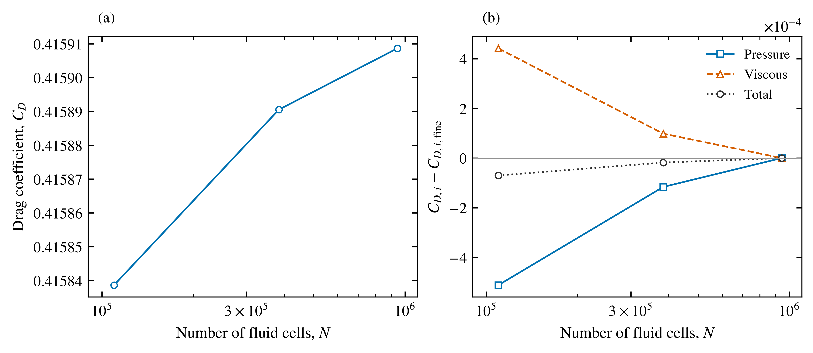
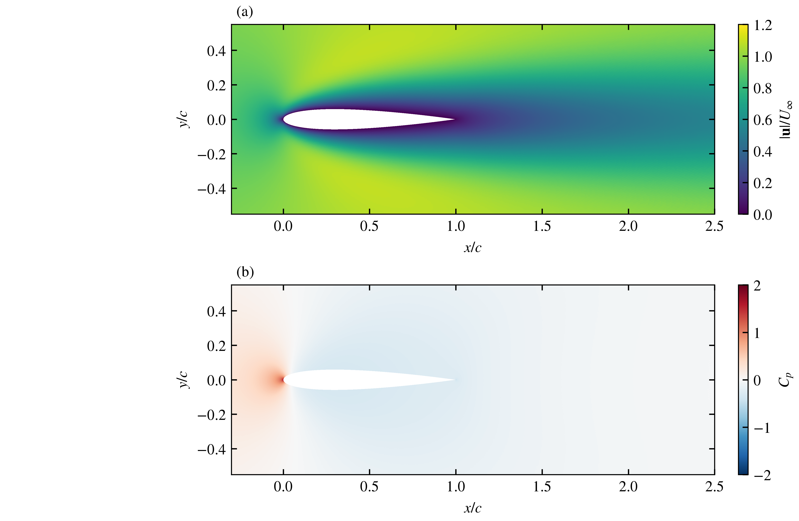
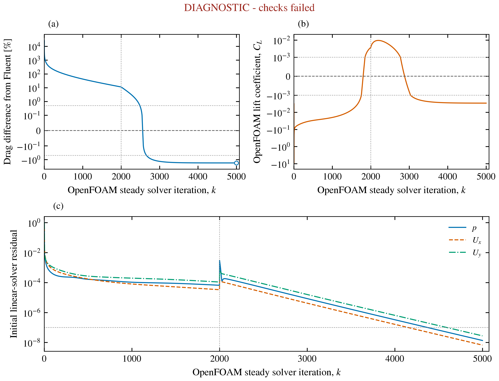
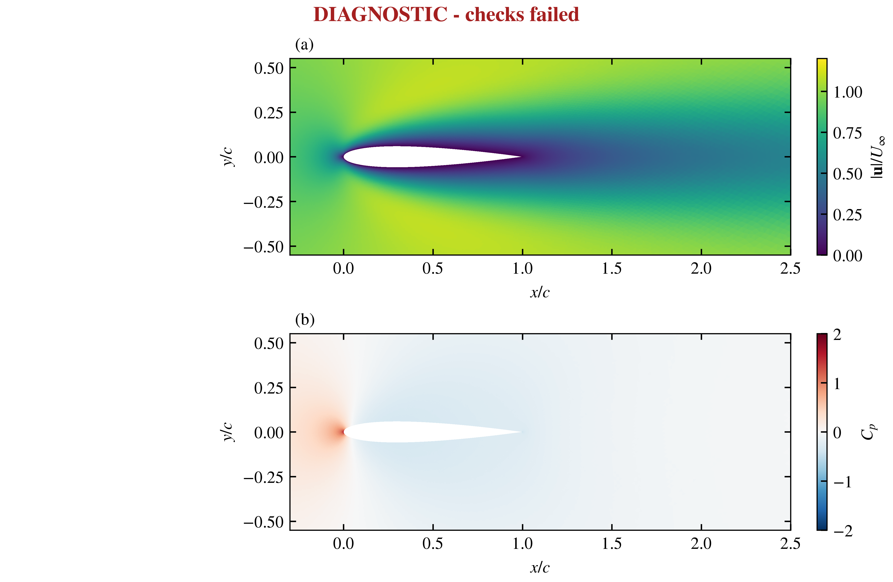

# Airfoil model status

The owner prioritizes actual CFD model runs and results. Explanations are brief,
formal lesson checkpoints are no longer required, and each completed calculation
is accompanied by an actual solver-derived figure. Native cases remain outside
Git on E:, with original projects preserved. No owner prediction, reflection or
independent implementation is inferred.

## Completed Fluent mesh comparison

All three calculations use the same original closed NACA 0012 boundary polygon,
zero incidence, chord/span 1 m, density 1 kg/m3, speed 1 m/s, viscosity 0.01 Pa s, Re = 100, planar steady
laminar flow, upstream velocity inlet, zero-gauge-pressure outlet and a radius 20c
outer boundary centred at x/c = 0.5. Coefficient references are unit density,
velocity, length, area and span. Numerical methods are the same pressure-based
coupled scheme, least-squares gradients, second-order pressure and second-order
upwind momentum. Each is a cold fresh-mesh solve followed by 100 further observed
iterations; all final states are saved and the Fluent sessions exited.

| Mesh | Cells | Cd | Cl | Minimum orthogonal quality |
|---|---:|---:|---:|---:|
| Coarse |109600|0.41583862|-3.4838049e-5|0.334853|
| Medium |383562|0.41589053|9.1542336e-6|0.502614|
| Fine |944026|0.41590864|-1.1893415e-5|0.359458|

All passed residual, mass-balance, quality and force-window checks. Fine final
scaled continuity residual was 8.5253e-13 and relative mass imbalance 3.5527e-16.
Force ranges described as zero refer to the printed report precision. The medium
to fine total-Cd change is 0.00435432%, using fine Cd as denominator, below the
previously declared 0.5% comparison target. This is a measured sensitivity result,
not an error bound, GCI, universal mesh independence or physical validation.

Pressure Cd increases 0.000116358 from medium to fine, while viscous Cd decreases
0.00009824; these contributions largely cancel. The zero-angle lift bias is
small but nonmonotonic and changes sign. Both facts limit a simple convergence
claim based only on total drag. Airfoil domain sensitivity is unfinished.

### Mesh generation and admission

The opt-in `--scale-edge-limits` control scales original-edge size limits as
well as background/wake sizes. At scale 1 its settings are unchanged from the
saved medium mesh. The solved scales are 1.4, 1.0, 0.55. Original polygon vertices
and segment coverage are retained, without trailing-edge rounding. Actual wall
faces increase 390, 770, 1,154; median wall-adjacent triangle altitude decreases
0.00469548,0.00232778,0.00160603 m. Leading-edge, trailing-edge and wake resolution
also decrease. These are measured nonuniform meshes, with no inferred uniform
refinement ratio or convergence order.

The initial fixed-edge-limit scale 1.4 preparation and the 0.85/0.75 trial meshes
are retained externally. They were superseded before their CFD solves because
actual subdivision/spacing changed too little. The 0.55 mesh was selected from
mesh-only evidence, passed independent polygon/patch/area checks and satisfied
the 950,000-cell/node admission ceiling before Fluent ran. Selection records,
preflights, executed-source snapshots and all trials are preserved. The initial
Common Licensing feature query returned no list; actual two-process Student
session startups succeeded. Only one Fluent session ran at a time.

### Figures and reproduction

`scripts/airfoil_mesh_metrics.py` checks actual Gmsh topology, polygon segment
coverage, inlet/outlet assignment and regional spacing. `analyse_airfoil.py`
checks every sampled force against native reports, actual settings, residuals,
mass and saved case/data presence. A separate independent review checked each
saved HDF5 mesh/data pair against its original imported mesh and wall flags.
`analyse_airfoil_sensitivity.py` checks method equality and input hashes, exposes
pressure/viscous contributions and writes the public comparison tables.

`plot_airfoil_fields.py` reconstructs triangles from saved Fluent face/cell IDs,
uses the corresponding cell-centred fields and retains fixed ranges containing
all data. Final fine-PDF layout was corrected after rendered inspection found
clipped labels; earlier exports remain preserved. Field layers are rasterized
at 600 dpi within vector axes. Captions, source hashes, plotting code, PDF/SVG/PNG
and rendered checks accompany the versioned external exports. Native Fluent
field/residual exports remain unchanged externally.

Small records are in `results/airfoil-sensitivity-v002`, with individual checked
runs in `results/airfoil-sensitivity-coarse-v002`,
`results/lesson03-alpha0-local-v002` and `results/airfoil-sensitivity-fine055-v002`.
Native runs are in the external `2026-11-01-airfoil-sensitivity-v002` directory;
the medium case remains in its earlier versioned directory.

## Matching OpenFOAM model

A 383,562-cell one-prism-layer unit-span extrusion of the same medium mesh passed
`checkMesh -allGeometry -allTopology`. Native geometry/topology, determinant,
concavity, skewness and interpolation checks passed; a small-edge diagnostic
for 36 edges is retained in the log. No check was disabled. The initial 2,000-step
steady SIMPLE run uses Foundation 14 `incompressibleFluid`, least-squares
gradients, bounded linear-upwind momentum, corrected diffusion, two
nonorthogonal pressure correctors and U relaxation 0.7. It starts from uniform
fields and is a different algorithm and initialization from Fluent.

The matched OpenFOAM model completed and saved 5,000 steady iterations on the
same 383,562-cell medium mesh. Cd = 0.4086185961, Cl = -0.002897496409; the absolute
Cd difference from Fluent is 1.74852%.
This is a retained diagnostic result. Failed checks: openfoam.zero_angle_lift_diagnostic.
The separate declared 0.5% cross-code target failed.
Numerical convergence status is True; the
zero-angle symmetry diagnostic status is False.

The original cold-start declaration is unchanged. The initial run saved 2,000;
U equation relaxation changed from 0.7 to 0.9 for continuation to 2,500, then
remained 0.9 through 5,000. Original dictionaries, checkpoints, logs and hashed
continuation records are retained. Discretization and all thresholds stayed
unchanged. No Fluent solution fields were imported into OpenFOAM.

Final initial residuals are p 1.358e-08, Ux
6.67523e-09 and Uy 2.76908e-08.
Pressure uses the maximum initial residual across every correction solve in an
iteration. Last-100 relative Cd range is 2.43957e-06; absolute
Cl range is 2.29817e-06. Maximum absolute Cl in that window is
0.0028975, against the unchanged 0.001 diagnostic.
Final reconstructed relative boundary mass imbalance is 6.37712e-14.
Full numeric thresholds, named pass/fail results and source hashes accompany
the public tables in `results/airfoil-cross-solver-v001`.

The independent analyzer checks actual native geometry/cell-face topology,
settings, saved fluxes, all correction residuals and every sampled force in
the Fluent reference. The earlier saved 2,500 outlet had no reversed faces.
No geometry, physical-boundary or coefficient-reference mismatch was found.
The cause of the drag/lift discrepancy remains unresolved. Different numerical
methods, mesh effects and steady-state assumptions require investigation; none
has been established as the cause. Mesh and domain independence and physical
validation remain unestablished. Residual norms and starting fields differ,
so iteration counts and residual magnitudes do not rank solver performance.

Diagnostic retention saves false acceptance flags and named failures without
changing thresholds. Default analysis and plotting still reject failed checks;
explicit diagnostic plots visibly label the failure. Full startup histories
remain visible, including the relaxation change. Native fields, solver logs and
processor checkpoints are external on E:; recorded dictionaries are in
`cases/openfoam-airfoil-re100-recorded`.

Gmsh computed meshes;
Fluent and OpenFOAM compute their respective flow solutions. These models do
not validate Concorde, the ornithopter or any aircraft performance claim.

## Subsequent R40 domain comparison

See [the controlled R20/R40 study](AIRFOIL_DOMAIN_STUDY.md) for the next actual runs, preserved inner mesh, rejected first annulus, completed ANSYS continuation and OpenFOAM numerical/diagnostic outcomes. R40 Fluent Cd 0.4146461; OpenFOAM Cd 0.407369962. The cross-code difference is 1.75478%, against the unchanged 0.5% comparison target.
