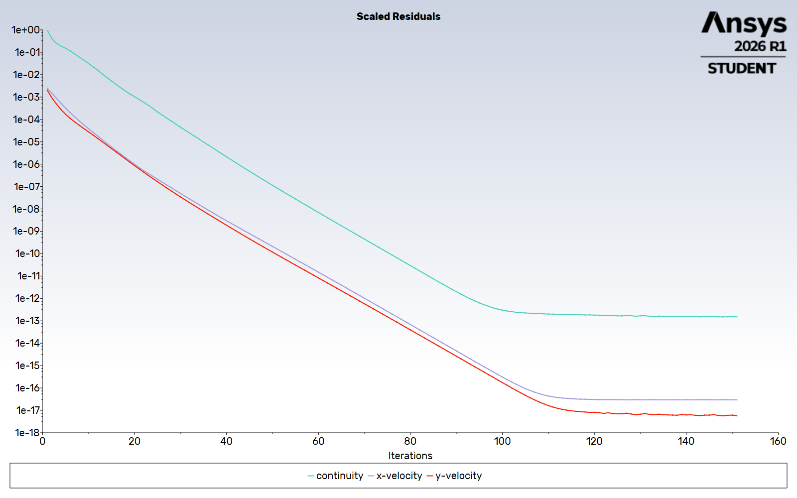
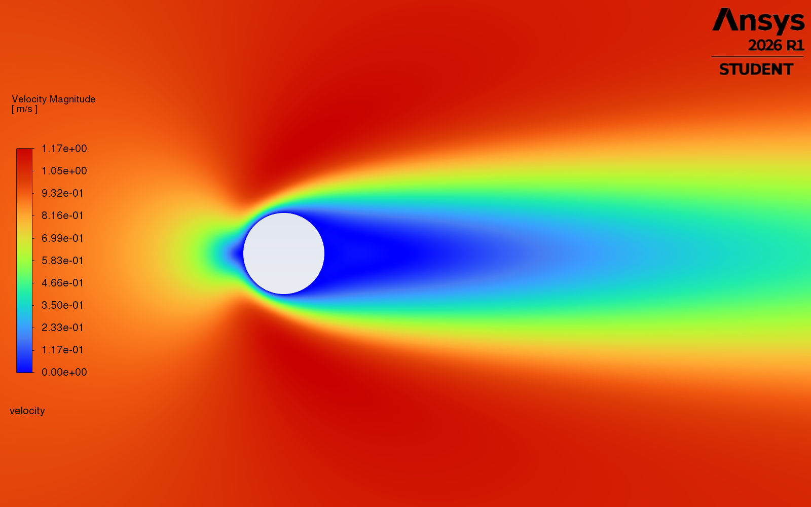
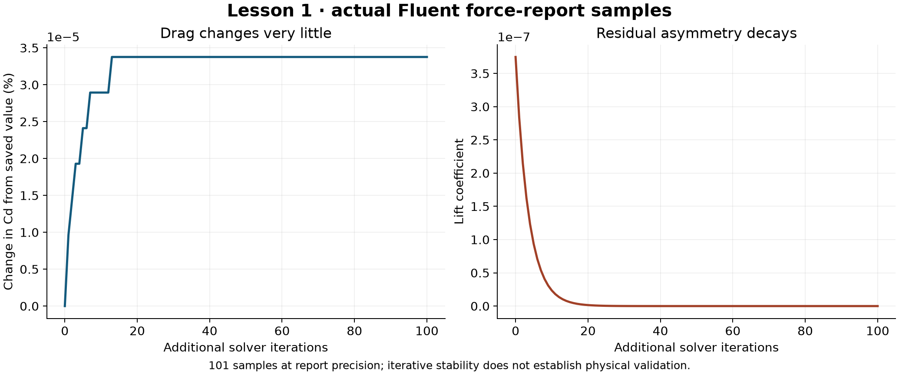

# Lesson 1: when is a cylinder calculation settled?

Status: numerical replay complete.

## Physics and question

Flow exerts force through pressure and viscous friction at the cylinder wall.
The Reynolds number compares inertia with viscous effects:
`Re = rho U D / mu = 1 * 1 * 1 / 0.05 = 20`.
Fluent approximates the equations on cells and iterates toward a solution.
Residuals describe remaining equation imbalance; drag and lift monitor integrated
physical outputs. Small residuals and stable forces are distinct checks.

Question: does a saved, residual-converged calculation also give stable forces
when iteration continues?

## Prediction checkpoint

Before the replay, predict whether drag will remain approximately constant,
drift, or oscillate during 100 additional solver iterations after the recorded
residual target has been reached. Explain your reasoning and what evidence would
change your mind. Record any answer received before the result reveal verbatim
in prediction.md. Under the revised policy an unanswered prompt does not block
progress. Do not supply an answer on the owner's behalf.

## Defined case

- Two-dimensional steady incompressible laminar cylinder flow; unit span.
- Diameter 1 m; circular outer boundary radius 20 m; structured O-grid.
- Density 1 kg/m3, dynamic viscosity 0.05 Pa s, incoming speed 1 m/s.
- Upstream semicircle: horizontal velocity inlet; downstream semicircle:
  pressure outlet at zero gauge pressure; stationary no-slip cylinder.
- Reuse the saved fine-grid case/data in a new external native run folder:
  512 circumferential cells by 192 radial layers = 98,304 cells.
- Recheck saved solver settings, reference values, outlet conditions and mesh
  on load. Existing documentation reports second-order pressure/momentum and
  the coupled pressure-based solver; confirm these live rather than assuming.
- Measure drag and lift coefficients, pressure/viscous drag contributions,
  continuity and momentum residuals, signed inlet/outlet mass flux, and force
  changes over the additional iteration window. Reference density, speed,
  length, projected area and span are all one in SI units.

## After the prediction

Check resources and licensing; open one hidden two-process Fluent session.
Load the copied case/data, inspect mesh quality and settings, retain the initial
forces, and continue for a planned 100 iterations with force histories and an
explicit record of stopping controls. Record how many iterations actually run.
Compare force histories, residuals and relative mass imbalance (net flux divided
by inlet flux). A stability target must be declared before the replay result is
examined; 0.01% drag change across the final 20 iterations is a proposed learning
target, not a universal accuracy or validation criterion. Use an absolute lift
metric near zero. Investigate any drift rather than silently changing criteria.
Save native files, raw reports and real Fluent pressure/velocity exports.

## Limits and reflection checkpoint

A replay tests persistence/reproducibility and iterative stability for this
discrete steady problem. It cannot establish domain independence, physical
unsteadiness, experimental agreement or aircraft performance. The new result is reported below.

Owner task after reviewing the run: explain why residual convergence, force
stability and physical validation answer different questions. Record any owner
reflection in their own words. Under the revised automatic continuation policy,
an unanswered reflection does not block the next lesson.

Prediction, personal exercise and reflection remain pending.

## Actual result

Live Fluent Student startup succeeded using two solver processes. The saved fine
case was read, its pressure-based planar steady laminar model and second-order
coupled numerical settings inspected, and it was extended from iteration 51 to
151. All three residual convergence checks were temporarily disabled to allow
the full observation window; residuals remained monitored. Saved case settings
retain that deliberate stopping-control change.

- Cd: 2.0731574 initially, 2.0731581 finally, about 0.000034% change.
- Final Cl: 4.8294702e-15; the final 20-sample absolute range was 3.28e-15.
- Final continuity/x/y residuals: 1.5088e-13 / 2.9557e-17 / 5.7020e-18.
- Minimum orthogonal quality: 0.999985; reported inlet mass flow 40 kg/s, net
  mass flow 0 kg/s at printed precision.
- Final 20 Cd samples were identical at report precision (about eight significant
  digits). This is not a claim of zero numerical error.

The predeclared learning stability targets passed. This tests iterative stability
of one discrete steady calculation; domain and physical validation remain open.

Small reports, samples, numerical settings and sanitized transcript are in
`results/lesson01-cylinder-replay`. Native case/data and full raw reports are
preserved outside the repository. The current runner supports both saved-case
replay and fresh-mesh domain calculations; the replay branch implements this
method. An execution-time code checksum was not captured for this first replay.

ANSYS Fluent computed the fields and exported the images. The owner specified
the automatic visual-review workflow; prediction/reflection remain unanswered.

