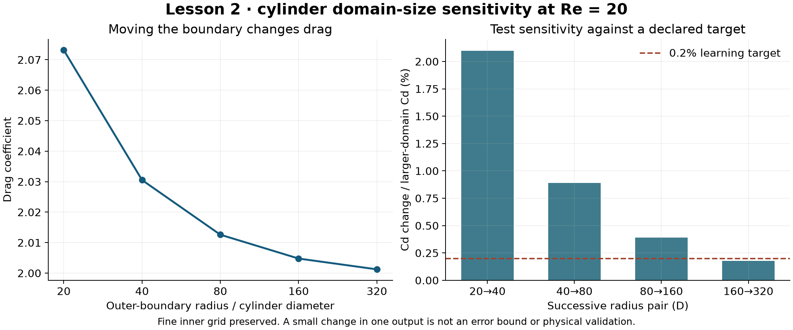
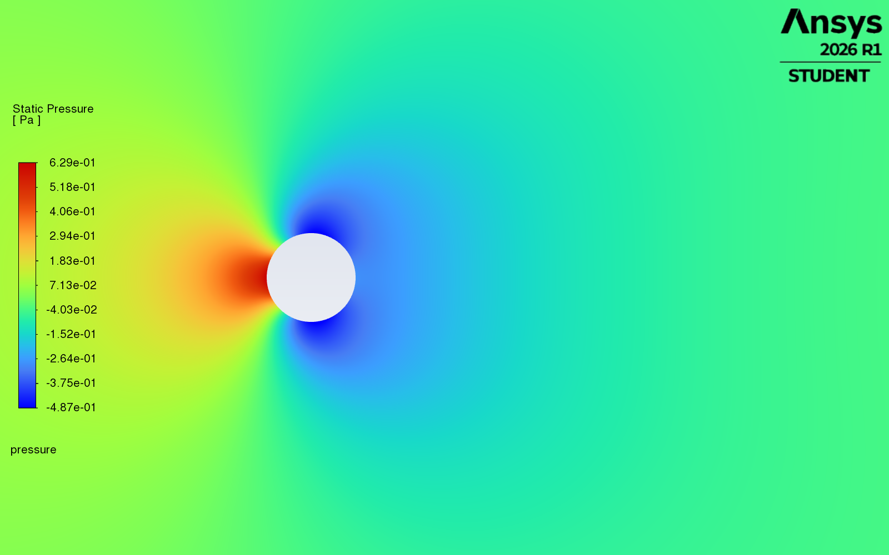

# Lesson 2: mesh agreement versus boundary sensitivity

Status: planned numerical domain comparison complete on 1 November 2026. Owner requested an actual Fluent image
after each completed simulation, followed by automatic continuation.

## Physical and numerical question

An external-flow calculation replaces an infinite fluid region with a finite
boundary. That boundary imposes incoming velocity and outgoing pressure and can
influence forces on the body. Refining cells inside the same finite region cannot
remove an error caused by the boundary location.

The existing cylinder meshes have 24,576, 55,296 and 98,304 cells. Cd changed by
0.01543% from medium to fine at radius 20D. Lesson 1 additionally found the fine
case iteratively stable. We now move the far boundary while preserving the fine
mesh's original 98,816 nodes through radius 20D exactly.

## Conditions and controlled changes

Keep Re=20, diameter=1 m, rho=1 kg/m3, speed=1 m/s, mu=0.05 Pa s, unit span,
steady planar incompressible laminar flow, no-slip body, the same semicircular
inlet/outlet split, coupled solver and second-order schemes.

Add outer radial rings with approximately the existing radial growth ratio;
preserve the original radial and circumferential coordinates through 20D. Check
the original coordinates against the saved mesh before solving. Thus the domain
change does not silently coarsen the near-body grid. Record all added cell counts,
quality diagnostics, convergence, mass balance and force histories.

Begin with radius 40D, then 80D if prior numerical checks pass. Add larger radii
only if needed. A **predeclared learning target** for subsequent comparisons is
less than 0.2% change in Cd between the two largest tested radii, using the larger
domain's Cd as denominator. This is an output-specific sensitivity target, not
a physical accuracy bound, formal extrapolation or proof that all fields are
domain independent. Do not change this target after seeing results.

Each new case is initialized and iterated to 1e-8 residual targets (cap 600),
then extended for 100 iterations with residual stopping checks disabled and
drag/lift sampled every iteration. Apply Lesson 1's declared force-stability
targets and inspect final residuals and mass balance independently. Save case/data
before closing the single hidden two-process session.

## Participation and attribution

Optional prediction: which result is more likely to change when moving the outer
boundary, iteration convergence or the final force? Give a physical reason.
No owner answer is assumed.

Optional personal task after the comparison: explain why mesh agreement at one
domain size cannot establish domain independence. Reflection remains unanswered
until the owner supplies their own words.

Codex designs and operates these controlled changes and prepares the records;
ANSYS Fluent computes the fields. The owner sets the learning questions and
automatic visual-review policy. No owner implementation is inferred.

## Actual results

| Outer radius / D | Cells | Final Cd | Change from preceding domain |
|---:|---:|---:|---:|
| 20 | 98,304 | 2.0731581 | baseline, Lesson 1 replay |
| 40 | 112,128 | 2.0305332 | 2.0992% |
| 80 | 125,952 | 2.0126077 | 0.8907% |
| 160 | 139,776 | 2.0047797 | 0.3905% |
| 320 | 153,600 | 2.0012404 | 0.1769% |

All four new cases reached the residual target, completed 100 additional
iterations, met the declared force-stability checks at printed precision and
saved case/data before closing. Minimum orthogonal quality was 0.999985 for all;
final continuity residuals were approximately 1.5e-13 to 1.6e-13. Relative mass
imbalances were below 1e-15 at report precision.

Every original fine-grid node through radius 20D was retained exactly. The outer
annular rings were generated separately for each larger radius; only the common
core through 20D is claimed identical. The boundary split, illustrative fluid
properties and numerical methods were held fixed.

The final pair meets the predeclared 0.2% Cd sensitivity learning target. This
does not establish a formal error bound, convergence of every field or agreement
with a physical benchmark. In particular, the original tiny mesh change at 20D
did not imply a negligible finite-domain effect.

Native plots have automatic colour ranges; use the numerical reports for
quantitative comparisons. Reports and force histories are in
`results/lesson02-radius40`, `lesson02-radius80`, `lesson02-radius160` and
`lesson02-radius320`; the comparison table is in
`results/lesson02-domain-comparison.json`. Large native files remain outside Git.
Saved cases retain the deliberately disabled residual stopping checks used for
the observation window; re-enable them when using those cases for another run.

No owner prediction or reflection was supplied during this series. Codex
implemented and operated the study; Fluent computed the fields and exports.
The owner authorized the study and automatic visual review, without claiming
independent implementation.
