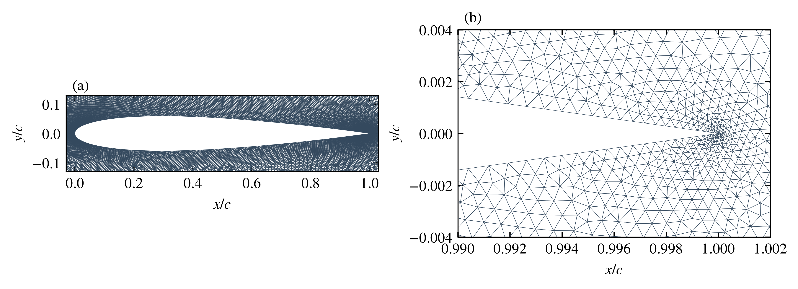
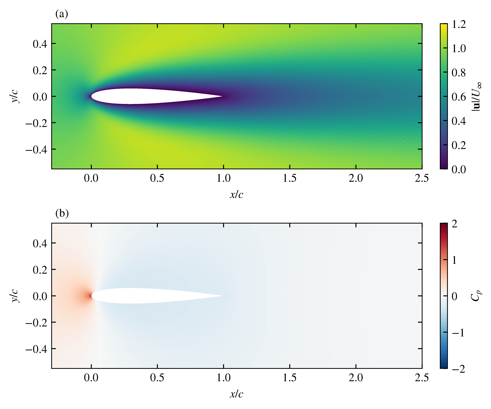

# Lesson 3: repair the mesh without changing the airfoil

Status: the first triangular candidate was rejected at minimum orthogonal
quality 0.0375223; no flow ran on that candidate. Local edge sizing repaired
the same boundary geometry. The 383,562-cell candidate reached quality 0.502614
and passed the zero-incidence Fluent numerical checks. Mesh sensitivity,
airfoil domain sensitivity and the matched OpenFOAM comparison remain open.

## Question and physics

Pressure and viscous wall stresses determine lift and drag. A sharply pointed
trailing edge makes a simple interpolated O-grid awkward: the old mesh has
minimum orthogonal quality 0.0658879 near that point. Residual convergence does
not demonstrate that this spatial approximation is accurate.

The first controlled change replaces the O-grid with an unstructured triangular
mesh while retaining all original wall and outer-boundary polygon vertices and
segments. No trailing-edge rounding or airfoil-shape substitution is introduced.
The source remains the [scaled closed NACA 0012 definition](https://tmbwg.github.io/turbmodels/naca0012_val.html),
represented by the existing 384-point polygon. The NASA resource describes a
different, turbulent Re=6 million validation case; its aerodynamic data are not
a matching benchmark for our Re=100 laminar case.

Gmsh's [documented Python API](https://gmsh.info/doc/texinfo/#Gmsh-API) generates
first-order triangles with distance-to-wall and wake size fields. It does not
compute the fluid solution. Fluent independently checks the exported mesh and
performs the flow calculation. A source mesh SHA-256 and boundary-preservation
check accompany each mesh.

## Conditions and checks declared before the new result

Begin at zero incidence, chord/span=1 m, rho=1 kg/m3, speed=1 m/s,
mu=0.01 Pa s, Re=100. Keep steady planar incompressible laminar flow, no-slip body,
the existing 20-chord-radius boundary polygon and upstream velocity-inlet / zero
gauge-pressure-outlet split. Use the same coupled second-order numerical methods
and unit coefficient references as before.

The candidate must reach minimum Fluent orthogonal quality >=0.2 before solving.
This is a declared learning gate, not a universal accuracy criterion. Then run
to 1e-8 residual targets (cap 600) and observe 100 further iterations. Inspect
final residuals <=1e-7, relative mass imbalance <=1e-6 and last-20 force stability.
The Cd range target is 0.01% of mean Cd, and the Cl range target is 1e-5 absolute.
At zero incidence, |Cl| <=1e-3 is a separate symmetry diagnostic; unstructured
mesh asymmetry can require refinement even when forces are iteration-stable.

After the first candidate, compare at least three size scales, preserving the
same boundary polygon and size-field definitions. A <0.5% Cd change between the
two finest tested levels is a proposed learning sensitivity target. It is not
a formal discretization-error bound. Check lift bias as well as drag.

The domain remains fixed for this mesh study. The cylinder lesson demonstrated
why that is not evidence of airfoil domain independence. Test the airfoil domain
separately before strong angle-comparison claims. Native field images use
automatic colour scales unless explicitly documented otherwise.

## Optional owner tasks

Predict whether improved cell quality alone guarantees a more accurate drag
coefficient. After the results, explain the difference between geometric
preservation, mesh quality and force sensitivity. Owner prediction/reflection
remain unanswered unless the owner supplies their own words. The owner has
authorized continuation without blocking at these prompts.

Codex prepares the mesh, code, execution and checks. Gmsh computes mesh nodes and
elements; ANSYS Fluent computes flow fields and native plots. No independent
owner implementation, aircraft validation or research novelty is claimed.

## Repaired candidate: first completed calculation

The rejected candidate disabled boundary-point size propagation. The repair
uses local sizes tied to adjacent original polygon edge lengths and enables
boundary size propagation. It changes the interior mesh, retaining the original
wall and outer-boundary polygon vertices/segments. The mesh has 383,562 triangles
and 192,550 nodes, compared with the original 61,440 quadrilaterals. Higher cost
and improved orthogonal quality do not by themselves establish lower force error.

| Check | Result |
|---|---:|
| Minimum Fluent orthogonal quality | 0.502614 |
| Final Cd | 0.41589053 |
| Final Cl | 9.1542336e-6 |
| Final solver iteration | 227 |
| Final scaled continuity residual | 1.2717e-10 |
| Relative mass imbalance | 3.8369e-14 |
| Last-20 Cd relative range | 0 at printed precision |
| Last-20 Cl absolute range | approximately 1.0e-13 |

The old zero-angle Cd was 0.41608387: the new value differs by about 0.0465%
using the new value as denominator. This is a comparison between different mesh
families, not a three-level refinement result or discretization-error estimate.
The small nonzero lift is recorded as a mesh/asymmetry diagnostic.

The intended quality-only launch omitted its optional flag, so the existing
runner proceeded to flow after its quality gate passed. The departure was
reported, all data were retained, and the wrapper was corrected for future
quality-only use. The residual checks were restored before saving the final
case/data. The Fluent session then exited; no second Fluent session was launched.

`scripts/analyse_airfoil.py` independently compares the complete sampled force
history with native force reports, checks final residuals, quality and mass
balance, and records the executed-source hash. Public records are in
`results/lesson03-alpha0-local-v002`. Native Fluent plots and saved case/data are
preserved externally. The academic field figure reconstructs triangles using
saved Fluent face-to-cell IDs and reads the corresponding saved cell values;
it does not assume Gmsh and Fluent share a cell ordering. Full method captions,
source hashes and PDF/SVG exports accompany the figures externally.

Next compare additional mesh sizes and run the matched OpenFOAM case with full
native mesh checks. This single accepted Fluent case establishes neither mesh
independence, domain independence nor physical validation. Owner reflection is
still blank; Codex prepared the workflow, Gmsh computed the mesh and Fluent
computed the solution.
