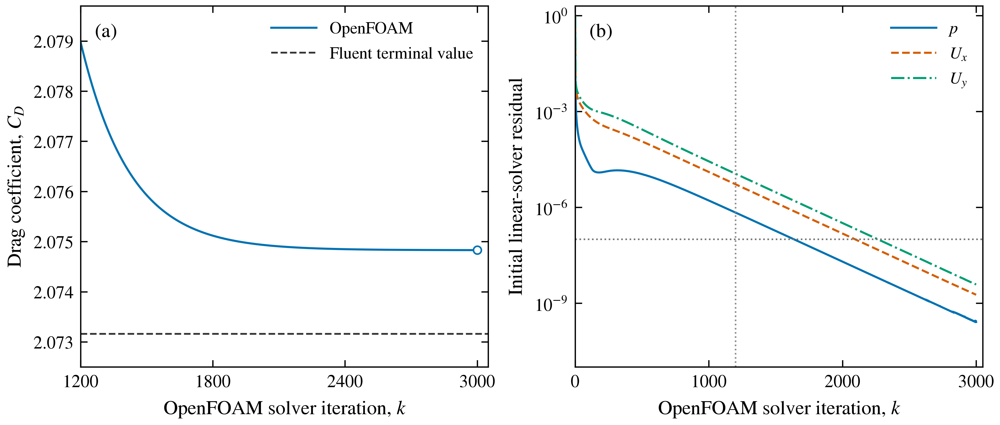

# Matched cylinder calculation: Fluent and OpenFOAM

Status: matched numerical calculation complete. Both solvers' declared checks
passed; their final Cd difference was 0.0806353%. This is not physical validation.

## Question and methods

Do two different finite-volume implementations produce consistent, numerically
settled forces for the same deliberately simple problem? This is a code-to-code
comparison, not experimental validation.

| Item | Matched specification |
|---|---|
| Geometry | Circular cylinder, D = 1 m, outer radius 20D |
| Model | Steady, incompressible, laminar, Re = 20 |
| Fluid | rho = 1 kg/m3; mu = 0.05 Pa s; nu = 0.05 m2/s |
| Inlet | Upstream semicircle, U = (1, 0, 0) m/s |
| Outlet | Downstream semicircle, zero gauge pressure |
| Cylinder | Stationary no-slip wall |
| Mesh | Same 98,304-cell fine Fluent O-grid |
| Span | Fluent unit span; OpenFOAM one-cell extrusion of thickness 1 m |
| 2D condition | Planar Fluent; OpenFOAM empty front/back patches |
| References | Uref = 1 m/s; rhoRef = 1 kg/m3; Aref = 1 m2; Lref = 1 m |
| Forces | Drag in +x, lift in +y |

The source mesh SHA-256 is recorded. OpenFOAM's converter retained the cell count
and named patches. Its mesh passed the unchanged
`checkMesh -allGeometry -allTopology` command, including geometry/topology,
determinant, concavity and interpolation-weight checks. Coordinate-preservation
verification accompanies the final record.

Fluent Student 2026 R1 uses the pressure-based coupled algorithm, least-squares
gradients, second-order pressure and second-order upwind momentum. OpenFOAM
Foundation 14 uses `incompressibleFluid`, steady SIMPLE with `consistent yes`,
least-squares gradients and bounded linear-upwind momentum, with corrected
diffusion. These are distinct algorithms/discretizations; nominal order does not
make their operators identical. OpenFOAM pressure is kinematic (m2/s2), whereas
Fluent reports pressure in Pa. Density is one here; general pressure comparisons
must account for that distinction.

## Checks declared before comparison

For Fluent, extend the saved solution by 100 iterations and retain the prior
force-stability, residual and mass-balance targets. For OpenFOAM, initially run
1,200 steady iterations; retain all data if the cap is insufficient, extend the
run without changing criteria, and document the reason. Inspect the final 100
force samples, initial p/U residuals <=1e-7, Cd relative range <=1e-4 and boundary
mass imbalance <=1e-6. Record lift separately. The proposed cross-code Cd
difference target is 0.5%, normalized by the Fluent Cd. It is a learning
comparison criterion, not an accuracy or uncertainty bound.

Residual definitions/scalings differ, so their absolute values are not plotted
as equivalent errors. Fluent starts from a saved converged field, while OpenFOAM
starts from uniform U and p. Iteration counts and run times therefore do not
constitute a fair performance comparison. The OpenFOAM printed time coordinate
is an iteration/pseudo-time index for this `steadyState` problem, not a resolved
physical time history.

One Fluent session and one OpenFOAM case may run concurrently, initially with two
solver processes each. Resource admission and monitoring take precedence; native
data remain on E:. Save results before closing. Initial overlap was observed,
with available host RAM about 2.3 GiB during the small-case overlap and recovering
after Fluent exited. This does not authorize concurrent large aircraft jobs.

## Reproduction and evidence

`scripts/prepare_openfoam_cylinder.py` writes the OpenFOAM dictionaries and copies
the existing mesh into a fresh external case. Convert with
`fluentMeshToFoam -2D 1 input-cylinder.msh`, verify all patch types and run the full
mesh check before solving. Decompose into two subdomains, run
`mpirun -np 2 foamRun -parallel`, then reconstruct saved fields. Preserve all
control-dictionary versions and solver logs when extending the calculation.

Primary method references: [OpenFOAM 14 mesh conversion](https://doc.cfd.direct/openfoam/user-guide-v14/mesh-conversion)
and [solution/algorithm control](https://doc.cfd.direct/openfoam/user-guide-v14/fvsolution).
The installed Foundation 14 tutorial dictionaries were also inspected.

Fluent and OpenFOAM
compute their respective numerical solutions.

## Results

| Quantity | Fluent | OpenFOAM |
|---|---:|---:|
| Final Cd | 2.0731581 | 2.074829796625 |
| Final Cl | 4.8295e-15 | -2.9844e-10 |
| Final iteration | 151 (100 after saved state) | 3,000 (uniform initial state) |
| Relative mass imbalance | 0 at printed precision | 1.3347e-11 from saved boundary flux |
| Cd range / window mean | 0 at printed precision, final 20 | 3.7262e-7, final 100 |

OpenFOAM's final initial linear-solver residuals were 1.8215e-9 (Ux),
3.8203e-9 (Uy) and 2.5538e-10 (p). Fluent's final scaled residuals were
1.5088e-13 (continuity), 2.9557e-17 (Ux) and 5.7020e-18 (Uy). These norms
remain distinct and their magnitudes should not be ranked as comparative accuracy.
The converted mesh had zero x/y coordinate difference at stored precision,
98,304 cells and unit span. The full native OpenFOAM mesh check passed.

The 1,200-iteration cap was insufficient (Uy initial residual about 1.12e-5 and
Cd still drifting). Its saved state and logs were preserved, then the same case
was continued to 3,000 without changing the declared criteria. Both cases were
saved and their solver sessions exited after completion.

### Interpretation

The final difference is 0.0806353%, normalized by Fluent Cd, below the declared
0.5% learning comparison criterion. Agreement is for the same finite domain.
Separately, moving Fluent's boundary from 20D to 320D changed Cd by about 3.59%
using the larger-domain result as reference. Close code agreement can therefore
coexist with a much larger shared boundary effect. Neither quantity is a formal
uncertainty estimate or experimental validation.

All numerical comparison data and full force/residual samples are in
`results/lesson04-cross-solver`. Recorded input dictionaries are in
`cases/openfoam-cylinder-re20-recorded`. The plotted data, captions and hashes
are preserved; vector PDF/SVG and high-resolution PNG exports are stored in
the versioned local exports directory. No owner-written prediction/reflection
was supplied. Each CFD code computed
its own solution.

## Analysis verification

The revised analysis independently checks every Fluent force sample against its
native report, the declared stability window and terminal summary. It verifies
source-mesh hashes, actual cell counts, geometry/span, recorded model/material/
reference settings and OpenFOAM boundary dictionaries before asserting matched
conditions. Deliberately altered read results (stale summary, changed viscosity
and slip cylinder) were rejected without modifying any native data. The audit
is in `results/lesson04-cross-solver/analysis-audit-v002.json`.
