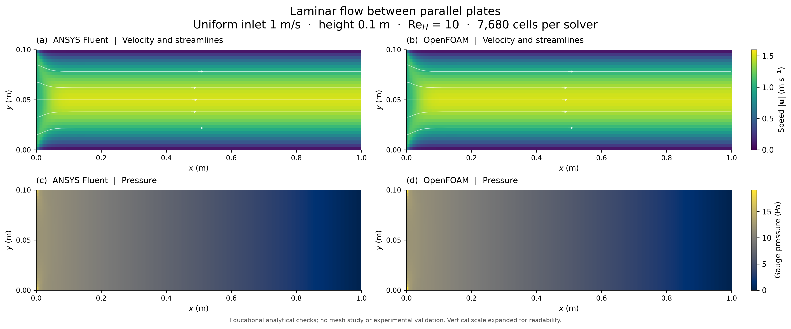
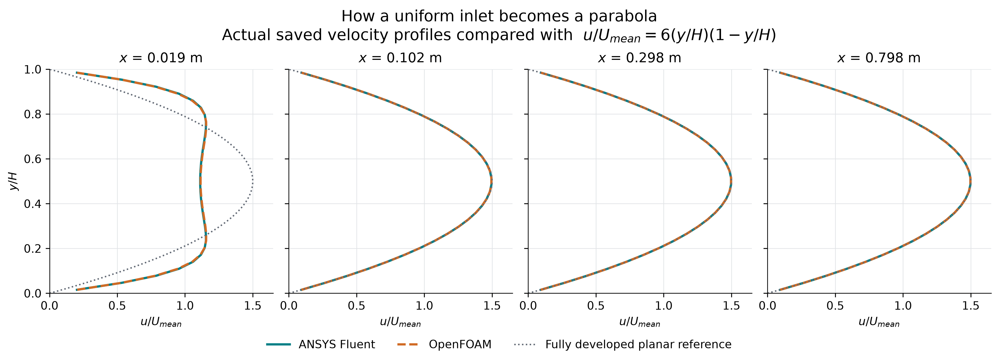

# Laminar channel flow: a visual starter model

Fluid enters uniformly, slows next to the stationary walls and speeds up in the centre. Downstream the velocity profile approaches a parabola while pressure falls along the channel.

## Case and observations

A 1m-long, 0.1m-high **2D planar channel between parallel plates**, with7,680 rectangular cells per solver. This is not an axisymmetric circular pipe. Uniform inlet1m/s; rho1kg/m3, mu0.01Pa.s; Re_H10, Re_Dh20; steady incompressible laminar flow; no-slip walls and zero-gauge-pressure outlet. One hidden Fluent Student2026R1 session used two processes; OpenFOAM Foundation14 also used two ranks, sequentially. Both imported the same emitted mesh. Native files and supported temporary files remain on E: outside Git.

| Downstream quantity | ANSYS Fluent | OpenFOAM | Planar analytical reference |
|---|---:|---:|---:|
| Centre velocity at x=0.797917m (m/s) |1.497075|1.497076|1.5|
| Profile RMS error / mean inlet speed (%) |0.09977|0.09973|0|
| Developed pressure-gradient magnitude (Pa/m) |11.97663|11.97661|12|

The reference is u/Umean=6(y/H)(1-y/H), used downstream; developing inlet profiles are not expected to match it. Actual cell values use common colour scales. Streamlines are plotting integrations through the saved vector fields. The vertical display scale is expanded; axes retain metres. Native Fluent screenshots are preserved separately in the image directory.

The two solvers' maximum cell pressure differs by1.1314Pa near the entrance wall corner (x0.0020833m,y0.0015625m). Nearly coincident downstream profiles do not establish agreement everywhere. There is no entrance mesh study, mesh independence result or experimental validation. See [field checks](../../results/channel-flow-v001/field-checks.json), [cross-code differences](../../results/channel-flow-v001/cross-solver-summary.json) and the separate Fluent/OpenFOAM numerical-check JSON files for actual residual, mass and saved-endpoint stability evidence.

## Methods and record

Fluent uses SIMPLE, least-squares cell gradients and second-order pressure/momentum. OpenFOAM uses steady SIMPLE consistent, least-squares gradients, bounded linear-upwind momentum and corrected diffusion. Each was capped at800 initial iterations; Fluent converged at222 and observed50 further iterations to272. OpenFOAM ran800, retaining750/800 fields. Stability compares saved endpoints50 iterations apart; it is not an every-iteration force or field test. All numerical targets were declared before solving.

The optional final Fluent XY residual export was empty. Its saved data contains the complete native residual history; the CSV is recovered from that HDF history without rerunning the solver. The original executed driver, export failure and native files are preserved. The reusable driver includes the recovery path. Exact source/input hashes accompany the result records.

Scripts: channel_mesh.py, channel_fluent.py, prepare_openfoam_channel.py, plot_channel_flow.py, analyse_channel_fluent.py, analyse_channel_openfoam.py in [scripts](../../scripts/). Recorded OpenFOAM dictionaries are in [cases](../../cases/openfoam-channel-recorded-v001/).

ANSYS and OpenFOAM computed the fields.

Teaching context: [Clarkson rectangular-channel Fluent tutorial](https://sites.clarkson.edu/gahmadi/wp-content/uploads/sites/28/2020/01/ME527-ANSYS-Fluent-Tutorial-Part-1.pdf) and the [official Foundation14 tutorial guide](https://doc.cfd.direct/openfoam/user-guide-v14/tutorials). These provide teaching context; they are not experimental validation of this run.
