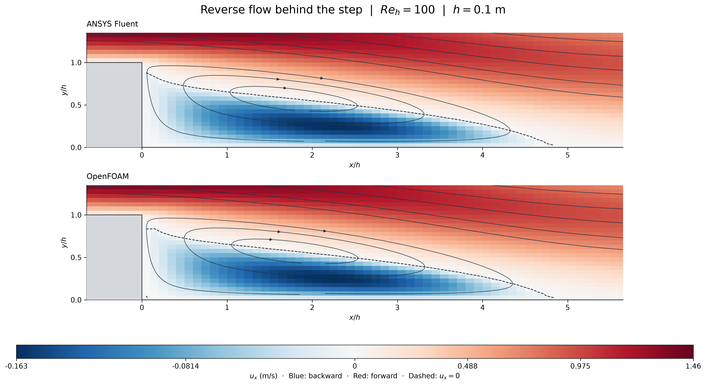
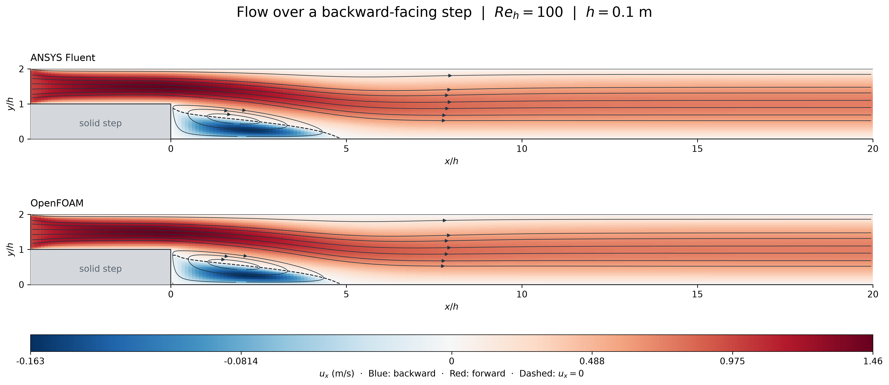

# Backward-facing step: separation and reverse flow

Actual ANSYS Fluent and OpenFOAM calculations, saved on 1 November 2026.
Both use 8,800 cells, keeping this a small introductory model.

The channel suddenly becomes deeper. The main stream passes over the step,
while a recirculating pocket forms beneath it. Blue means negative axial
velocity: fluid locally travels against the incoming stream. The dashed line
marks zero axial velocity. Streamline arrows follow the saved computed field.
Each half of the diverging colour scale is linear; saturated blue and red
represent different magnitudes. The images retain the visible cell resolution.

## Conditions and method

| Quantity | Recorded value |
|---|---|
| Geometry | Step height h=0.1 m; expansion ratio 2:1 |
| Upstream region | x=-0.4 to 0 m, y=0.1 to 0.2 m |
| Downstream region | x=0 to 2 m, y=0 to 0.2 m |
| Flow | Steady, planar, incompressible, laminar |
| Properties | Density 1 kg/m3; dynamic viscosity 0.001 Pa s |
| Inlet | Uniform axial velocity 1 m/s; transverse velocity zero |
| Outlet and walls | Zero gauge pressure; stationary no-slip walls |
| Reynolds number | Re_h=100; upstream hydraulic-diameter Re=200 |
| Mesh | 8,800 rectangular cells; dx=0.01 m, dy=0.005 m |
| Fluent | Student 2026 R1; double precision, two processes, SIMPLE, second-order pressure/momentum |
| OpenFOAM | Foundation 14 incompressibleFluid; two MPI ranks, consistent SIMPLE, bounded linearUpwind momentum |

The inlet develops over the short upstream section; it is not prescribed as a
fully developed profile. Both solvers ran sequentially in the background and
saved native states before closing. Fresh disk/RAM checks preceded launch;
Fluent successfully acquired a live two-process Student session. Project
files, Python environment and supported caches/temp remain on E:, with the
existing ANSYS installation on D:.

## What the calculations show

| Measurement | Fluent | OpenFOAM |
|---|---:|---:|
| Saved final iteration | 904 | 2,000 |
| Minimum axial velocity (m/s) | -0.162730 | -0.162763 |
| Relative boundary mass imbalance | 1.00e-9 | 6.93e-12 |
| Maximum velocity-component endpoint change / inlet speed | 5.42e-5 | 1.88e-11 |
| Downstream section-mean pressure drop (Pa) | 0.122369 | 0.122326 |

The stability comparisons use saved fields 100 iterations apart. They do not
measure the field at every intermediate iteration. The pressure sections are
at x=0.805 and 1.795 m. Minimum Fluent orthogonal quality is 1; OpenFOAM reports
zero nonorthogonality and a full Mesh OK check. All volumes are positive.

Final residuals, mass balance and the declared saved-endpoint stability limits
pass in both solvers. An additional Fluent last-100 history diagnostic fails:
the maximum continuity residual is 1.02929e-6 against 1e-6, at iteration 805;
iterations 805-807 are slightly above the threshold. The final continuity
residual is 2.66111e-7. The machine-readable aggregate remains **false** for
Fluent and **true** for OpenFOAM. Residual norms differ between solvers and are
not directly comparable. No extra continuation was added to erase this flag.

The near-bottom first-cell zero-velocity crossing is approximately x/h=4.838
in both codes. This is a grid-dependent proxy at y/h=0.025, not an exact wall
reattachment measurement. Agreement on this mesh does not establish mesh or
domain independence, experimental validation or aircraft performance.

Fluent's material viscosity and saved field are verified as 0.001 Pa s. Its
separate display/reference-viscosity setting retained the default; that setting
does not define the solved viscosity or the Reynolds number reported here.
The optional final Fluent residual XY export was empty. The complete 904-point
history was recovered from the saved HDF data and checked against the baseline
XY and native history CSV, without changing or rerunning the calculation.

## Files and reproduction

- [Checks, cell data and source archives](../../results/backward-step-v001/)
- [Figure captions and PNG/SVG exports](../../images/2026-11-01-backward-step-v001/)
- [Exact small OpenFOAM dictionaries](../../cases/openfoam-backward-step-recorded-v001/README.md)
- [Reproduction instructions](../../docs/REPRODUCING.md#small-backward-facing-step-model)
- [Original Fluent velocity-magnitude image](../../images/2026-11-01-backward-step-v001/fluent-native-velocity.png)

Native mesh/case/data/logs remain outside Git under
`E:/CFD-Learning-Lab/native/runs/2026-11-01-backward-step-v001`.
Original C: projects and earlier models are preserved. This record is prepared
locally; no GitHub publication or university submission occurred.

The step is a common teaching geometry, as illustrated by the official
[OpenFOAM tutorial](https://doc.cfd.direct/openfoam/user-guide-v12/backwardstep)
and [SU2 laminar-step tutorial](https://su2code.github.io/tutorials/Inc_Laminar_Step/).
Our conditions differ; these are context links, not matched benchmark results.

## Contributions and reflection

The owner requested more interesting small models, both solvers and clearer
images. Codex selected this setup, wrote the mesh/run/analysis scripts, operated
the solvers and prepared the figures and record. ANSYS Fluent and OpenFOAM
computed their respective numerical fields. Owner prediction/reflection remains
unprovided; no independent owner implementation or research novelty is claimed.
Optional observation: use the streamline arrows to explain why blue represents
reverse flow rather than merely slow forward flow.
