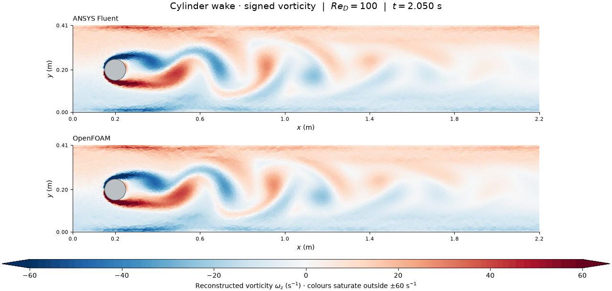
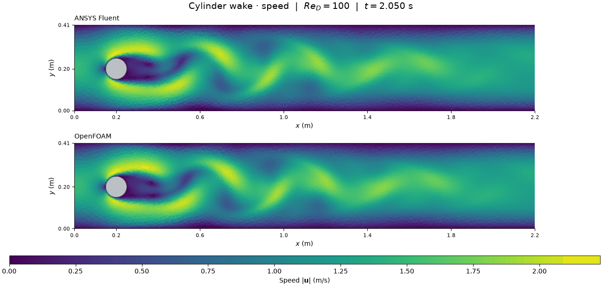
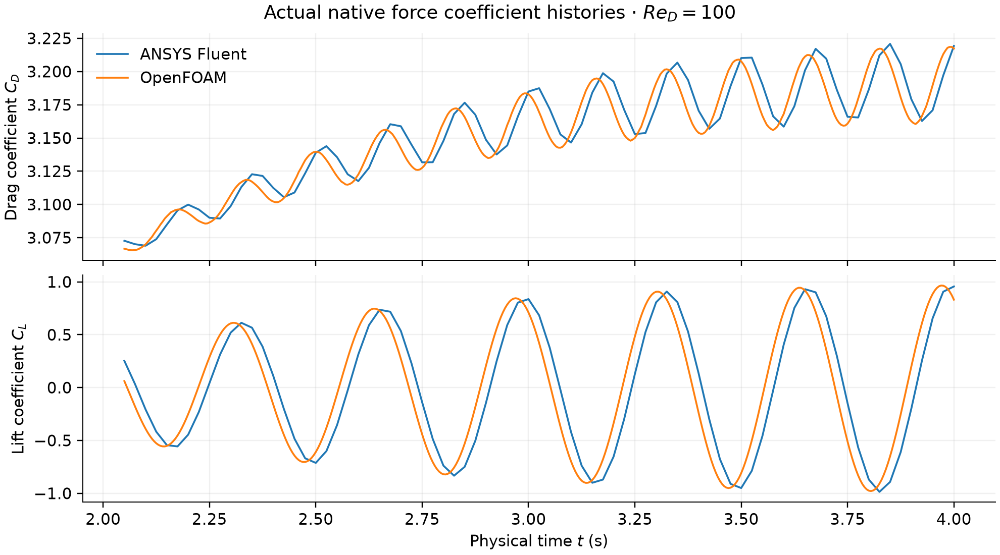

# Cylinder vortex shedding: an actual transient model

Saved Fluent and OpenFOAM calculations at nominal Re_D=100, on the same modest
21,598-cell mesh. The main figures use actual matching snapshots from the
stronger-iteration continuation, 2.05 to 4 s.

The wake alternates from one side of the cylinder to the other. Red and blue
show opposite signs of rotation; they do not mean forward and backward speed.
The changing wake produces an oscillating lift force, so a constant lift value
is not the convergence goal for this unsteady flow.

## Geometry and conditions

| Quantity | Recorded setup |
|---|---|
| Channel | 2.2 m long, 0.41 m high |
| Cylinder | Diameter 0.1 m, centre (0.2, 0.2) m; 128 linear wall segments |
| Model | 2D planar, transient, incompressible, laminar |
| Properties | Density 1 kg/m3; dynamic and kinematic viscosity numerically 0.001 in SI units |
| Inlet | ux=6*y*(0.41-y)/0.41^2 m/s; uy=0; analytic mean 1 m/s, maximum 1.5 m/s |
| Walls/outlet | Stationary no-slip walls and cylinder; zero pressure outlet |
| Initial state | Zero interior velocity and pressure, prescribed inlet applied immediately |
| Time step | Fixed 0.005 s; second-order time integration |
| Force references | Density 1, mean speed 1, diameter 0.1, reference area 0.1 m2, unit depth |
| Execution | One hidden solver at a time; two Fluent processes / two OpenFOAM MPI ranks |

The inlet has 41 faces. Its unscaled midpoint flux is 0.4101219512 m3/s,
0.02974% above the analytic integral 0.41 m3/s; both codes use the same sampled
parabola. The mesh has positive volumes, Fluent minimum orthogonal quality
0.333333 and OpenFOAM maximum nonorthogonality about 30 degrees. These are
mesh-quality checks, not mesh independence.

## What was checked and corrected

Both original 0-2 s pilots were saved. Their mass and finite-field checks pass,
but their declared final residual targets fail. The original fields and false
flags remain unchanged. Fluent used 20 inner iterations per step; OpenFOAM
used 3 PIMPLE outer corrections. Subsequent calculations continue those states;
they do not repair the original startup timeline.

The 2-4 s continuation raises Fluent's cap to 60 inner iterations and OpenFOAM
to 8 outer corrections with 2 pressure correctors. The residual target remains
1e-5 and the relative boundary mass-imbalance target remains 1e-4. Fluent saves
every 0.025 s; OpenFOAM saves every 0.05 s. The paired animation uses their
matching native times, without interpolated frames or phase shifting.

| Final saved-state check at 4 s | Outcome |
|---|---|
| Fluent aggregate numerical checks | Residual target not met (retained diagnostic) |
| Fluent scaled continuity residual | 1.2156089e-05 |
| Fluent relative boundary mass imbalance | 7.260855e-09 |
| OpenFOAM aggregate numerical checks | PASS |
| OpenFOAM relative boundary mass imbalance | 3.8253812e-11 |

Fluent scaled residuals and OpenFOAM terminal initial linear-system residuals
have different definitions. Their magnitudes are not an accuracy ranking.
The machine-readable reports retain every check and the earlier pilot misses.
The figures show numerical flow structures; a settled periodic cycle,
time-step/mesh independence and quantitative benchmark accuracy have not been
established.

## Figure methods and interpretation

Speed is the actual saved cell-centred vector magnitude. Signed vorticity is
reconstructed from the saved vector field on the actual fluid triangles using
area-weighted node reconstruction and piecewise linear derivatives. No
triangles bridge the solid cylinder, and no synthetic vortex is added.
Vorticity colours saturate outside +/-60 s^-1 to reveal the wake beneath strong
wall shear; extension arrows, full native extrema and saturated-cell fractions
are recorded. Raw numerical values are unchanged. Both codes share scales and
timestamps; the captions distinguish physical time from GIF playback time.

## Benchmark scope and limitations

Geometry, viscosity and analytic inlet follow the published
[DFG 2D-2 Re=100 case](https://wwwold.mathematik.tu-dortmund.de/~featflow/en/benchmarks/cfdbenchmarking/flow/dfg_benchmark2_re100.html).
Our practical pressure outlets are not asserted equivalent to its specified
do-nothing traction condition. Mesh, numerics and short startup duration differ.
This is a DFG-inspired teaching model, not a passed matched benchmark or
experimental validation. It does not validate the Concorde or ornithopter.

The optional native Fluent z-vorticity PNG was unsupported in the first pilot;
saved native fields, speed and pressure exports were unaffected. A versioned
driver uses the supported vorticity-magnitude field; the main signed figures
use the documented reconstruction. The v003 Fluent analyser distinguishes the
current top-level physical time from nested restart history; the v002 analyser
report is preserved as a diagnostic rather than changing any solver data.
OpenFOAM's original startup status briefly
showed a false error from inherited traps in environment setup; logs establish
that the pilot completed, and versioned wrappers correct the status reporting.

## Files and reproduction

- [Numerical reports and small data](../../results/vortex-shedding-v001/)
- [Images and full captions](../../images/2026-11-01-vortex-shedding-v001/)
- [Pilot OpenFOAM inputs](../../cases/openfoam-vortex-pilot-recorded-v001/README.md)
- [Continuation OpenFOAM inputs](../../cases/openfoam-vortex-corrected-recorded-v003/README.md)
- [Reproduction](../../docs/REPRODUCING.md#transient-cylinder-vortex-shedding)
- [Fluent numerical correction](../../docs/vortex-fluent-v002-numerical-correction.md)

Native mesh/cases/data/processor states/logs stay outside Git in
E:/CFD-Learning-Lab/native/runs/2026-11-01-vortex-shedding-v001.
The full per-frame numeric tables stay in the versioned E: exports folder;
small final tables accompany the repository. All copies preserve the original
projects. No commit, GitHub publication or university submission occurred.

## Contributions and reflection

The owner selected the next model and requested paired solvers and visual
results. Codex prepared geometry/scripts, operated the tools, inspected the
evidence and produced the record. Gmsh generated the mesh; Fluent and OpenFOAM
computed their respective numerical flow fields. Owner reflection remains
unprovided. No independent owner implementation or research novelty is claimed.
Optional observation: identify a red/blue vortex pair and describe how its
position changes between frames.
