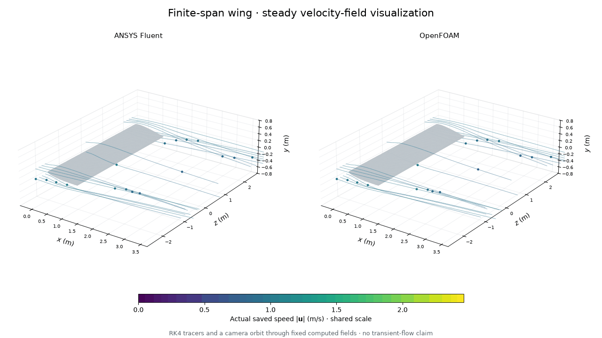
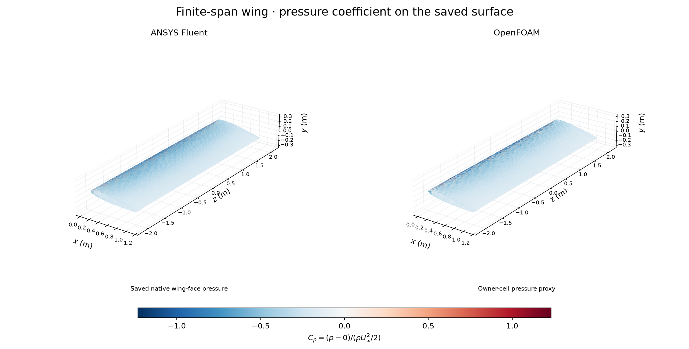
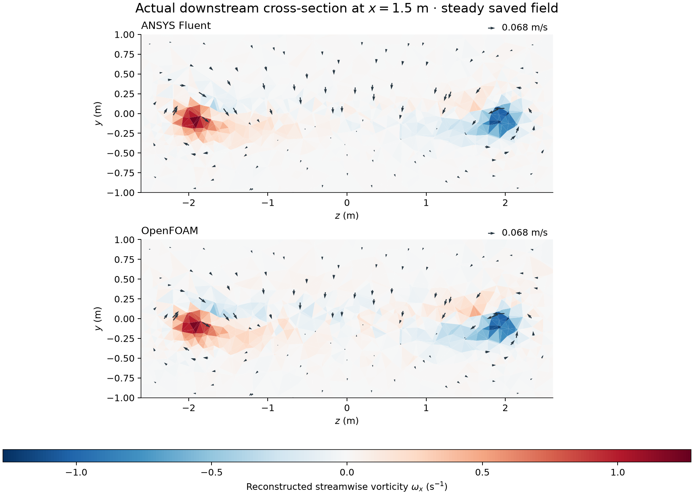

# A finite-span wing: actual 3D Fluent and OpenFOAM fields

A full-span rectangular wing brings tip flow and a three-dimensional wake into
this portfolio. These tracers integrate through actual saved **steady** velocity
fields; camera and tracer motion are visualization, not transient CFD evolution.
The paired calculations use 169,800 linear tetrahedra at nominal Re_c=400.
Declared numerical outcomes: Fluent **MISS (retained diagnostic)**; OpenFOAM **PASS**.

## Pressure and downstream crossflow

Cp is gauge pressure divided by 0.5*rho*U_inf^2. The surface-pressure sampling
method and shared scales are recorded in the captions. A finite span lets flow
turn near the tips; the downstream view shows the computed crossflow and
reconstructed rotation on the documented plane.

## Geometry and conditions

| Item | Recorded condition |
|---|---|
| Wing | Full chord 1 m, span 4 m, rectangular planform S=4 m², AR=4 |
| Profile | Symmetric NACA 0012-like profile with rounded trailing cap; exact coordinates exported; differs from exact NACA 0012 |
| Incidence | Clockwise 8 degrees about span axis z through (0.25,0,0) m |
| Domain/axes | x=-3..9 m, y=-4..4 m, z=-6..6 m; flow +x, vertical +y, span z |
| Properties | rho 1 kg/m³, mu 0.0025 Pa s, nu 0.0025 m²/s, U_inf 1 m/s; illustrative Re_c=400 |
| Boundaries | Stationary no-slip wing; upstream and four lateral planes fixed U=(1,0,0); outlet pressure 0 |
| Numerics | Steady incompressible laminar; SIMPLE; second-order momentum; actual per-code outlet/settings recorded in reports |
| References | rho 1, U 1, c 1, S 4; drag +x, lift +y; moment origin (0.25,0,0) |
| Execution | Sequential hidden solvers, two processes/ranks, initial cap 1200 iterations; 4 GiB available RAM/10 GiB free E: admission |

A steady iteration index is not physical time. No iteration-cap increase,
automatic sensitivity campaign or second flow case was added.

## Numerical evidence

| Saved-state quantity | Fluent | OpenFOAM |
|---|---:|---:|
| Aggregate declared checks | MISS (retained diagnostic) | PASS |
| Final continuity / pressure initial residual | 0.000157771996 | 1.02089546e-08 |
| Relative boundary mass imbalance | 2.91387625e-09 | 2.58403669e-11 |
| Cd | 0.233084566 | 0.216036576 |
| Cl | 0.306040799 | 0.27644356 |
| Final 100 Cd relative range | 6.02048964e-06 | 8.62539588e-09 |
| Final 100 Cl relative range | 1.03236971e-05 | 4.71327208e-08 |

Signed differences relative to OpenFOAM are +7.8913%
for Cd and +10.7064% for Cl, using
100*(Fluent-OpenFOAM)/abs(OpenFOAM). These differences remain unresolved;
no cause is attributed by assumption. Native Fluent force tables and their
pressure/viscous columns are retained with the numerical reports.

Targets remain residual 1e-5, relative mass 1e-4 and final 100 Cd/Cl relative
range 1e-3, with range=(max-min)/max(abs(mean),1e-3). Insufficient actual samples
cannot pass. All momentum components, force samples and named failed flags are
retained in the [Fluent report](../../results/finite-wing-v003/fluent/fluent-checks.json)
and [OpenFOAM report](../../results/finite-wing-v003/openfoam/checks.json).
The codes use different residual definitions; magnitudes are not an accuracy
ranking. A stable force history does not erase a missed residual criterion.

Fluent native minimum orthogonal quality is 0.106856.
OpenFOAM full checkMesh passes with positive volumes, maximum nonorthogonality
53.0159221 degrees and skewness 0.783515758.
The first mesh was rejected by Fluent at 0.0297565 before any flow iteration.
The cap-refined candidate retained two cells at 0.0838855364. The final repair
relocated only two interior nodes, preserving boundary/CAD/profile geometry;
its all-tet candidate minimum is 0.106856374. Earlier meshes
and rejected receipts remain preserved. Mesh quality is not mesh independence.

## Methods, limits and ownership

The figures use native saved fields and verified native-to-source tet mappings.
Traces, interpolation, pressure sampling, downstream reconstruction and display
limits are documented in the [captions](../../images/2026-11-01-finite-wing-v003/CAPTIONS.md)
and [figure checks](../../results/finite-wing-v003/visuals/checks.json).
[Actual wing pressure table](../../results/finite-wing-v003/actual-wing-pressure.csv). Large native files, NPZ arrays and full trace/per-frame exports
remain external on E:. [Reproduction](../../docs/REPRODUCING.md#finite-span-wing)
records actual scripts, dictionaries and source hashes.

This is one illustrative low-Re steady calculation. A settled physical wake,
unsteady stability, mesh/domain sensitivity, benchmark accuracy and experimental
validation have not been established. No induced-drag separation or induced-drag
value was computed. The figures do not validate Concorde or the ornithopter.

[NASA's downwash explanation](https://www1.grc.nasa.gov/beginners-guide-to-aeronautics/downwash-effects-on-lift/)
and [finite-wing induced-drag concept](https://www1.grc.nasa.gov/beginners-guide-to-aeronautics/induced-drag-coefficient/)
provide context, not matching validation data. The
[ANSYS quality definition](https://ansyshelp.ansys.com/public/Views/Secured/corp/v261/en/wb_msh/msh_orthogonal_quality.html)
explains why the tetrahedral native quality gate also depends on cell skewness.

The owner requested progression, paired solvers and visual results. Codex chose
and implemented the detailed model, operated the tools, inspected evidence and
prepared this record. Gmsh generated the mesh; Fluent and OpenFOAM computed
respective flow fields. Owner reflection is unprovided. No independent owner
implementation, research novelty, aircraft-performance or admissions claim is
made. No commit, push, university submission or external publication occurred.
