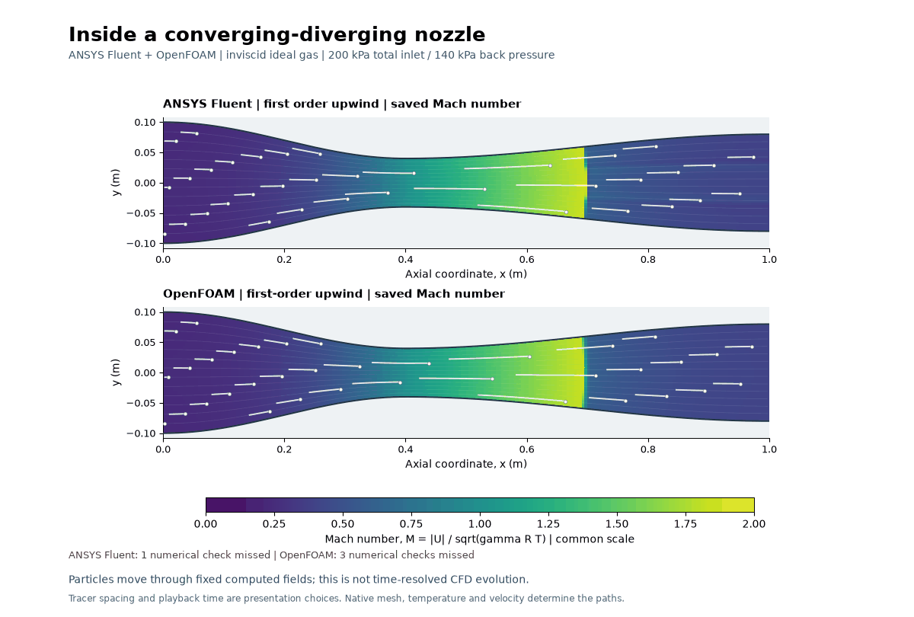
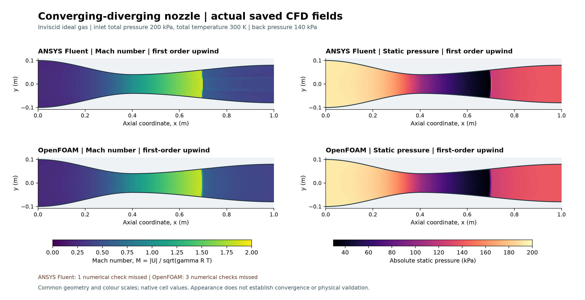
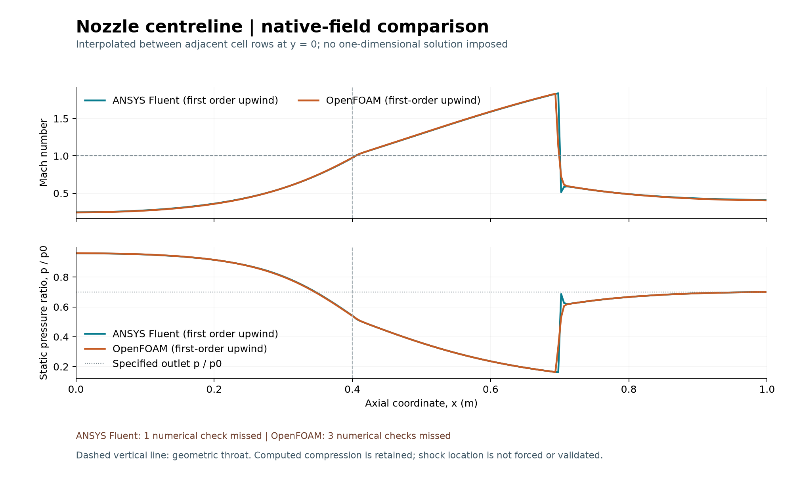

# Compressible flow through a nozzle

Both selected saved fields accelerate above Mach1 and show a compressive supersonic-to-subsonic transition near x0.70m. These are underconverged computational snapshots; shock position/jump and physical predictions are not validated.
Tracers follow the selected saved velocity snapshots. Their motion is a
visualization, not a computed physical time history or evidence of a settled flow.
Declared checks: Fluent **MISS (retained diagnostic)**; OpenFOAM **MISS (retained diagnostic)**.

The narrowing can accelerate compressible flow. Back pressure influences its
downstream compression. Any shock candidate here comes from actual saved Mach
and pressure changes; no shock position or analytical flow field was imposed.

| Condition | Value |
|---|---|
| Geometry | Planar length 1 m; full heights 0.20 m inlet, 0.08 m throat at x=0.4 m, 0.16 m exit |
| Mesh | Shared 240×40 quadrilaterals; 9,600 fluid cells |
| Gas/model | Inviscid, adiabatic, calorically perfect ideal-gas Euler; nominal γ=1.4, R=287.05 J/(kg K) |
| Inlet/outlet | Stagnation pressure 200 kPa and temperature 300 K; outlet absolute static pressure 140 kPa |
| Walls | Impermeable slip; no boundary-layer or turbulence model |
| Selected numerics | Fluent Roe-FDS, final first-order-upwind; OpenFOAM Kurganov, upwind reconstruction |
| Fixed budgets | Fluent 2,000 iterations; OpenFOAM 6,000 localEuler pseudo-iterations; two ranks/processes, sequential hidden runs |

| Recorded quantity | Fluent | OpenFOAM |
|---|---:|---:|
| Declared numerical outcome | MISS (retained diagnostic) | MISS (retained diagnostic) |
| Relative native mass imbalance | 8.9989095e-05 | 0.00021120491 |
| Inlet mass flow, kg/s per m depth | 37.076488 | 37.049748 |
| CFD compression candidate x, m | 0.6979192 | 0.69924125 |

All genuine missed criteria remain in the
[Fluent audit](../../results/nozzle-v001/selected-fluent/fluent-checks.json) and
[OpenFOAM audit](../../results/nozzle-v001/selected-openfoam/openfoam-checks.json).
The selected first-order treatment adds numerical diffusion and can broaden compression features. Residuals, mass history and saved-state changes are separate checks;
a visually clean contour or zero diagonal algebraic residual is not convergence.

[Full methods and preserved diagnostics](../../docs/NOZZLE_METHODS.md) record
actual schemes, gas rounding, depth normalization, numerical flags and sources.
[Per-cell data](../../results/nozzle-v001/actual-native-cell-fields.csv). Native solver files, NPZ arrays and full trace exports remain external.
These illustrative fields do not establish mesh/domain independence, shock
position accuracy, matched benchmark agreement or physical validation.

Fluent and OpenFOAM computed
their respective fields. Owner reflection remains unprovided; no independent
owner implementation, novelty, admissions or aircraft/engine validation is claimed. No Git commit, publication or university submission occurred.
