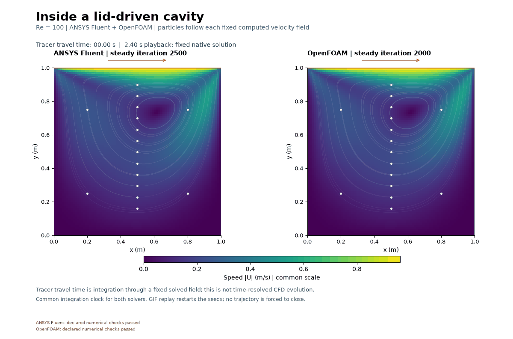
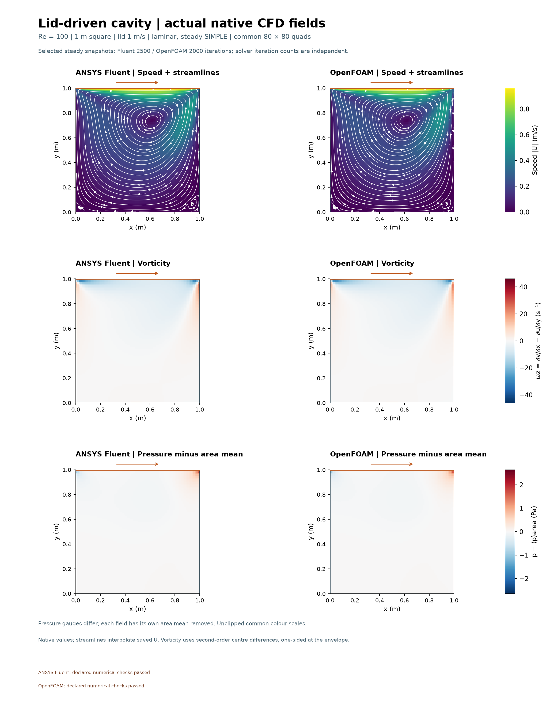
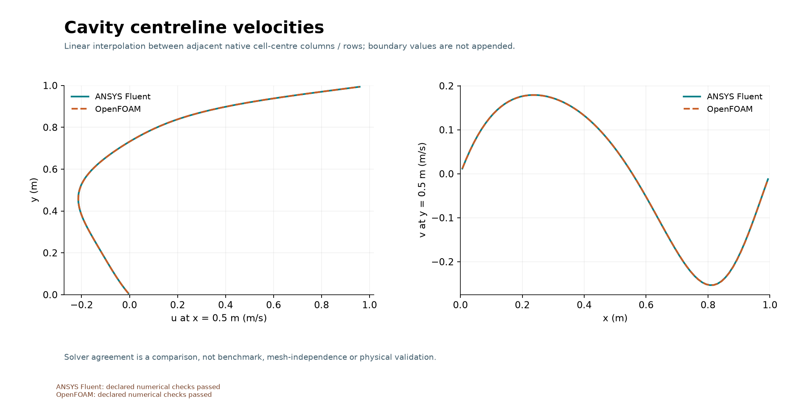

# Lid-driven cavity at Re = 100

Both solvers predict a dominant clockwise circulation beneath the moving lid, with small recirculating corner regions. Their centreline velocity curves nearly coincide on this mesh.
The moving lid transfers momentum into the enclosed viscous fluid.
Declared numerical checks: Fluent **PASS**; OpenFOAM **PASS**.

| Setup | Value |
|---|---|
| Geometry and mesh | 1 m square; common 80 × 80 quadrilaterals, 6,400 cells |
| Fluid | Density 1 kg/m³; dynamic viscosity 0.01 Pa s; Re = 100 |
| Walls | Lid (1,0) m/s; three stationary no-slip walls; all impermeable |
| Model | Steady incompressible laminar Navier–Stokes, SIMPLE; no energy equation |
| Iterations | Fluent 2,500; OpenFOAM 2,000; two processes/ranks, sequential |

Pressure has an arbitrary closed-domain gauge; each contour subtracts its own
area-weighted mean. Full native face-flux divergence checks every cell.
Closed-wall net zero alone does not prove local conservation. All missed targets
remain in the [Fluent audit](../../results/cavity-v001/fluent/fluent-checks.json)
and [OpenFOAM audit](../../results/cavity-v001/openfoam/checks.json).

The 48-frame GIF uses 50 ms delays. RK4 tracers move through each fixed saved
velocity field; their integration clock is not simulated transient evolution.
Fluent retains its original 2,000-iteration state and real continuity-residual miss. A separately authorized saved-state continuation adds exactly 500 iterations without reinitialization; final selection is at 2,500.
Vorticity is derived from native centre gradients. The lid-corner velocity jump,
one mesh and finite iteration budgets limit interpretation. Solver agreement
does not establish benchmark accuracy, mesh independence or physical validation.
See [methods and results](../../docs/CAVITY_METHODS.md) and
[figure captions](../../images/2026-11-01-cavity-v001/CAPTIONS.md).

The owner directed the model topic. Codex implemented and operated the workflow;
Fluent and OpenFOAM computed the fields. Owner reflection remains unprovided.
No independent owner implementation, novelty, publication or university submission is claimed.
