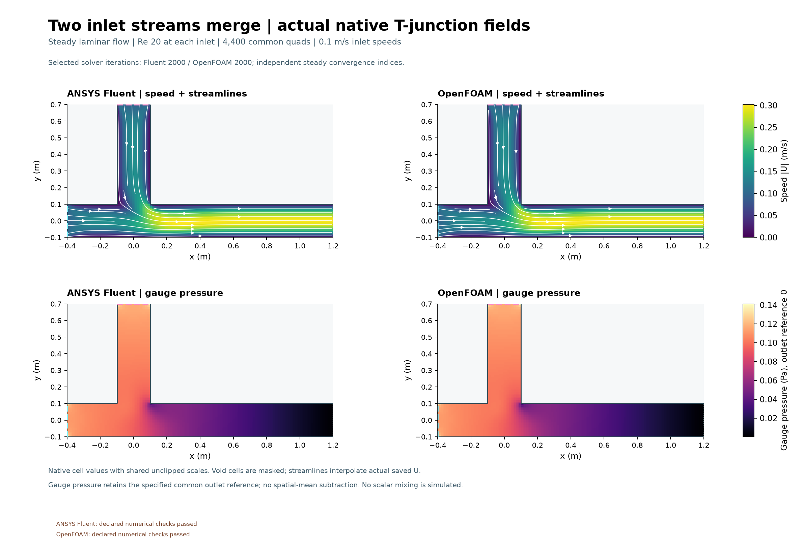
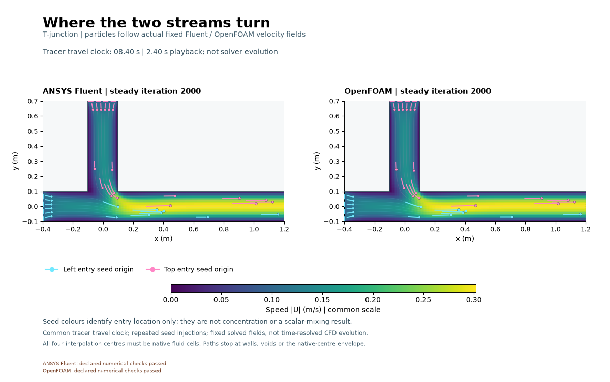

# Two streams through a T-junction

The upper stream turns into the horizontal channel, and both inlet streams feed a faster, developing outlet profile. The paired speed, pressure and tracer fields closely agree on this mesh.
Fluent declared checks: **PASS**; OpenFOAM: **PASS**.
Two uniform 0.1 m/s inlets of width 0.2 m merge into one outlet. Density 1 kg/m³,
viscosity 0.001 Pa s: each inlet Re20, expected outlet width-based Re40.
The shared mesh has 4,400 quads. Both steady laminar SIMPLE budgets are 2,000 iterations.
The outlet fixes gauge pressure zero; stationary walls are no-slip.

Tracers follow actual fixed saved velocity fields. Entry colours label seeds;
no concentration or scalar mixing is solved. The 48×50 ms GIF is visualization,
not transient CFD. Corners, uniform inlet-wall discontinuities, one mesh and
finite iterations limit interpretation. [Methods and actual metrics](../../docs/TJUNCTION_METHODS.md),
[numerical outcomes](../../results/tjunction-v001/selected-results.json) and
[captions](../../images/2026-11-01-tjunction-v001/CAPTIONS.md) preserve every miss. No benchmark, experimental validation or mesh independence is established. The solvers computed fields.
