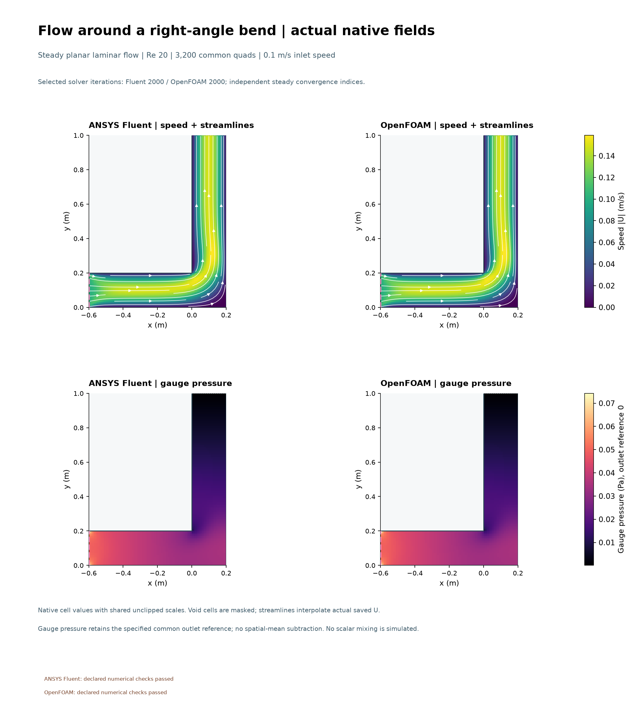
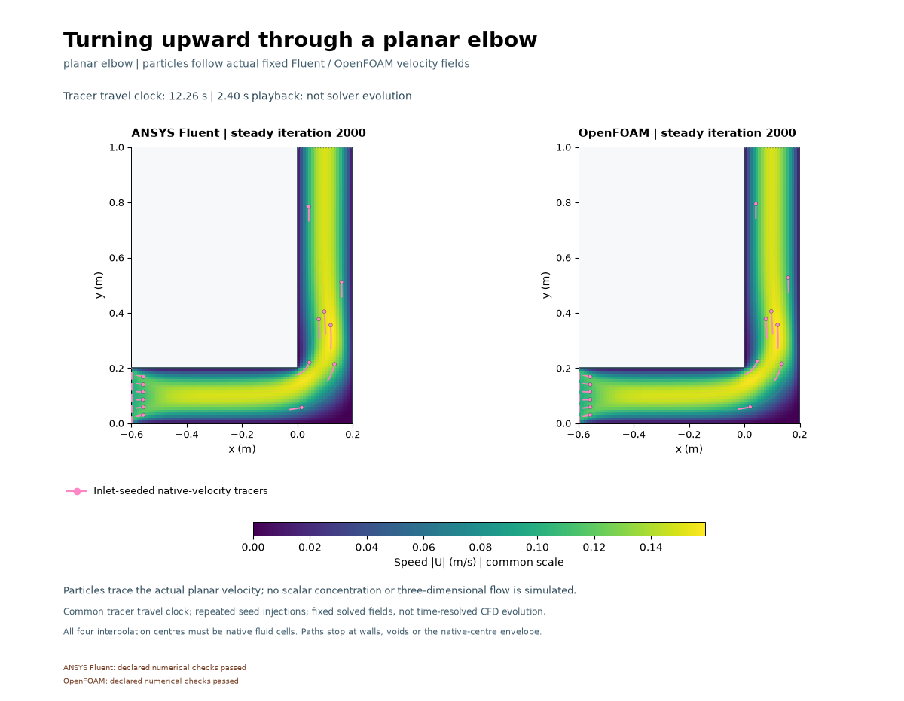

# Flow around a planar channel bend

Both solvers show the flow turning upward through the corner, with the speed profile shifting through the bend before developing along the vertical outlet channel. The paired speed and gauge-pressure fields closely agree on this mesh.
Fluent declared checks: **PASS**; OpenFOAM: **PASS**.
One uniform 0.1 m/s inlet of width 0.2 m turns upward through a sharp 90° bend.
Density 1 kg/m³ and viscosity 0.001 Pa s give width-based Re20.
The shared mesh has 3,200 quads. Both steady laminar SIMPLE budgets are 2,000 iterations.
The outlet fixes gauge pressure zero; stationary walls are no-slip.

Tracers follow actual fixed saved velocity fields. No scalar mixing is solved. The 48×50 ms GIF is visualization,
not transient CFD. Corners, uniform inlet-wall discontinuities, one mesh and
finite iterations limit interpretation. [Methods and actual metrics](../../docs/ELBOW_METHODS.md),
[numerical outcomes](../../results/elbow-v001/selected-results.json) and
[captions](../../images/2026-11-01-elbow-v001/CAPTIONS.md) preserve every miss. No benchmark, experimental validation or mesh independence is established. This planar model does not simulate 3D secondary flow or establish Dean vortices. The solvers computed fields.
