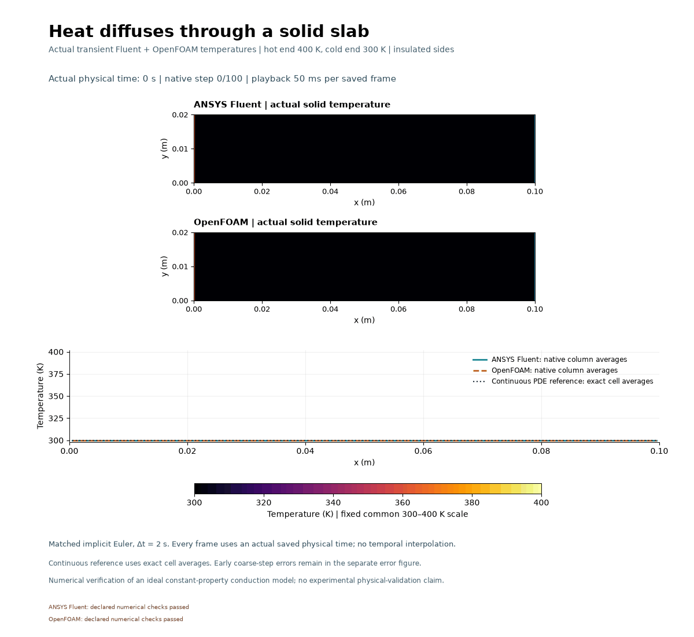
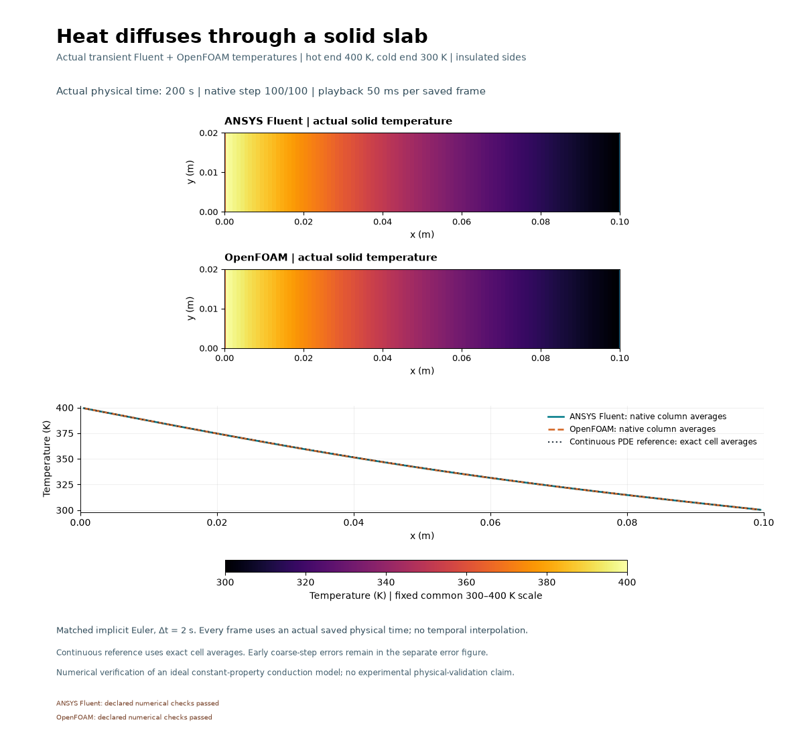
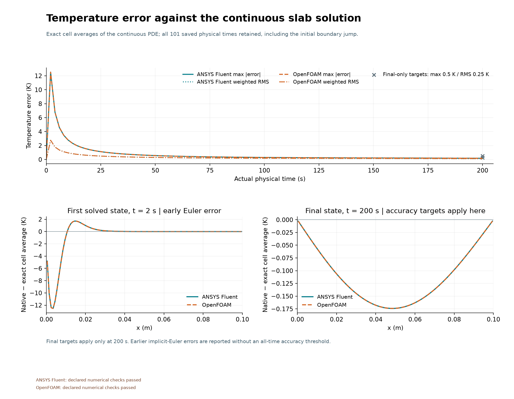
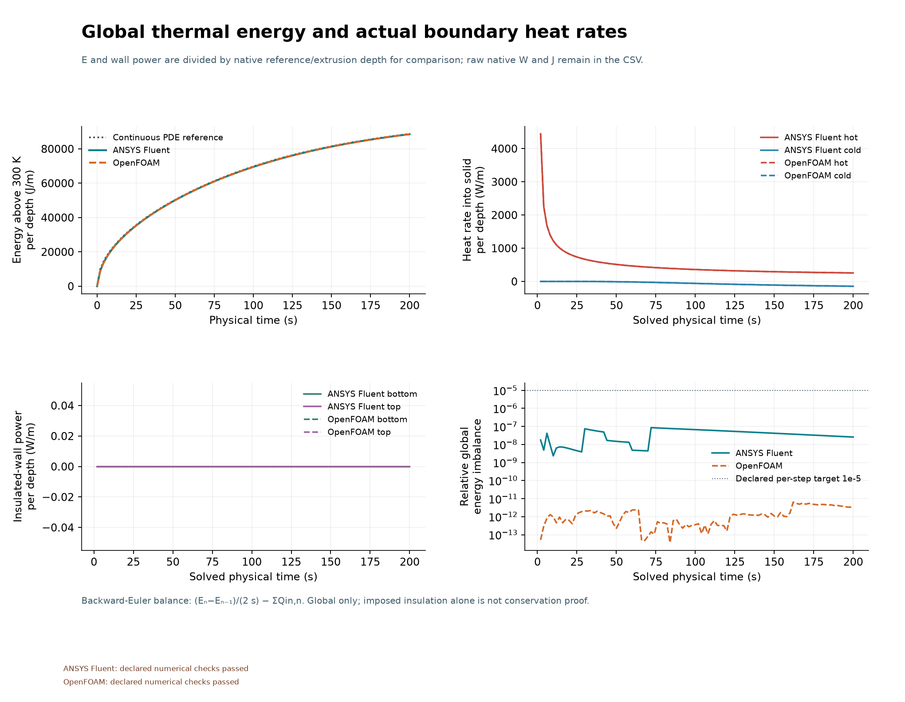

# Heat spreading through a solid slab

Heat spreads from the hot left edge while the right edge remains cold. The computed profiles from Fluent and OpenFOAM overlap at matching physical times. Each final maximum error against the analytical cell-average solution is about 0.174 K. The larger errors during the early heating transient remain visible in the diagnostic figure.
Fluent declared checks: **PASS**; OpenFOAM: **PASS**.
The GIF shows actual saved temperatures at 0,4,...,200 s. Its 2.55 s playback
compresses physical time. These are computed temperatures with no tracers.

A 0.1 m by 0.02 m generic solid initially at 300 K is heated at its left edge
(400 K), with the right edge held at 300 K and both long edges insulated.
The 2,000-cell mesh and implicit Euler step of 2 s are common to both codes.
Density is 1,000 kg/m³, heat capacity 1,000 J/(kg K), and conductivity 10 W/(m K).
Only solid energy is solved; no fluid motion is simulated.

[Methods and actual metrics](../../docs/THERMAL_SLAB_METHODS.md),
[numerical outcomes](../../results/thermal-slab-v001/selected-results.json) and
[captions](../../images/2026-11-01-thermal-slab-v001/CAPTIONS.md) preserve all misses.
The exact 1D PDE cell-average solution is an analytical reference. Accuracy
thresholds apply only at 200 s; early boundary-jump/coarse-Euler errors remain.
This is numerical verification of this ideal PDE, with no experimental physical
validation or mesh/time independence established. The owner directs the project;
Codex selected and operated the model; solvers computed the fields. Owner
reflection and independent owner execution are unprovided.
