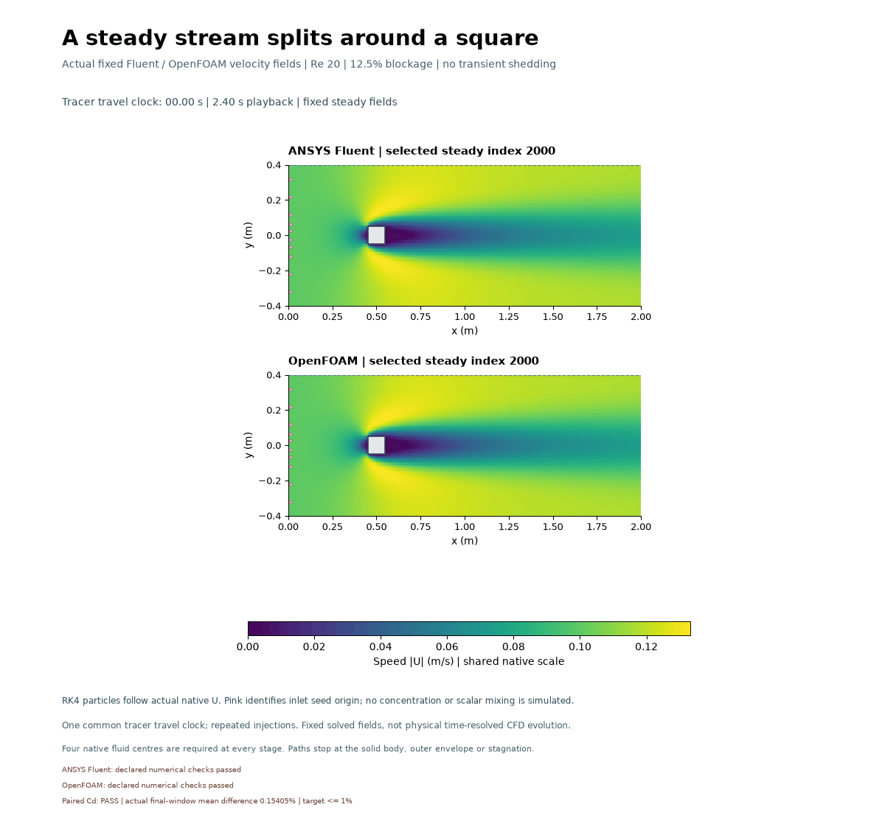
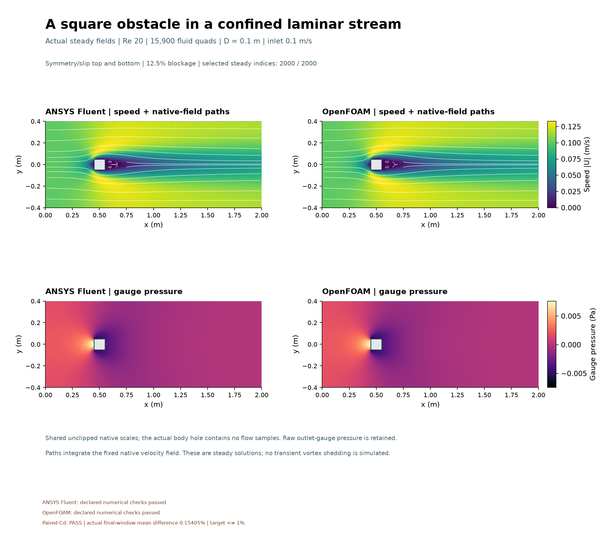
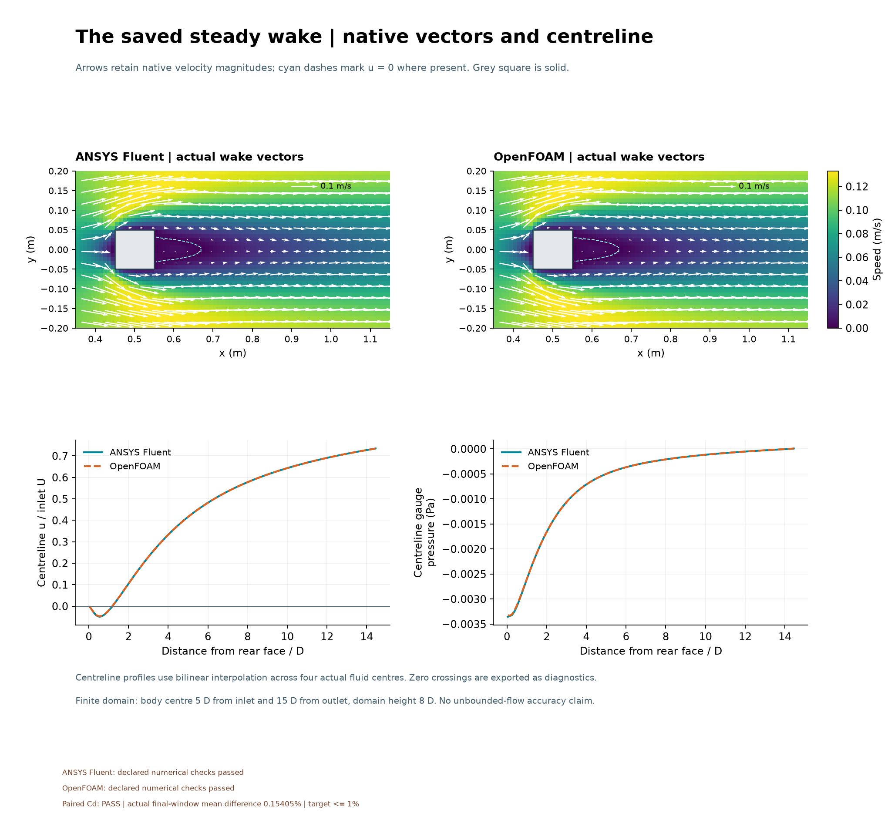
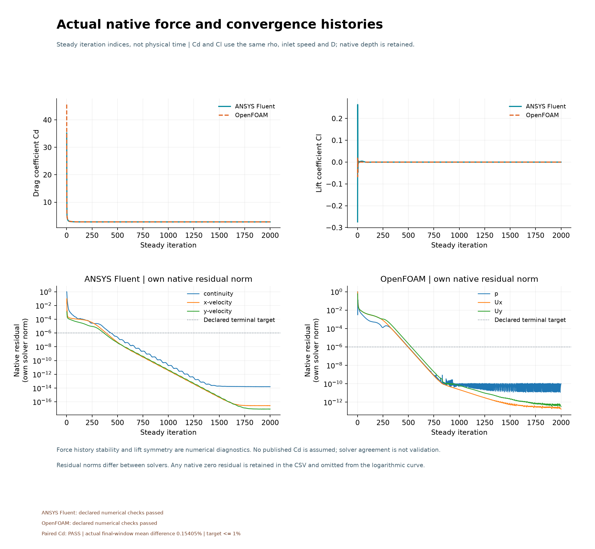

# A square obstacle and its steady wake

Completed 2 November 2026; stored under the preceding overnight batch namespace.

Both saved fields show slower flow behind the square. Fixed-field path probes show local differences in the wake despite close integrated drag.
Fluent's own declared checks: **PASS**; OpenFOAM's own checks:
**PASS**. Separate paired last-200 mean Cd target: **PASS**,
actual difference **0.154048%** against a 1% target. These outcomes stay separate.

A 0.1 m square sits in a 2 m by 0.8 m finite domain. Inlet speed is 0.1 m/s,
density 1 kg/m³ and viscosity 0.0005 Pa s, giving Re_D = 20. The stationary body
is no-slip; top and bottom are symmetry/slip. Height 8D means 12.5% blockage.
Both steady solvers start from rest and save exactly 2,000 iterations on 15,900
shared quads. The actual square hole contains no fluid values.

Particles follow fixed saved velocity fields. The 48 × 50 ms GIF is visualization,
not transient CFD or evidence of vortex shedding. Its travel clock is
40 s, with cohorts injected every 6 s,
selected from actual native-field timing.

[Methods and actual metrics](../../docs/SQUARE_WAKE_METHODS.md),
[numerical outcomes](../../results/square-wake-v001/selected-results.json) and
[captions](../../images/2026-11-01-square-wake-v001/CAPTIONS.md) preserve all misses.
One mesh, square corners, finite blockage and the fixed iteration cap limit
interpretation. No mesh/domain independence, unbounded-flow prediction or
benchmark/physical validation is established. The owner directs progression;
Codex selected, implemented and operated this setup; the solvers computed fields.
Owner reflection and independent owner implementation remain unprovided.
