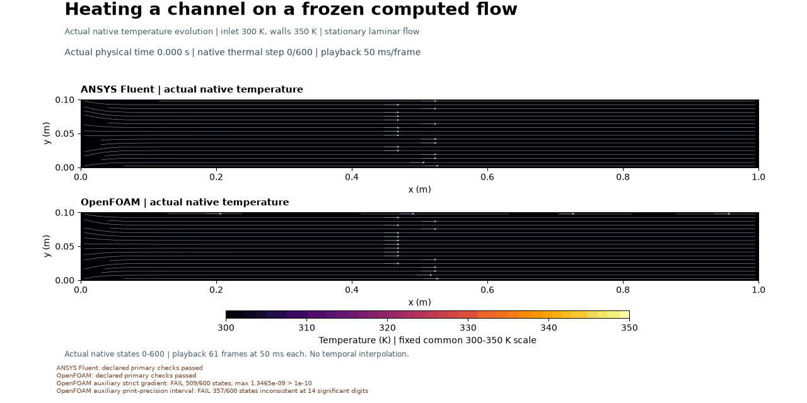
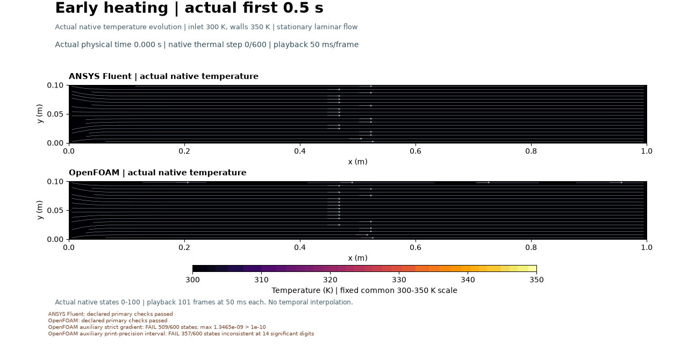

# Heating a channel with its computed flow held fixed

Cold fluid warms rapidly from the 350 K walls. Both solvers computed 600 thermal steps to 3 s on their separately frozen flow fields; both final outlet bulk temperatures are 349.9541 K. Their primary numerical checks pass. Auxiliary OpenFOAM gradient checks remain unresolved: the strict stencil comparison fails in 509 of 600 steps and the printed-precision interval check fails in 357 of 600. These diagnostics remain separate from the global energy checks; the production mismatch has not been explained by proven print-precision consistency.
Declared primary checks: Fluent **PASS**; OpenFOAM **PASS**. Auxiliary failures are listed above.
The main GIF uses 61 actual saved states over 0–3 s; the early GIF uses 101
states over 0–0.5 s. Playback is 50 ms per frame. Actual settled map repeats
are retained. Temperature evolves while each solver's own computed flow stays fixed.

The generic fluid enters at 300 K; stationary walls are held at 350 K.
[Methods, assumptions and numerical limits](../../docs/HEATED_CHANNEL_METHODS.md)
and [recorded outcomes](../../results/heated-channel-v001/selected-results.json)
retain all primary and auxiliary misses. The initial unsolved heat rate is
unavailable, not a valid zero. No physical validation or mesh/time independence
is established. The owner directs progression; Codex prepares and operates;
ANSYS and OpenFOAM compute the fields. Owner reflection is unprovided.
