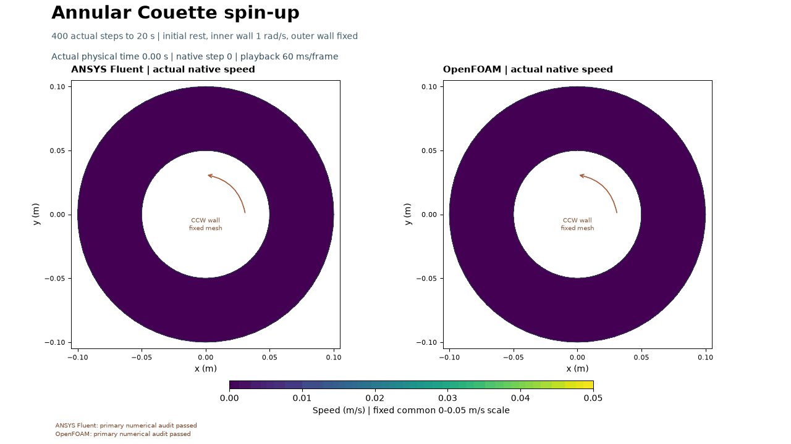

# Annular Couette spin-up

Motion spreads outward from the spinning inner wall; both solvers settle to very similar circular shear profiles.

The inner cylinder starts rotating and viscosity spreads its motion across the fluid gap. The outer wall stays fixed. Each code computed 400 actual steps to 20 s on 1,536 shared cells at Re = 20.

| Solver | Own primary checks | Max dimensionless divergence | Final Lz per depth (kg m/s) | Late-time assessment |
|---|---|---:|---:|---|
| fluent | PASS | 7.958e-10 | 2.83497e-05 | Numerically steady for this run |
| openfoam | PASS | 2.514e-10 | 2.83408e-05 | Numerically steady for this run |

OpenFOAM's CFD reached 20 s, while its separate wrapper copied-output preservation postcheck remains failed: two derived restart vorticity copies changed (245/247 unchanged). Both strict diagnostics remain false. The original 10-outer OpenFOAM pilot missed its pressure-coupling residual target (18/19 checks). The explicit 30-outer amendment changes only its iteration budget; thresholds are unchanged. See [methods](../../docs/ANNULAR_COUETTE_METHODS.md) and [compact numerical record](../../results/annular-couette-v001/summary.json) for all retained misses and source hashes.

Frames show actual native velocity states every 0.2 s on a fixed mesh, with a shared 0 to 0.05 m/s scale. The arrow annotates the moving wall. No particles or interpolated times are introduced. Genuine settled or quantized map repeats remain. The circular steady limit is descriptive; the calculation does not establish mesh/time independence, experimental validation or 3D Taylor vortices.

A small visual task: explain why fluid farther from the inner wall starts moving later, and why a fixed outer wall produces a velocity gradient. Owner reflection has not been provided.

The user directed progression and visual priorities. Codex prepared, operated and checked the calculations; Fluent and OpenFOAM computed their own native results. [Reproduction and selected dictionaries](../../cases/openfoam-annular-couette-selected-v001/README.md) explain what is public and what remains in the external native archive.
