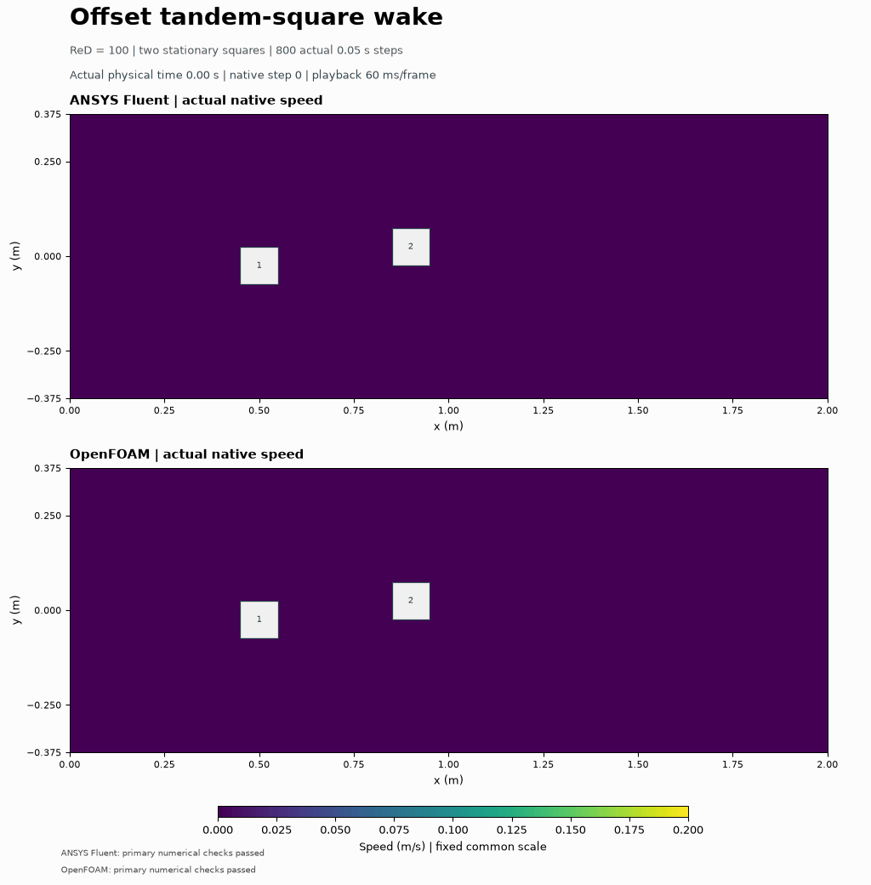

# Offset tandem-square wake

The first square produces a low-speed wake that reaches the offset second square; the final native maps and profiles show interacting downstream velocity deficits. Finite-time lift histories vary during the run; sustained periodicity is not established.

Two offset 0.1 m squares interact through their wakes at Re = 100. Both codes computed 800 actual steps to 40 s on 9,472 cells. Own primary checks: ANSYS Fluent PASS; OpenFOAM PASS. Each body has its own measured pressure, viscous and total force histories.

The frames use actual native velocities, two exact solid holes and a fixed 0 to 0.2 m/s scale; any saturation is labeled. No particles or interpolated times are added. Initialization is prescribed rest with an active inlet, not a solved conservative state. Force and residual histories start at step 1. Exact derived-copy diagnostics and raw wrapper outcomes remain separate from primary numerical checks; all false flags are retained.

See [methods](../../docs/TANDEM_OFFSET_WAKE_METHODS.md), [results](../../results/tandem-offset-wake-v001/summary.json) and [reproduction prerequisites](../../cases/openfoam-tandem-offset-wake-selected-v001/README.md). No periodicity, force plateau, zero mean lift, mesh/time independence or physical validation is claimed. Fluent and OpenFOAM computed their own fields.
