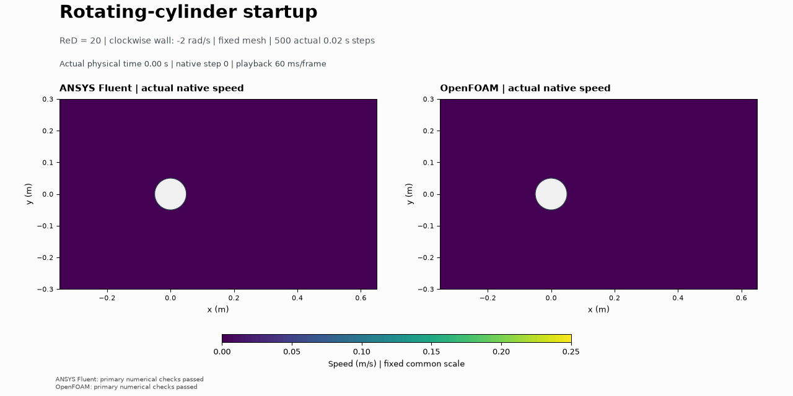

# Rotating-cylinder startup

Both codes show accelerated upper-side flow and a slower asymmetric lower wake at 10 s.

A clockwise rotating cylinder meets a 0.1 m/s inlet at Re = 20 and nominal spin ratio 1. Both codes computed 500 actual steps to 10 s on 8,192 shared cells. Own primary checks: ANSYS Fluent PASS; OpenFOAM PASS. Pressure, viscous and total force histories start at solved step 1; computed lift direction is an outcome.

The GIF uses 101 actual native states, a fixed 0 to 0.25 m/s scale and the exact 128-facet polygon hole. Saturation is labeled. No particles or interpolated times are added. The final pressure figure compares 128 actual surface facets per code. Initialization is prescribed rest with active boundary conditions, not solved conservation. Any false artifact-preservation diagnostic and raw wrapper status remain separate from primary numerical checks.

See [methods](../../docs/MAGNUS_CYLINDER_METHODS.md), [results](../../results/magnus-cylinder-v001/summary.json) and [prerequisites](../../cases/openfoam-magnus-cylinder-selected-v001/README.md). No ideal-flow accuracy, periodicity, force plateau, mesh/time independence or physical validation is claimed. The user directed progression; Codex operated and checked; Fluent and OpenFOAM computed their own fields. Owner reflection is unprovided.
