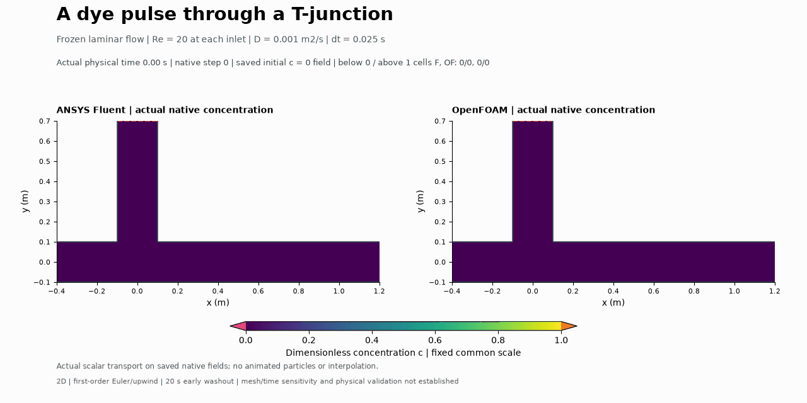

# A tracer pulse through a T-junction

Both solvers show a dye pulse travelling down the upper branch, turning into the outlet channel and fading as unmarked fluid replaces it.

A short dimensionless tracer pulse enters the upper branch while unmarked fluid enters from the left. Advection carries it through the junction and diffusion spreads its concentration. Each solver uses its own previously computed frozen Re 20 inlet flow. Both scalar calculations contain 800 actual steps to 20 s on 4,400 shared cells; own primary checks: ANSYS Fluent PASS; OpenFOAM PASS.

The GIF uses 101 actual native states at common times, fixed concentration limits 0–1 and the actual T-domain cells. These are transient scalar fields. Initial cells are prescribed c = 0; no initial solved residual or Euler budget is invented. The actual top-inlet samples are 1 at steps 1–80 and 0 from 81. The OpenFOAM off-grid table edge is 2.0125 s, rather than a claim of an exact 2 s continuous pulse.

**Optional visual exercise:** After the top inlet returns to c = 0, explain why tracer already inside the channel keeps moving. Refer to the velocity field and the tracer remaining in the domain. This exercise does not pause model work; owner reflection remains unprovided.

See [methods](../../docs/TRACER_TJUNCTION_METHODS.md), [results](../../results/tracer-tjunction-v001/summary.json), [captions](../../results/tracer-tjunction-v001/CAPTIONS.md) and [case prerequisites](../../cases/openfoam-tracer-tjunction-selected-v001/README.md). Reconstructed scalar conservation and distinct native residuals accompany the fields. Failed controls and raw pending flags remain separate from actual final acceptance. First-order smearing and the single mesh/time step limit accuracy; 20 s does not establish complete washout or physical validation. The user directed; Codex operated and checked; Fluent/OpenFOAM computed. Owner reflection and independent owner execution remain unprovided.
