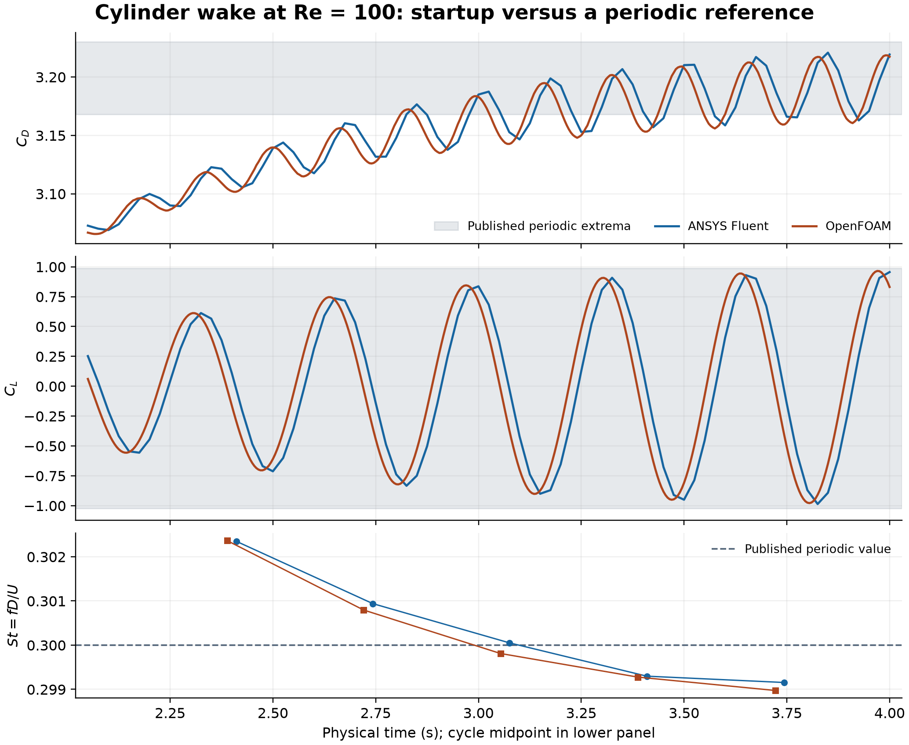

# Cylinder wake: convergence and developed-cycle evidence

**8November2026 update:** [A new versioned continuation record](convergence-v001/README.md) covers4–8s with800accepted new steps/801nativefields per code, actual paired media, cycle stability and wall-pressure estimates. The inherited startup and unmatched benchmark conditions remain explicit.

## Earlier startup record, retained

Both solvers shed vortices at nearly the published rate, while the lift amplitude is still growing. The figure compares native force samples over 2.05–4.00 s with periodic reference extrema. Shaded areas show the published extrema, with no acceptance threshold implied.



| Quantity | ANSYS Fluent | OpenFOAM | Published periodic reference |
|---|---:|---:|---:|
| Sampled drag range | 3.069–3.221 | 3.066–3.219 | 3.168–3.230 |
| Sampled lift range | −0.986–0.956 | −0.979–0.965 | −1.023–0.987 |
| Strouhal number from mean period | 0.30035 | 0.30024 | 0.300 |

The comparison uses the 21,598-cell confined cylinder from the [wake lesson](../07-vortex-shedding/README.md): diameter 0.1 m, channel 2.2 × 0.41 m, parabolic inlet with 1 m/s mean, no-slip walls, density 1 kg/m³, kinematic viscosity 0.001 m²/s and time step 0.005 s. The practical pressure outlets have not been shown equivalent to the traction formulation used by the modern Featflow reference.

Five periods per solver come from successive rising lift zero crossings, estimated linearly between the native force samples. The force spacing is 0.025 s in Fluent and 0.005 s in OpenFOAM. The histories are plotted at their own times with no phase shift. Extrema are sampled values, not fitted peaks.

The plotted Fluent series is the versioned 120-inner-iteration continuation from the saved 2 s checkpoint. It saved to 4 s and passed its mesh and mass balance checks; the final scaled continuity residual of 1.2153 × 10⁻⁵ missed the 10⁻⁵ target. The preserved [OpenFOAM continuation audit](../../results/vortex-shedding-v001/continuation-openfoam/checks.json) passed its declared checks. The earlier 60-iteration Fluent attempt remains in the original wake lesson. No new CFD solve was used for this comparison.

The [original Schäfer–Turek specification](https://www.mathematik.tu-dortmund.de/lsiii/cms/papers/SchaeferTurek1996.pdf), section 2.2, defines a developed cycle starting at peak lift and also asks for a pressure difference. This analysis uses a startup window and does not evaluate that pressure metric. Reference values are from [Hübner, Mahmood and Turek, Table 8](https://riemann.mathematik.uni-dortmund.de/papers/HuebnerMahmoodTurek2012.pdf). The near match in frequency does not establish a matched benchmark pass, mesh or time step independence, or physical validation.

Reproduce the chart with Python, NumPy and Matplotlib:
```sh
python compare_cylinder_benchmark_v003.py --out fresh-figure-directory
```
[Native Fluent force CSV](fluent-force-history.csv) · [Native OpenFOAM force CSV](openfoam-force-history.csv) · [Numbers and source hashes](summary.json) · [Vector figure](benchmark-force-comparison.svg)

The user directed the model progression. Codex ran and analyzed the continuation and prepared the comparison; Fluent and OpenFOAM computed their own fields. User reflection remains unprovided. Large native cases are archived separately.
