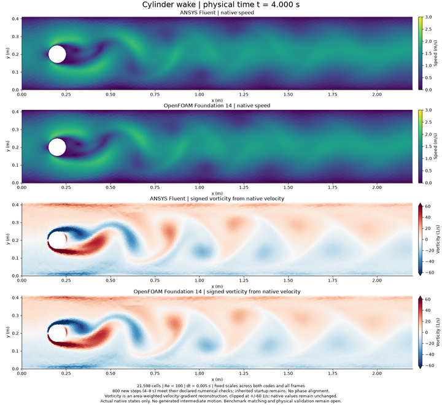
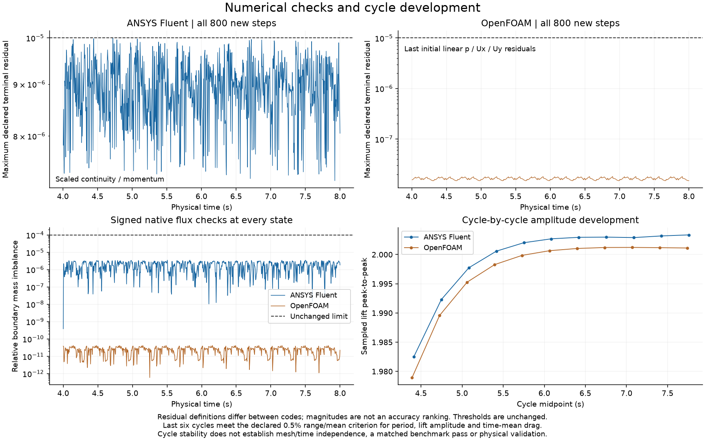

# Cylinder wake: convergence and developed-cycle evidence

[Full-size paired MP4](cylinder-developed.mp4) · [Numerical checks](numerical-checks.png) · [Forces and pressure](forces-and-pressure.png) · [Methods](METHODS.md) · [Data](data/)

Both selected continuations cover **4–8 s, 800 new steps and 801 native states per solver**. Every new step meets the unchanged declared residual and boundary-mass limits. The last six complete force cycles satisfy the predeclared 0.5% range/mean stability criterion for period, sampled lift peak-to-peak and time-mean drag. This improves the numerical evidence in the existing cylinder showcase; it does not add a new numbered model.

Alternating vortices produce oscillating lift and a drag signal at roughly twice the lift frequency. Earlier pictures looked periodic while the lift amplitude was still growing. This update checks the iteration convergence and then measures how successive cycles change.

| Last-six-cycle quantity | ANSYS Fluent | OpenFOAM |
| --- | ---: | ---: |
| Mean period (s) | 0.334669 | 0.334877 |
| Strouhal number | 0.298803 | 0.298617 |
| Time-mean drag coefficient | 3.199420 | 3.196474 |
| Mean sampled lift peak-to-peak | 2.003008 | 2.001066 |
| Mean estimated front–rear wall pressure (Pa) | 2.414885 | 2.420590 |
| Maximum relative boundary mass imbalance over 4–8 s | 3.512e-06 | 4.203e-11 |

The lift-amplitude relative ranges over the last six cycles are **0.0336% in Fluent and 0.0279% in OpenFOAM**, below the declared 0.5% diagnostic criterion. This is observed window stability, not a proof of exact periodicity, discretization independence or physical accuracy. Native forces are plotted at their own times without phase alignment or fitted extrema.

## What changed

The original PISO Fluent calculation and both new pressure-tolerance-only diagnostics retain their numerical misses. Tightening pressure AMG termination alone did not remove the continuity plateau. A same-checkpoint Coupled algorithm bundle (flow Courant20, explicit pressure/momentum relaxation0.5) passes ten new steps; a guarded half-second window passes, followed by the finite continuation to8s. Physics, mesh, dt, spatial/time schemes and residual definitions remain fixed. This bundle does not uniquely isolate one cause.

OpenFOAM retains its eight PIMPLE outer corrections, two pressure corrections and original physical/numerical settings. A100-step qualification passes before its exact4.5s partitioned checkpoint is copied for the remaining700steps. All restart interfaces and duplicate states/force samples are checked. These are saved-state continuations, not fresh independent calculations from zero.

## Interpretation and limits

The inherited0–4s startup contains retained numerical misses. The4s initial fields are finite and checked, but their earlier residual failure is not retroactively repaired. Mesh and time-step independence are open. The128-segment cylinder and practical pressure outlets are not asserted equivalent to the published benchmark's exact geometry and traction condition; the modern reference also describes a longer development procedure. **No matched benchmark pass or experimental validation is claimed.**

Pressure differences are documented wall-vertex estimates at(0.15,0.2) and(0.25,0.2)m. They use adjacent native wall-face pressures interpolated in polar angle, with matching stencils and weights recorded. Fluent uses native face SV_P; OpenFOAM's zeroGradient evaluated face value equals its owner-cell pressure. Density1 converts its kinematic pressure numerically toPa. These are discretized estimates, not exact continuum point measurements.

The MP4 contains161actual saved states0.025s apart at20fps (8.05s playback). The compactGIF selects every second native frame:81states0.05s apart at20fps (4.05s playback). Every encoded frame was decoded and compared with its source. There is no generated intermediate motion or phase shift. The GIF reset is not simulated flow. Full161frameGIF remains external because of its41.3MB size; full-size PNG/PDF and the4.03MB MP4 remain available here.

Speed scales are fixed0–3m/s. Signed vorticity is an area-weighted reconstruction from native velocity, not a solver-exported exact wall derivative. Its colors clip at±60/s with extension markers; raw extrema and saturated fractions are retained. Red/blue show rotation sign, not flow direction. The force/pressure phase differences are retained and do not rank the solvers' accuracy.

[Reproduction and storage](REPRODUCING.md) · [Methods and primary sources](METHODS.md) · [Preserved history](history/) · [Source provenance](provenance/)

Fluent and OpenFOAM computed their respective fields. This is a local GitHub-ready record; no new upload is claimed. [Fresh technical review](data/technical-review.json) passed with no Critical or Important findings. A minor text-spacing issue is recorded as deferred polish.
