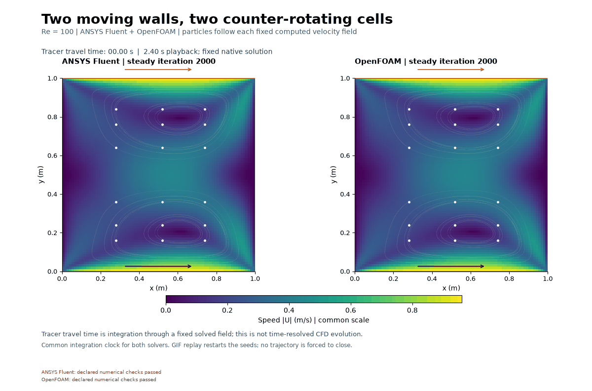
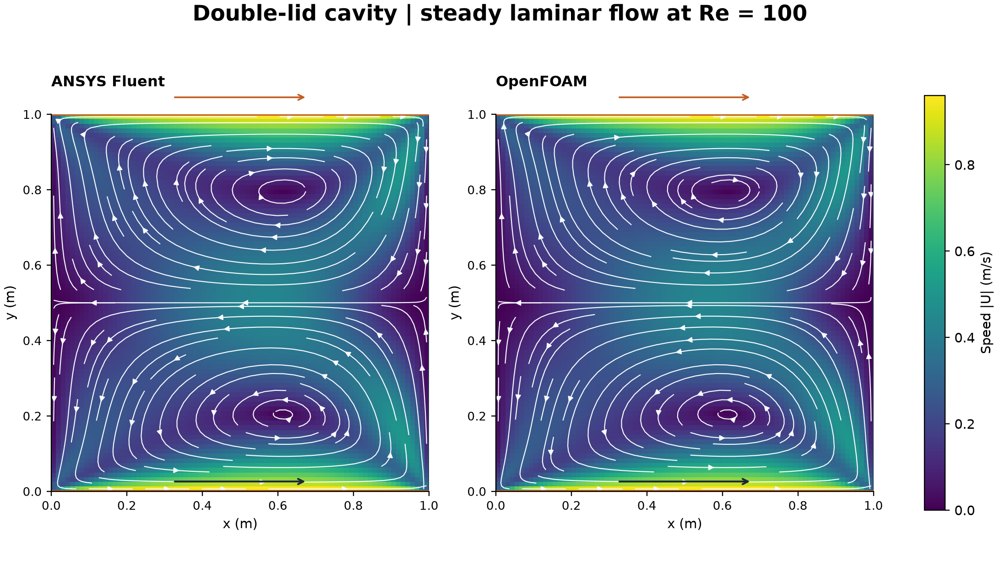

# Two moving walls, two counter-rotating cells

The upper cell rotates clockwise, the lower cell counterclockwise. Both walls move right; fluid returns left through the middle at about 0.426 m/s at the centre in both solvers.

The tracers move through each **steady** saved field using fourth-order Runge–Kutta integration of the interpolated cell-centre velocity. The 48 frames show tracer motion, with an 8 s integration window and 2.4 s playback. They do not represent a transient solve.

## Setup and checks

The model reuses the 1 m square and 80 × 80 quadrilaterals from the [single-lid cavity](../10-lid-driven-cavity/README.md). Both horizontal walls are no-slip and move at (1,0) m/s. The two side walls are stationary and impermeable. Density 1 kg/m³ and dynamic viscosity 0.01 Pa s give Re = 100. The laminar, incompressible steady solvers start from rest and use SIMPLE with second-order momentum advection (Fluent second-order upwind; OpenFOAM bounded linear upwind). The two-process Fluent and two-rank OpenFOAM runs were sequential. OpenFOAM uses a 0.01 m extrusion with empty planes. The closed cavity pressure has an arbitrary additive gauge.

| Saved result | ANSYS Fluent | OpenFOAM |
|---|---:|---:|
| Steady iterations | 2,000 | 2,000 |
| Largest terminal residual in its own norm | 1.45 × 10⁻⁸ | 8.52 × 10⁻¹⁰ |
| Max cell divergence scaled by L/U | 2.09 × 10⁻¹⁰ | 9.09 × 10⁻¹¹ |
| Relative velocity change, iterations 1,800–2,000 | 2.05 × 10⁻⁶ | 7.02 × 10⁻⁷ |
| Interpolated centre horizontal velocity (m/s) | −0.42652 | −0.42616 |

Both passed the native mesh checks and the five numerical checks in [summary.json](summary.json). Continuity uses the actual saved face fluxes on every cell. Zero flow through impermeable walls is expected and cannot by itself establish interior mass balance. Force stability is not a target for this closed cavity; the check uses the change in the velocity field. Fluent scaled residuals and OpenFOAM initial linear-system residuals use different norms.

The velocity fields differ by 0.63% in relative L2 using OpenFOAM as denominator on the matched uniform grid. The [centreline plot](cavity-centreline-velocities.png) resolves vertical velocity along the reflection plane on a scale of 10⁻⁹ m/s; that panel is a symmetry diagnostic. The sampled [centreline CSV](centreline-velocities.csv) contains interpolated interior values only. One mesh, a prescribed corner velocity jump and steady numerics limit interpretation. Agreement does not establish mesh independence or physical validation.

## Reproduce the model

[Fluent driver](double_lid_fluent_v001.py) uses the shared mesh from lesson 10. [OpenFOAM preparation](prepare_double_lid_openfoam_v001.py) checks and copies its native mesh, changes the bottom boundary to a fixed velocity and sets the write interval. The [two-rank runner](run-double-lid-openfoam-v001.sh) checks mesh quality and reconstructs iterations 1,800 and 2,000. Both runs save before closure. [Audit and plotting code](audit_plot_double_lid_v002.py) reads those native archives and the shared geometry NPZ, using the existing [analysis helpers](../../scripts/). The native cases and full logs are kept separately on E:.

Fluent and OpenFOAM computed the fields.
