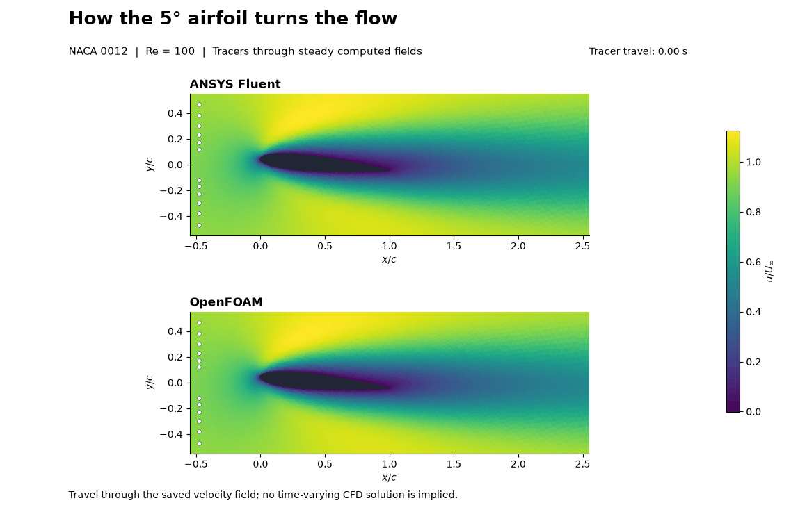
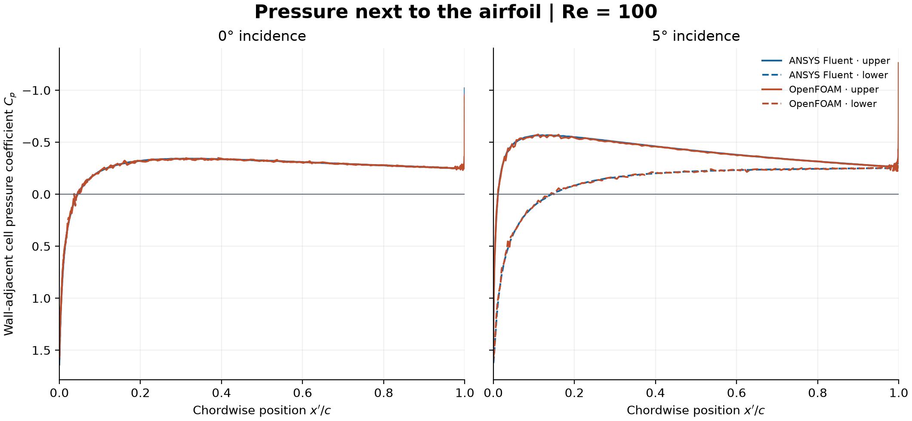

# What five degrees changes: NACA 0012 in Fluent and OpenFOAM

At 0°, the upper and lower pressure curves nearly overlap. At 5°, pressure is lower over most of the upper side than at the corresponding location on the lower side, the wake tilts downward, and both solvers compute positive lift.

The animation follows particles integrated through the saved **steady** velocities. It uses 56 frames, a 4 s tracer travel window, and 60 ms per displayed frame. Each field uses the same axes and streamwise velocity scale.

| Solver | Incidence | Drag coefficient | Lift coefficient |
|---|---:|---:|---:|
| ANSYS Fluent | 0° | 0.41584 | −0.00003 |
| ANSYS Fluent | 5° | 0.42566 | 0.26802 |
| OpenFOAM | 0° | 0.40647 | −0.00076 |
| OpenFOAM | 5° | 0.41626 | 0.26388 |

The change in lift from 0° to 5° is about 0.268 in Fluent and 0.265 in OpenFOAM. Fluent drag is about 2.3% higher at both angles using OpenFOAM as the denominator. The difference remains unresolved. The [pressure maps](airfoil-pressure.png) and [streamwise velocity maps](airfoil-wake.png) use the same scales across all four cases.

This plot uses the actual pressure in the cell touching each wall edge and the edge midpoint for its chordwise location. It is not an extrapolated surface pressure curve. The narrow trailing-edge features remain visible and need a local sensitivity check.

## Model and numerical checks

Steady planar incompressible laminar flow, closed NACA 0012 polygon, chord 1 m, 20-chord outer radius, density 1 kg/m³, viscosity 0.01 Pa s, inlet (1,0) m/s, stationary no-slip airfoil and zero gauge pressure outlet. Re = 100. Force references use the 1 m chord and unit span. OpenFOAM uses a one-layer unit-depth extrusion with empty planes. Fluent uses coupled second-order upwind momentum; OpenFOAM uses steady consistent SIMPLE and bounded linear upwind momentum.

The 0° geometry is the 109,600-triangle coarse member of the repaired [airfoil mesh study](../03-airfoil-mesh/README.md). At 5°, the polygon and near mesh rotate rigidly about midchord, with the rotation tapered smoothly to zero from 1.25 to 6 m. Cell connectivity and outer boundary coordinates are unchanged. All signed triangle areas retain their sign, with area ratios between 0.9961 and 1.0041. These checks do not establish mesh or domain independence.

Fluent's accepted 0° saved case was reused, and Fluent recomputed the 5° case. Both OpenFOAM cases ran to 3,000 steady iterations, missed the residual target and were preserved. Exact saved copies continued without reinitialization to 4,800. Both solvers used two processes or ranks, sequentially. The selected endpoints passed applicable mesh, residual, mass balance and force stability checks. The symmetry diagnostic applies only at 0°. Native residual norms differ. See the [machine-readable checks](summary.json), [force table](force-summary.csv) and [adjacent-cell pressure samples](near-wall-cp.csv).

## Reproduce

Use the [mesh rotation script](morph_airfoil_incidence_v001.py) and existing [Fluent driver](../../scripts/airfoil_run.py). The [OpenFOAM setup](prepare_openfoam_airfoil_incidence_v001.py) and [two-rank runner](run-openfoam-incidence-v001.sh) produce the first endpoints. The [verified restart copy](prepare_incidence_continuation_v001.py) and [continuation runner](run-openfoam-incidence-continuation-v001.sh) reproduce the saved-state extension. [Audit and plotting code](audit_plot_airfoil_incidence_v003.py) reads the archived native fields on E: and uses the existing [analysis helpers](../../scripts/). The native case/data, full logs and environments remain outside Git.

This is an educational comparison at two low-Re conditions. It does not establish stall angle, experimental validation or aircraft performance. The user directed model progression; Codex configured, ran and checked the workflow and prepared the figures. Fluent and OpenFOAM computed their respective fields. User reflection remains unprovided.

The [local airfoil refinement comparison](trailing-edge-v001/README.md) preserves the 5° polygon and far domain, with paired Fluent/OpenFOAM images and numerical checks. Earlier misses are retained; global mesh/domain independence and physical validation remain open.
