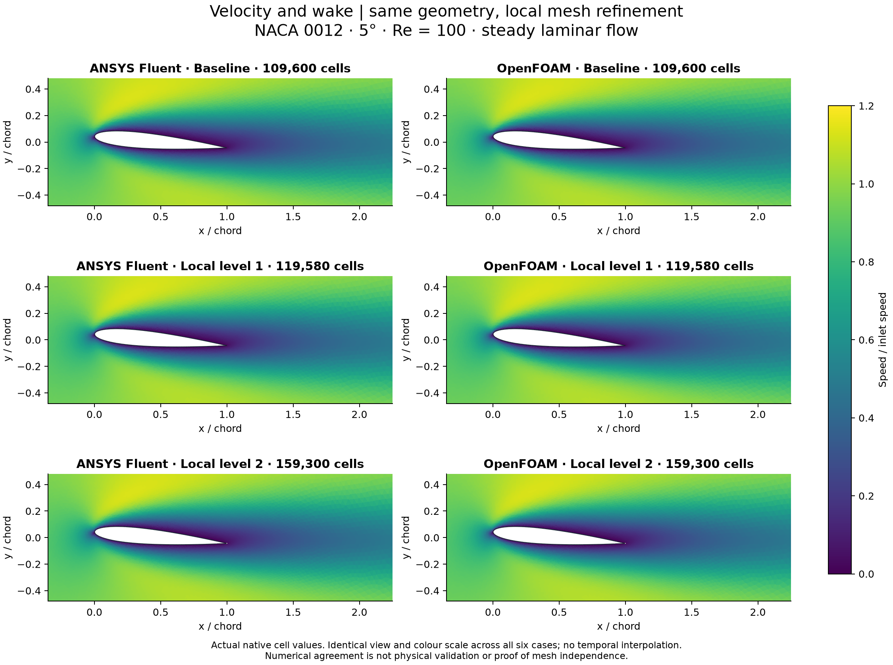
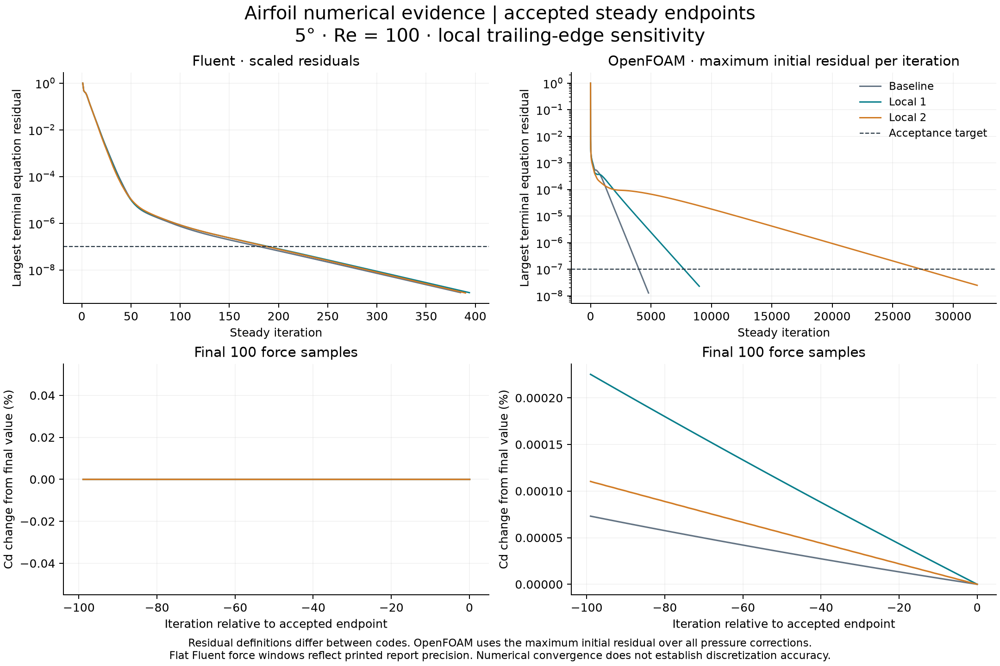

# Airfoil trailing-edge refinement: comparing two solvers

The original polygon and far domain are preserved while two local refinements resolve the sharp trailing edge. Both codes reached endpoints that passed their predeclared numerical checks. The remaining differences are unresolved; this is local spatial sensitivity, not physical validation or global mesh independence.

NACA 0012, 5° incidence, Re = 100, steady laminar flow. All six panels share the same view and colour scale.

| Solver | Local level | Cells | Cd | Cl |
|---|---:|---:|---:|---:|
| ANSYS Fluent | 0 | 109,600 | 0.42565837 | 0.26802330 |
| ANSYS Fluent | 1 | 119,580 | 0.42567217 | 0.26802729 |
| ANSYS Fluent | 2 | 159,300 | 0.42571728 | 0.26792724 |
| OpenFOAM | 0 | 109,600 | 0.41626130 | 0.26387989 |
| OpenFOAM | 1 | 119,580 | 0.41660011 | 0.26292008 |
| OpenFOAM | 2 | 159,300 | 0.41606628 | 0.26128901 |

The retained 0.5% cross-code drag learning goal is not met: baseline/local-1/local-2 gaps are 2.257%, 2.178%, 2.320% using OpenFOAM as denominator. Independent endpoint convergence does not establish cross-code agreement.

The [force plot](figures/airfoil-force-sensitivity.png) shows local mesh response and the cross-code gap. Small integrated-force changes do not establish accurate point pressure. [Wall-pressure traces](figures/airfoil-wall-pressure-sensitivity.png) retain actual mesh-dependent sample coordinates; a changing sampled minimum does not compare one fixed physical point or prove a singularity. See also [pressure maps](figures/airfoil-Cp-comparison.png) and [actual meshes](figures/airfoil-TE-mesh.png).

Residual definitions differ between codes. Endpoint residual, mass and force-stability checks passed; printed flat force windows reflect report precision. Earlier OpenFOAM misses remain [preserved](history/FAILURES.md). The finer selected solution continues exact saved checkpoints through 32,000 steady iterations; it is not an independent full rerun.

Read [methods and limits](METHODS.md), [reproduction requirements](REPRODUCING.md), [selected native cases](data/selected-native-cases.json) and [machine-readable forces](data/force-comparison.csv). Native meshes/cases/data, environments, licence information and credentials remain outside this repository. This is a local GitHub-ready record; no new upload is claimed.

The user directed the comparison. Codex prepared, executed and checked the workflow and figures. Fluent and OpenFOAM computed their respective fields. User reflection remains unprovided. No independent owner execution, novelty or aircraft-performance claim is made.

Fresh read-only [technical review](data/technical-review.json): PASS, no Critical, Important or Minor findings. This confirms the bounded local numerical record, not publication, physical accuracy or mesh independence.
