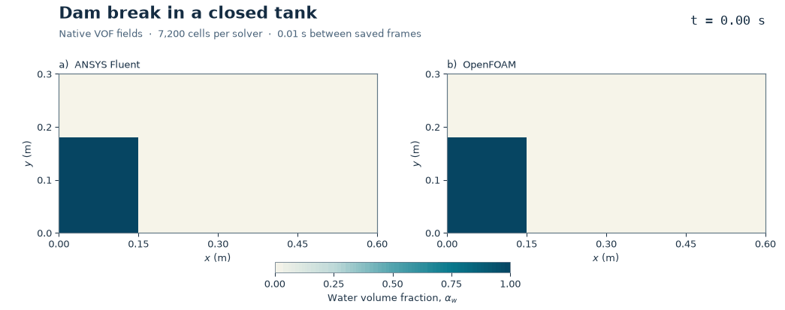

# 23. Dam break in a closed tank

Gravity pulls the water column down and drives a thin front along the floor.
When the front meets the far wall, it rises and falls back into the tank.
The volume-of-fluid (VOF) field tracks the fraction of each cell occupied by water.

[Snapshot comparison](dam-break-comparison.png) · [Fluent startup and impact](dam-break-fluent.png) ·
[Front and conservation plots](dam-break-diagnostics.png) · [Time series](dam-break-history.csv)

## Setup

- Tank of 0.60 × 0.30 m. Water initially fills a 0.15 × 0.18 m rectangle at the lower left.
- Both phases start at rest. Rigid, stationary no-slip walls enclose the tank.
- Incompressible laminar air and water. Water density 998.2 kg/m³ and dynamic viscosity
  0.001003 Pa·s. Air density 1.225 kg/m³ and dynamic viscosity 1.7894 × 10⁻⁵ Pa·s.
  Gravity is 9.81 m/s² downward. Surface tension is omitted.
- Both runs use 7,200 square cells of side 5 mm in the flow plane and 650 steps of
  1 ms. OpenFOAM uses one 10 mm cell through the depth with empty front and back.
- Fluent 2026 R1 uses PISO and explicit geometric VOF reconstruction. OpenFOAM
  Foundation 14 uses incompressibleVoF with MULES and interface compression.
  The solvers use their own pressure initialization and coupling.

## Measured results

| Solver | First floor-corner wetting (s) | Maximum sampled wall crest (m) | Crest time (s) | Maximum water volume drift |
| --- | ---: | ---: | ---: | ---: |
| ANSYS Fluent | 0.28 | 0.2975 | 0.39 | 2.35e-06% |
| OpenFOAM | 0.32 | 0.2975 | 0.56 | 0.00031% |

Floor-corner wetting is the first saved frame in which the floor cell beside the far wall reaches
a water fraction of 0.5. Crest height is the highest cell centre on that wall with
a water fraction of at least 0.5. The sampling interval is 0.01 s. A height of
0.2975 m corresponds to the centre of the topmost cell, where the roof limits the rise.

Both native mesh checks passed. Fluent reported minimum orthogonal quality
1.000. The saved water fractions stayed in
bounds within 10⁻⁶ and the water volume per unit depth stayed within 0.5% of the
initial 0.027 m². Fluent's last inner iteration met the 10⁻⁴ residual criterion
for continuity and both momentum equations on
33/650 steps.
The largest terminal Fluent continuity residual was
0.298. The Fluent run is
retained as a visualization with an unresolved per-step convergence limit.
OpenFOAM's final reported local continuity error was
3.16e-08. The peak native OpenFOAM interface Courant number was
1.88. These are distinct solver diagnostics.

The animation uses each solver's saved fields at the same physical times with
a common colour scale. The OpenFOAM frame at zero shows the prescribed zonal
initialization. The model is a single-grid, single-time-step numerical comparison.
Experimental agreement, mesh and time-step independence, and three-dimensional
splash details remain untested.

## Reproduction

Use [the project's solver environment](../../docs/REPRODUCING.md) and fresh working
directories outside the repository. Run [the Fluent driver](dam_break_fluent_v004.py)
with a fresh output directory. It generates its mesh and runs one hidden,
two-process session. Run [the OpenFOAM preparer](prepare_dam_break_openfoam_v002.py)
with a fresh output directory and use Foundation 14. In the OpenFOAM case,
run `blockMesh > preview-blockMesh.log 2>&1` and
`checkMesh -allTopology -allGeometry > preview-checkMesh.log 2>&1`.
Then pass the case directory to [the two-rank wrapper](run_dam_break_openfoam_v002.sh)
under Bash. The [plot script](plot_dam_break_v005.py) aligns cells using native
mesh connectivity and cell centres. Pass the repository's scripts directory
as `--scripts`. [The audit](audit_dam_break_v002.py) accepts the Fluent run,
OpenFOAM run and a fresh output JSON path.

[Native checks](native-checks.json) · [Field measurements](dam-break-summary.json) ·
[Fluent setup readback](fluent-setup.json) ·
[OpenFOAM VOF tutorial reference](https://doc.cfd.direct/openfoam/user-guide-v14/dambreak)

Fluent and OpenFOAM
computed their respective flow fields.
