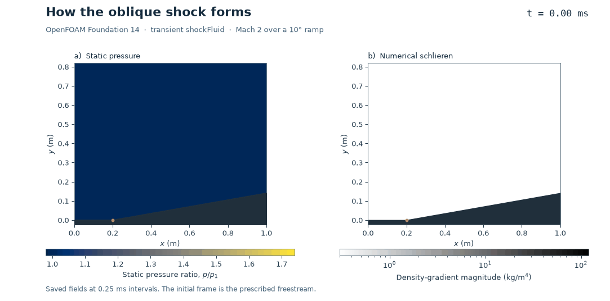

# 24. Mach 2 flow over a compression wedge

A 10° corner turns the supersonic air upward. The oblique shock is attached to the
corner. Static pressure rises as the flow crosses it, and the flow remains supersonic
downstream.

The animation uses the prescribed uniform start followed by 32 computed OpenFOAM
fields saved every 0.25 ms. Numerical schlieren shows the magnitude of the computed
density gradient. It makes the moving compression waves visible.

[Paired final pressure and Mach fields](mach2-wedge-comparison.png) ·
[Fluent saved fields](fluent-mach2-wedge.png) ·
[Pressure profile across the shock](mach2-wedge-pressure-profile.png) ·
[Vector pressure plot](mach2-wedge-pressure-profile.svg)

## Setup

- Two-dimensional Euler flow of calorically perfect air with γ = 1.4 and R = 287.05 J/(kg·K).
  Freestream Mach 2, static pressure 101.325 kPa and static temperature 300 K.
- The ramp turns 10° upward at x = 0.20 m in a 1.00 m long domain with a flat top
  at y = 0.82 m. Top and ramp are impermeable slip boundaries. The inlet prescribes
  the freestream and the outlet is supersonic.
- Both meshes have 22,400 quadrilaterals in the plane. OpenFOAM uses a single
  10 mm extrusion cell with empty front and back boundaries. Native cell centres
  matched the common geometry to 2e-12 m.
- Fluent 2026 R1 uses steady density-based implicit Roe flux with second-order
  upwind reconstruction after 120 first-order startup iterations. OpenFOAM
  Foundation 14 uses transient shockFluid, Kurganov flux, limited reconstruction
  and adaptive Euler time integration.

## Results

| Quantity | Ideal weak shock | ANSYS Fluent | OpenFOAM |
| --- | ---: | ---: | ---: |
| Shock angle from the freestream | 39.314° | 39.317° | 39.319° |
| Static pressure ratio | 1.70658 | 1.70672 | 1.70699 |
| Downstream Mach number | 1.6405 | 1.6404 | 1.6402 |

The weak branch of the θ–β–Mach relation supplies the theoretical reference.
A line fit through the half-pressure-rise crossings from x = 0.36 to 0.84 m
supplies the measured angle. Pressure ratios use median values on either side
of the fitted shock, clear of the boundaries.

Both native meshes passed checks. Fluent's minimum orthogonal quality was
0.985. Its four scaled residuals
were below 5 × 10⁻⁸ at iteration 720, and the relative net
mass imbalance was 7e-08%. OpenFOAM saved
8.00 ms after 4,599 physical steps.
Its peak reported Courant number was 0.300 and
the final relative net mass imbalance was 0.0066%.
The volume-weighted relative pressure change was
0.026% over the final 200 Fluent
iterations and 0.145% from 7 to 8 ms
in OpenFOAM.

These checks compare two single-grid solutions with an inviscid analytical
reference. Mesh sensitivity, time-step sensitivity and experimental agreement
remain untested. The finite numerical shock thickness depends on the mesh and
discretization.

[Measurements and checks](wedge-summary.json) · [Pressure-profile data](shock-pressure-profile.csv) ·
[OpenFOAM native mass-flow data](openfoam-mass-flow.csv) ·
[NASA oblique-shock relations](https://www.grc.nasa.gov/www/BGH/oblique.html)

## Reproduction and contributions

Follow the [local solver environment guide](../../docs/REPRODUCING.md). Run
[wedge_fluent_v001.py](wedge_fluent_v001.py) with a fresh output directory and the
repository's scripts directory. Run [prepare_wedge_openfoam_v001.py](prepare_wedge_openfoam_v001.py)
with a fresh case path, then pass the case path to [the two-rank launcher](run_wedge_openfoam_v001.sh)
under Bash with Foundation 14. Use [the analysis script](analyse_plot_wedge_v002.py)
with the two native run directories, the repository scripts path and a fresh export path.

Fluent and OpenFOAM
computed the fields.

## Mach2 wedge refinement

The [local two-grid comparison](spatial-v001/README.md) adds paired89,600-cell endpoints, native numerical-shock-width measurements and a bounded saved-state late-CFL diagnostic. It preserves the original study and its historical limits; no global mesh/time independence, experimental validation or new upload is claimed.
