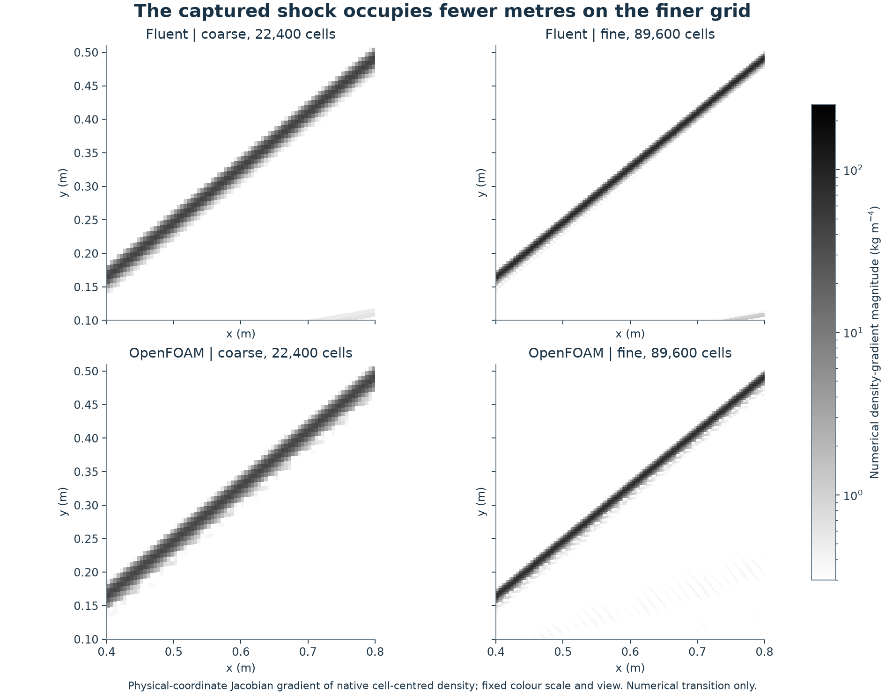

# A sharper captured shock on a finer grid

This is a refinement of existing **study 24**, with actual ANSYS Fluent and OpenFOAM fields. It adds no numbered model. The mesh doubles from 200×112 (22,400 cells) to 400×224 (89,600 cells) while retaining the same domain, straight 10° wedge and boundary conditions.

Both fine endpoints passed the original numerical limits. The median connected 10–90% numerical pressure-transition width changed from **12.163 to 6.094 mm in Fluent** and **13.630 to 6.804 mm in OpenFOAM**. The smaller thickness in metres describes shock capture by these schemes; it is not a molecular shock thickness or a measured order of convergence.

| Code / grid | Cells | Fitted angle (°) | Downstream/upstream pressure | Median numerical width (mm) |
|---|---:|---:|---:|---:|
| Fluent coarse |22,400|39.316659|1.70672068|12.163|
| Fluent fine |89,600|39.314617|1.70662373|6.094|
| OpenFOAM coarse |22,400|39.319189|1.70698758|13.630|
| OpenFOAM fine |89,600|39.320702|1.70662587|6.804|

The ideal weak-shock values are 39.313932° and 1.70657860 for this perfect-gas setup. The OpenFOAM angle error increases slightly on this refinement; improvement is not monotonic for every measured quantity. The ideal relations are an analytical consistency check, not experimental validation. [NASA describes the inviscid oblique-shock assumptions and jump relations](https://www.grc.nasa.gov/www/BGH/oblique.html).

[Full native pressure/Mach comparison](figures/wedge-coarse-fine-native-fields.png) · [Native shock profiles and widths](figures/wedge-shock-width-and-profiles.png) · [Numerical evidence](figures/wedge-numerical-checks.png) · [Mesh close-up](figures/wedge-refinement-mesh.png)

## What passed

Fine Fluent reached the accepted saved steady endpoint at 1520 iterations, with maximum native scaled residual 1.803e-9, relative boundary mass imbalance 1.870e-12 and pressure-field relative L2 change 2.837e-5 across its final 200 iterations. Earlier checkpoints miss one or more endpoint limits and remain preserved. Its native minimum orthogonal quality is 0.984818.

Fine OpenFOAM completed 9188 actual time steps to 8 ms and 33 saved states including the prescribed uniform initial field. Native maximum Courant number is 0.300025, terminal relative mass imbalance 4.825e-5 and 7–8 ms pressure-field change 0.00192968 against the unchanged 0.002 limit. This narrowly passing finite endpoint check does not establish complete steady-state convergence. Diagonal-solve zero residuals are not nonlinear convergence evidence. Positivity, ideal-gas consistency, mapped native geometry, supersonic outlet, analytical-angle/pressure and saved-state checks also pass.

## What the additional time-step check establishes

OpenFOAM uses adaptive steps at a fixed Courant target. Refining its grid changes both spacing and actual time steps, so its main coarse/fine result combines spatial and temporal effects. A separate 2284-step branch reuses the exact saved 7 ms fine-grid checkpoint and advances to 8 ms at maxCo 0.15, saving five states. It passes the same endpoint limits and retains all inherited startup Courant reports with their actual pre-advance time. See the [native branch evidence](figures/wedge-late-cfl-native-evidence.png).

Between the fine main and half-CFL endpoints, pressure relative L2 difference is 0.00168749 and Mach difference 0.00068205. Median width changes from 6.80417 to 6.74317 mm (about 0.90%). Local signed pressure differences reach−5.46% to+7.38% of freestream pressure near the captured shock. The displayed difference scale is±8% with no clipped cells; the preserved first export had±5% and 7 clipped cells. Small domain-weighted differences must not be confused with small changes everywhere. This late-time branch is neither an independent full rerun nor proof of time independence.

## Methods and reproduction

The selected passing helper suite contains 22 tests; the first mapping version is a retained failed diagnostic, not part of that passing suite. Run the seven named current test modules from the code folder with the recorded E: Python environment and the repository scripts path on PYTHONPATH. The archived actual-native mapping test requires the preserved external coarse case.

Read [the frozen specification](methods/SPEC.md), [plan](methods/PLAN.md), [late-CFL admission](methods/LATE-CFL-ADMISSION-v001.md), [numerical summary](data/summary.json), [every column width](data/shock-width-columns.csv) and [native bracket samples](data/selected-measurements.json). The pressure plateau/angle masks match the original study. Widths use connected native 10/50/90% brackets, linear interpolation in signed-normal coordinates, every prescribed x=.36–.84m column and no smoothing/extrapolation. Cell units mean projected vertical-column centroid increments, not an isotropic cell size. Numerical schlieren uses a tested physical-coordinate Jacobian of cell-centred density, not a simulated optical experiment.

[Executed sources and tests](code/) and [native audit records](checks/) are included. The original coarse study remains in the parent folder. Executable controllers contain recorded E: paths and immutable launch guards; **do not rerun them over completed directories**. To reproduce on this machine, use the existing E: environment and D: Fluent 261, review the frozen spec, allocate new versioned paths and manifests, then qualify geometry/native quality before the finite sequential flow runs. Hidden two-rank sessions, one solver at a time, source/parent checks and RAM≥4GiB/E:free≥10GiB admission apply. See the [environment guide](../../../docs/REPRODUCING.md). Native checkpoints, meshes, full logs and installed dependencies stay outside Git; this packet is an execution/methods archive, not a self-contained restart bundle.

All original coarse/native files and failed helper versions are preserved. The failed first centre-mapping test used a tolerance unsupported by the shared API; the new version tightens it to 1e-10. No solver acceptance limit was relaxed. The original geometry nodes are bit-identical members of the fine source mesh; native mapping/connectivity and centroid proofs bind the field plots.

## Limits and contributions

Two grids do not establish observed order, GCI, global mesh/domain/time independence or a unique discrepancy cause. Euler/slip excludes boundary layers, viscosity and turbulence. Agreement with an ideal weak shock does not validate an aircraft, real wind-tunnel flow or this portfolio physically.

The owner requested paired CFD models and visuals and authorized improvement of existing showcases. Codex selected and documented this bounded refinement, wrote/tested the scripts, ran and checked the solvers and prepared the figures and record. ANSYS Fluent and OpenFOAM computed the native fields. Owner execution and reflection are not claimed. This is a locally prepared record; no new GitHub upload is claimed.

The [single fresh whole-improvement technical review](checks/technical-review-v001.json) completed with no Critical, Important or Minor findings. Its independent native replay and preservation checks support the limited numerical record described above.
