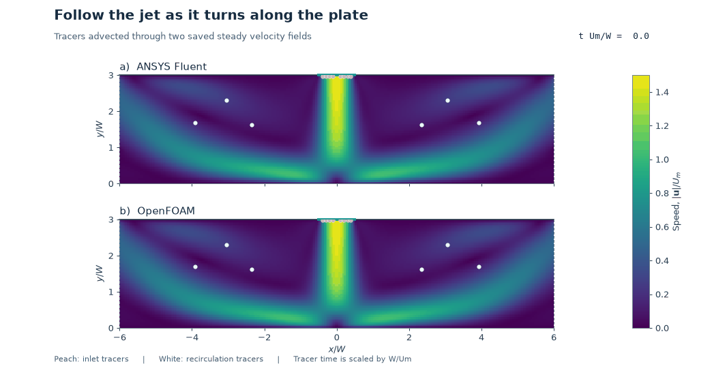

# 25. A planar jet impinging on a plate

A jet enters through a narrow slot in the ceiling. The plate stops its downward
motion at the centre, creating a local pressure peak. The flow turns left and
right along the plate, and both solvers show a recirculating eddy on each side.

Peach tracers start near the inlet and white tracers start inside the chamber.
Their trajectories are integrated through the saved steady velocity fields.
The clock shows tracer travel time scaled by the slot width and mean inlet speed.

[Paired speed maps and streamlines](impinging-jet-comparison.png) ·
[Fluent pressure map](fluent-jet-impingement.png) ·
[Plate pressure plot](impinging-jet-plate-pressure.png) ·
[Vector plot](impinging-jet-plate-pressure.svg)

## Setup

- A 20 mm slot in a 240 mm wide chamber, with a 60 mm gap between slot and plate.
  The slot prescribes a parabolic inlet profile with nominal mean speed
  0.07304 m/s. The plate and the solid ceiling
  segments are stationary no-slip walls. Both side outlets have zero gauge pressure.
- Steady, two-dimensional, isothermal laminar air at constant density 1.225 kg/m³
  and dynamic viscosity 1.7894 × 10⁻⁵ Pa·s. Re = 100 using slot width and nominal
  mean speed. Each solver uses the same 240 × 60 grid of 1 mm square cells in
  the flow plane. The OpenFOAM case uses one 10 mm depth cell with empty faces.
- Fluent 2026 R1 uses SIMPLEC and second-order upwind momentum. OpenFOAM
  Foundation 14 uses steady incompressibleFluid with consistent SIMPLE and
  bounded linear-upwind momentum.

## Results

| Solver | Centre plate pressure coefficient | Left net outlet share | Right net outlet share |
| --- | ---: | ---: | ---: |
| ANSYS Fluent | 1.5228 | 49.9995% | 50.0005% |
| OpenFOAM | 1.5291 | 50.0000% | 50.0000% |

The pressure coefficient uses the mean inlet dynamic pressure and zero gauge
outlet pressure. The centre value averages the two faces bracketing x = 0.
Fluent supplies native plate-face pressure. The OpenFOAM zero-gradient boundary
supplies the adjacent cell's kinematic pressure, converted to pascals. The two
centre values differ by about 0.41%.

Both meshes passed native checks. The net mass imbalance was below 10⁻⁸ of
the inlet mass flow in each calculation. Both matched the discrete inlet profile,
met the residual target of 10⁻⁶ in their respective norms, and passed the
reflection symmetry and endpoint field-stability checks. Fluent saved
1,750 iterations and OpenFOAM saved
1,250 steady iterations. Both side boundaries have
small regions of local reverse flow. The table reports net outlet flow.

The solver comparison uses a single mesh and a fixed chamber geometry.
Outlet placement and grid sensitivity remain untested, and experimental
agreement has yet to be established.

[Measurement data and checks](impinging-jet-summary.json) · [Plate pressure CSV](plate-pressure.csv)

## Reproduction and contributions

Follow the [local environment guide](../../docs/REPRODUCING.md). Give
[the Fluent driver](jet_fluent_v001.py) a fresh run directory and the repository
scripts directory. Give [the OpenFOAM case generator](prepare_jet_openfoam_v001.py)
a fresh directory, then pass that path to [the two-rank Bash launcher](run_jet_openfoam_v001.sh).
[The analysis script](analyse_plot_jet_v001.py) takes both run paths,
the repository scripts directory and a fresh export path.

The owner requested paired models with solver-derived visuals. Codex prepared
the cases, ran the solvers, checked the results and made the figures.
Fluent and OpenFOAM computed the fields. The owner reflection remains open.
