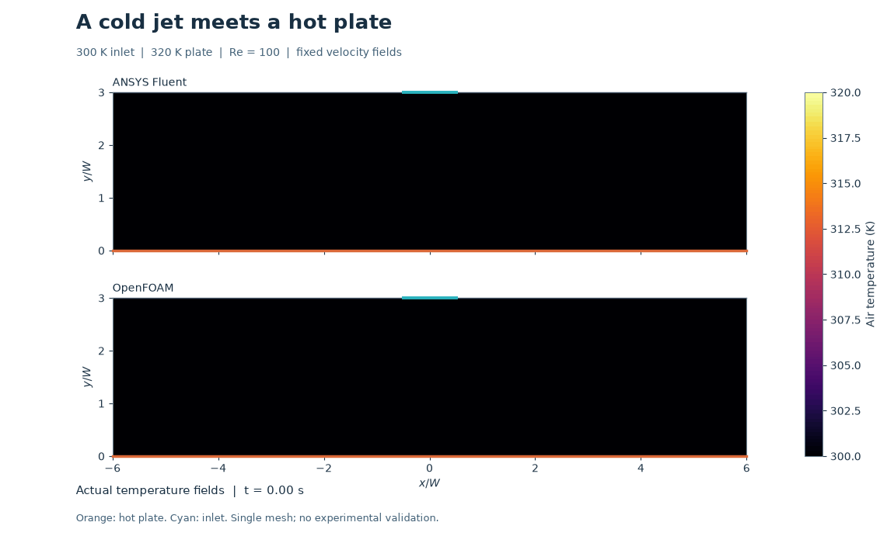
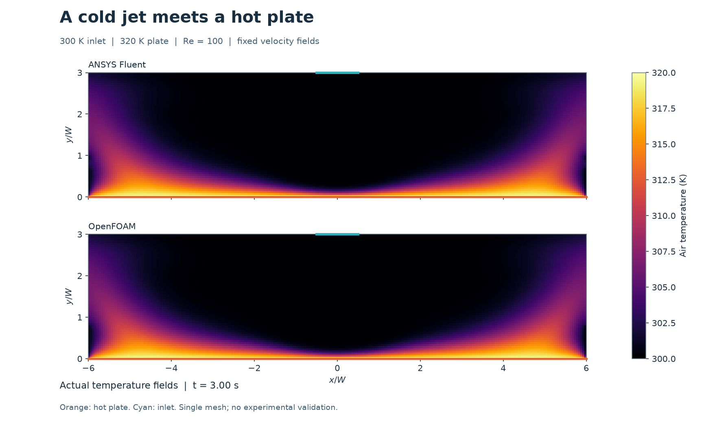
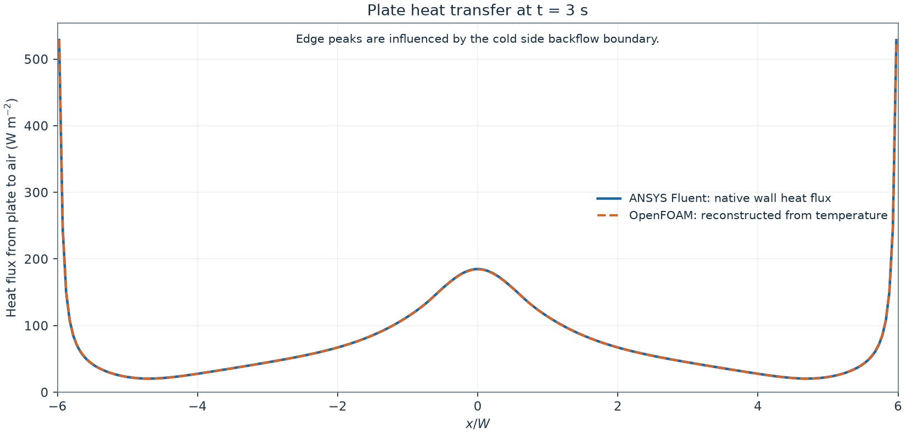
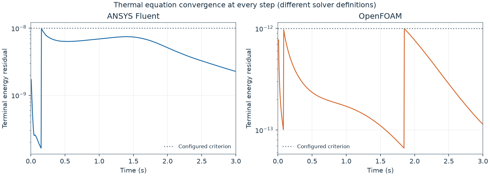

# 26. A cold jet cooling a hot plate

A 300 K air jet enters above a plate held at 320 K, turns and flows toward the
side openings. Both solvers compute a thin heated layer beneath the jet and
warmer air carried toward the sides. This animation uses **31 actual temperature
snapshots per solver**, from 0 to 3 seconds. The first frame is the prescribed
uniform 300 K initial condition. The plate temperature is fixed, so the plate
itself does not cool with time.

## Model and numerical method

The mesh and each solver's own converged flow are inherited from
[the planar impinging jet](../25-impinging-jet/README.md). Velocity and pressure
are held fixed while temperature evolves; the energy calculation does not feed
back into the flow. This is forced convection with constant properties and no
buoyancy, viscous heating, pressure-work or kinetic-energy contribution.

| Setting | Value |
|---|---|
| Geometry | 2D planar chamber, 0.24 m wide and 0.06 m high |
| Inlet | Centred 0.02 m slot; prescribed parabolic downward velocity, mean 0.0730367 m/s |
| Reynolds number | 100, based on mean inlet velocity and slot width |
| Fluid | Density 1.225 kg/m³; viscosity 1.7894e-5 Pa s |
| Thermal properties | Cp = 1006 J/(kg K); conductivity = 0.0262 W/(m K) |
| Inlet and initial air | 300 K |
| Bottom plate | No slip; fixed 320 K |
| Ceiling | No slip; adiabatic |
| Side openings | Pressure outlets; 300 K for reversed inflow; zero temperature gradient for outflow |
| Grid | 240 × 60 = 14,400 square cells; cell width 0.001 m |
| Time integration | 600 steps of 0.005 s; first-order implicit Euler |
| Thermal advection | First-order upwind in both solvers |
| Execution | Fluent 2026 R1 and OpenFOAM Foundation 14; sequential, two processes each |

Fluent uses its 2D unit-depth convention. OpenFOAM uses a 0.01 m extrusion with
empty front/back faces. All integrated heat and mass results below are normalized
to **one metre of depth**.

## Results at 3 seconds

| Quantity | ANSYS Fluent | OpenFOAM |
|---|---:|---:|
| Heat from plate (W/m depth) | 17.582615 | 17.594322 |
| Centre heat flux, mean of two central faces (W/m²) | 184.848 | 184.364 |
| Energy storage rate in air (W/m depth) | 5.327897 | 5.337141 |
| Relative mass imbalance | 7.143e-10 | 1.265e-10 |
| Relative energy balance error | 1.558e-07 | 2.395e-09 |

The integrated plate heat rates differ by **0.0666%**,
relative to Fluent. The final full-field temperature RMS difference is
0.0758 K. Agreement on this common grid is a
cross-solver comparison, not experimental validation or grid independence.

The jet produces a local heat-flux peak near the centre. The larger edge peaks
are influenced by the nearby side boundary admitting 300 K backflow; they must
not be attributed to the central impingement alone. Domain-size and thermal
boundary sensitivity remain open.

## Checks and interpretation

Fluent retains minimum orthogonal quality 1 on the shared square mesh.
OpenFOAM reports `Mesh OK.` with maximum nonorthogonality 0 degrees. Saved
velocity, pressure and face flux agree with their parent flow fields within
1e-12 absolute tolerance. Mass imbalance is below the declared 1e-4 limit.
The saved temperatures remain within 300–320 K to numerical tolerance.

All 600 time steps met the configured terminal thermal residual criterion:
1e-8 for Fluent and 1e-12 for OpenFOAM. Fluent scaled energy residuals and
OpenFOAM final linear-solver residuals have different definitions; their
magnitudes do not rank physical accuracy. The plot shows the final residual
of each step, not every inner iteration.

The final-step balance includes **energy storage**: net boundary heat entering
must equal the increase of energy in the air per unit time. Fluent native heat
reports and saved face heat flux agree. Its enthalpy datum is shifted to 300 K
for comparison. OpenFOAM heat rates are reconstructed from its saved temperatures
and face volume fluxes using the declared upwind and orthogonal diffusion
operators; they are not a native heat-transfer report. Storage uses the saved
2.995 s and 3 s states. Relative error is
`abs(net heat in - storage) / max(sum(abs(patch heat in)), abs(storage))`,
with a 0.005 acceptance limit. Both solvers pass this final-step balance check.

Positive storage at 3 s means thermal steady state has not been established.
The first-order method and single grid/time step require sensitivity studies.
The fields provide no validation of Concorde, an ornithopter or aircraft cooling.

[Measurements and check definitions](heated-jet-summary.json) ·
[Plate heat-flux CSV](plate-heat-flux.csv) ·
[Temperature history](thermal-history.csv)

## Reproduce

Use [the project environment setup](../../docs/REPRODUCING.md). Add the repository
`scripts` folder, `lessons/25-impinging-jet`, and this folder to `PYTHONPATH`.
Use `python -B`; all native run directories must be fresh and outside the repository.

1. Reproduce model 25 first. Keep its Fluent `jet-1750.cas.h5/dat.h5`, geometry,
   mesh-quality record and OpenFOAM time `1250` fields including `C`.
2. Pass the parent Fluent `jet-1750.cas.h5` path and a fresh output directory
   to [heated_jet_fluent_v002.py](heated_jet_fluent_v002.py).
3. Pass the parent OpenFOAM case directory and a fresh output directory to
   [prepare_heated_jet_openfoam_v002.py](prepare_heated_jet_openfoam_v002.py).
   Run [run_heated_jet_openfoam_v002.sh](run_heated_jet_openfoam_v002.sh) with that
   prepared case directory under the project's OpenFOAM 14 WSL environment.
4. [analyse_heated_jet_v002.py](analyse_heated_jet_v002.py) takes the project root
   and a fresh export directory. It expects native folders named
   `heated-impinging-jet-fluent-v002`, `heated-impinging-jet-openfoam-v002`, and
   `impinging-jet-fluent-v001` beneath `native/runs`. It checks native records,
   constructs the plots and decodes all 31 GIF frames.

The scripts use the existing D: Fluent installation and E: storage. The Bash
wrapper reserves `/dev/shm/cfd-heated-jet-v002` for MPI IPC only because this E:
mount cannot create Linux FIFOs; case files, results and ordinary caches stay
on E:. Before launching, verify disk and RAM, no live solver, and Fluent licence
availability. Save and close each solver before starting the other.

The preserved OpenFOAM v001 attempt stopped before its first temperature solve
because `TFinal` was absent. Version 002 explicitly inherits the same settings
from `T`; it does not relax tolerances. Earlier Fluent startup failures and
all native files remain in the private E: run directories.

## Contributions and reflection

The owner requested paired simulations and visual results. Codex prepared the
thermal cases, operated both tools, checked the native outputs and made this
record. ANSYS Fluent and OpenFOAM computed the temperature fields. The owner has
not yet supplied a personal reflection. No independent owner implementation or
research novelty is claimed. This record is prepared locally; no upload is
performed by its staging script.

## Heated-jet energy evidence — 8 November 2026

The [complete discrete-energy record](energy-v001/README.md) adds 600 actual thermal steps and 601 unique states per code, independent per-step and cumulative boundary-input/storage checks, and actual paired video. It retains the original 14,400 cells and 0.005 s step and each code’s frozen flow; the prescribed 320 K plate does not cool. This improves study 26 without adding a model or claiming physical validation, time independence or a new upload.
