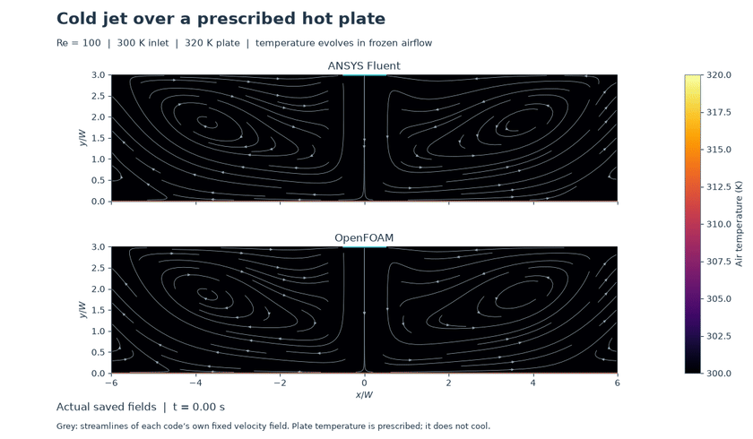
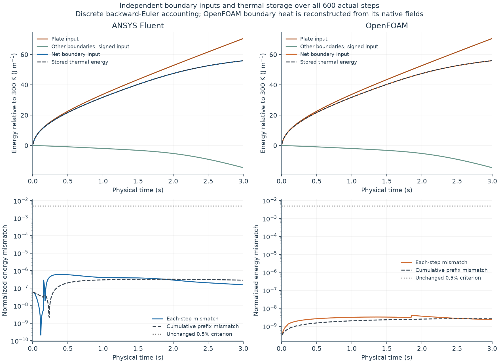
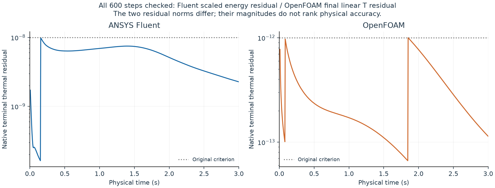

# Where does the plate's heat go?

This adds complete **discrete energy evidence to existing study 26**, using the same 14,400 cells, 0.005 s time step, numerical methods and each code's own frozen airflow. Both codes completed **600 actual thermal steps to 3 s**, using accepted 20-step qualifications followed by 580-step exact-checkpoint continuations. It adds no numbered model.

[Full-resolution video](media/heated-jet-energy-comparison.mp4) · [Endpoint fields](figures/temperature-comparison-3s.png) · [Independent energy accounting](figures/complete-energy-ledger.png) · [Wall heat transfer](figures/wall-heat-transfer.png)

The 320 K plate supplies heat to 300 K air. Some heat accumulates in the air; the remainder leaves through the openings, including their conductive contributions. The plate is held at a prescribed temperature and **does not cool**. Temperature evolves in fixed velocity, pressure and face-flux fields and does not alter the flow. Grey streamlines show each code's static velocity field, not transient particle trajectories.

The animation uses 61 actual saved states from 0 to 3 s, spaced 0.05 s apart, without temporal interpolation. At 10 frames per second, those 3 physical seconds occupy 6.1 seconds of video.

| Discrete quantity, per metre of depth | ANSYS Fluent | OpenFOAM |
|---|---:|---:|
| Heat supplied by plate over 0–3 s (J/m) | 70.56270340 | 70.56727445 |
| Net boundary energy entering (J/m) | 55.91926436 | 55.96602089 |
| Increase in stored thermal energy (J/m) | 55.91928883 | 55.96602067 |
| Largest normalized single-step energy mismatch | 6.139811e-07 | 4.014676e-09 |
| Largest normalized cumulative-prefix mismatch | 3.261146e-07 | 2.631100e-09 |
| Largest original-time temperature replay change (K) | 0.000000e+00 | 1.000444e-11 |

Heat and energy are normalized to one metre of out-of-plane depth. Fluent uses planar unit depth; OpenFOAM's empty extrusion is 0.01 m. Cumulative sums use **all 600 newly collected per-step boundary samples**, rather than interpolation through the old 31 display frames. Boundary inputs and storage are measured independently. These values describe numerical conservation, not physical uncertainty or an accuracy ranking.

## Numerical evidence

Every step and every cumulative prefix passes the predeclared 0.005 normalized energy criterion. The local numerator is the absolute difference between net boundary input and storage rate; the denominator is the larger of total absolute patch inputs and absolute storage rate. Cumulative input uses the right-endpoint sum of dt × Q. Cumulative error is normalized by the larger of cumulative absolute patch throughput and absolute stored-energy change. This follows the configured backward-Euler discretization. It is **not an exact continuous-time integral** or a time-independence result.

Fluent's native face heat is already integrated over each face. Every patch sum is matched to an actual solver heat report, with native mass reports checking its sign and the 300 K enthalpy-datum shift. OpenFOAM's boundary heat is explicitly reconstructed from every-step native temperature and frozen phi using its unchanged upwind/orthogonal scheme, including inlet and backflow diffusion. It is not a native heat-transfer report.

All 600 steps meet their original criteria: Fluent terminal scaled energy residual ≤ 1e-8 with a 30-inner-iteration cap; OpenFOAM final linear T residual ≤ 1e-12. Their residual norms differ. Relative mass imbalance ≤ 1e-4, frozen fields within 1e-12 absolute, finite temperatures in 299.99–320.01 K, native clocks and complete global step coverage also pass. The exact 0.1 s/step-20 restart is verified and its duplicate is excluded from merged sums. Both OpenFOAM partition clocks are checked. All 32 original saved-temperature states are compared at identical times with a 1e-8 K absolute tolerance.

## Model and provenance

[Methods and equations](METHODS.md) · [Primary references](methods/PRIMARY-SOURCES-v001.md) · [CSV histories](data/) · [Audits and source bindings](checks/) · [Archived executed sources](code/) · [Reproduction guide](REPRODUCING.md)

The 240 × 60 grid spans x = −0.12…0.12 m and y = 0…0.06 m. A centred 0.02 m slot supplies parabolic 300 K air at a mean 0.0730367 m/s, Re = 100. Constant properties are rho = 1.225 kg/m³, mu = 1.7894e-5 Pa·s, cp = 1006 J/(kg·K) and k = 0.0262 W/(m·K). The no-slip plate stays at 320 K; the no-slip ceiling is adiabatic. Side pressure openings use 300 K for reverse inflow. Flow is laminar and fixed, with no buoyancy, viscous heating, pressure work or kinetic-energy contribution. No solid or conjugate cooling model is present. First-order time and advection schemes are retained.

The original baseline has 32 distinct temperature states: 31 display snapshots plus 2.995 s for the final-step balance. It cannot alone establish an independent 600-sample energy history. This temperature-only replay supplies that missing evidence without recalculating flow. It uses a 20 + 580-step checkpoint continuation, not an independent uninterrupted full run. The two codes retain separately computed frozen flows; agreement does not isolate a unique discrepancy cause.

Preserved structural failures include a post-Fluent clock auditor that also matched historical autosave times, and an OpenFOAM wrapper that failed before any solve because its installed environment does not support nounset. New versioned readers and wrappers corrected these without rerunning accepted Fluent fields or weakening numerical limits. Original failures, manifests and tests remain in the archive. The intentionally failing historical clock regression is under code/history; it is excluded from the current green suite. Study 26's earlier missing-TFinal attempt also remains preserved in its original record.

## Limits and contributions

Edge heat-flux peaks are influenced by cold backflow at nearby side boundaries. This does not establish domain sensitivity, mesh/time independence, observed order, thermal steady state, experimental validation or aircraft accuracy. Native meshes, checkpoints, full logs, installed environments and private files remain outside Git. No new upload is claimed.

ANSYS Fluent and OpenFOAM computed the fields. No research novelty, admissions outcome or university submission is claimed.

## Technical review

One fresh review of the complete improvement found no Critical, Important or Minor issues. See the [review report](checks/heated-jet-technical-review-v001.json) and [closeout](checks/REVIEW-CLOSEOUT-v001.md). This review supports the stated numerical evidence; it is not physical validation or publication approval.
