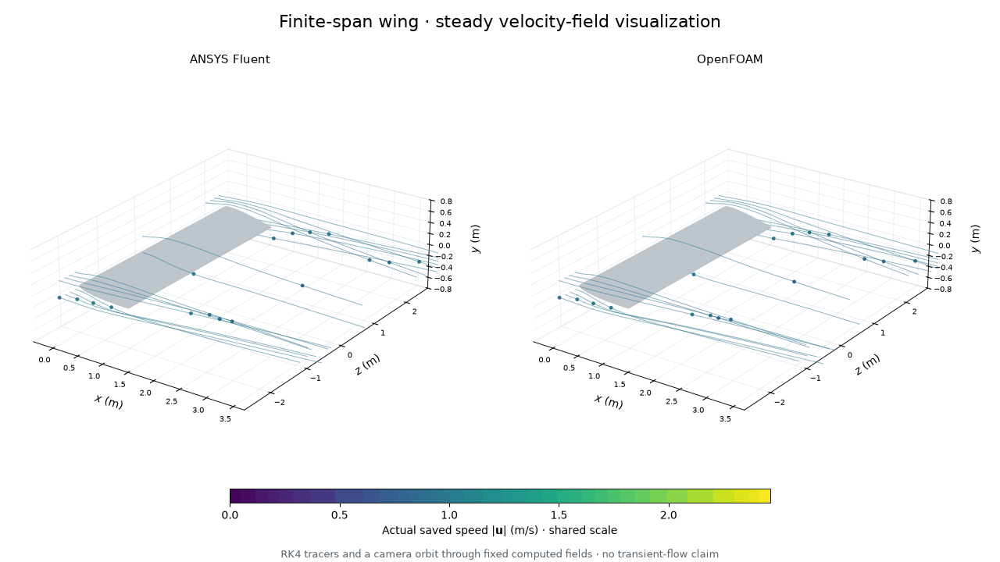
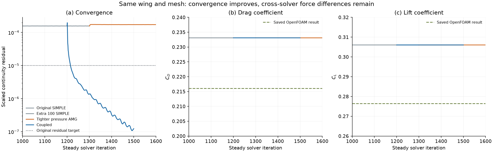
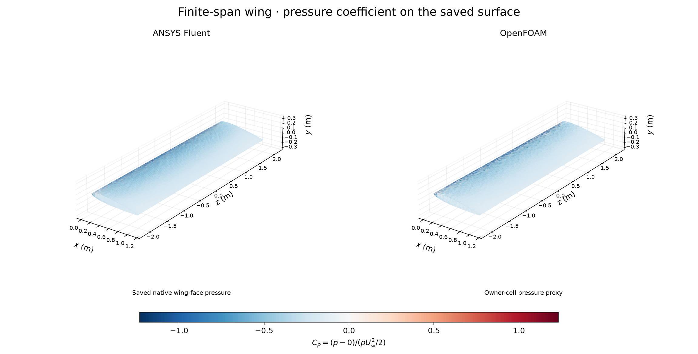
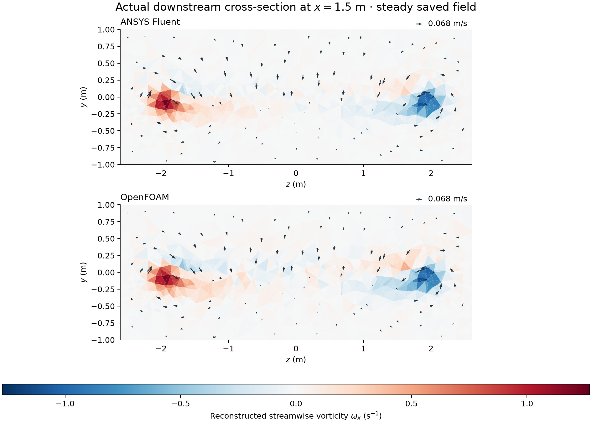

# 27. Revisiting the three-dimensional wing

The wing's Fluent calculation now meets the original residual, mass-balance
and force-stability targets. The animation compares this new Fluent result
with the **unchanged, previously checked OpenFOAM result**. Tracers and camera
motion show the steady velocity fields, not simulated transient development.

The [original wing record](../08-finite-wing/README.md) remains preserved with
its failed Fluent residual check. This follow-up changes the iterative solution
method; it does not change the wing, mesh or physical conditions.

## Geometry and flow

The full-span rectangular wing has chord 1 m, span 4 m and aspect ratio 4.
Its symmetric NACA 0012-like profile has a rounded trailing cap; it is not an
exact NACA 0012. The wing is pitched 8 degrees, in a 1 m/s stream at nominal
Reynolds number 400. Density is 1 kg/m³ and viscosity is 0.0025 Pa s.
The stationary wing is no-slip. Upstream and lateral boundaries specify
U=(1,0,0); the downstream boundary specifies zero gauge pressure.
The domain is x=-3..9 m, y=-4..4 m and z=-6..6 m.

Both codes use the existing 169,800-cell tetrahedral mesh and steady,
incompressible, laminar equations. Pressure and velocity are saved in three
dimensions. Each run has two processes and operates without desktop interaction.

## What changed

1. A preserved copy of the original 1,200-iteration Fluent state received 100
   more SIMPLE iterations. Its continuity residual remained about 1.58e-4.
2. On that copy, tightening the pressure AMG termination criterion from 0.1 to
   0.001 for 300 iterations reduced local mass imbalance, but the continuity
   residual remained about 1.73e-4. This attempt is retained as a failed test.
3. A separate copy of the original state received 300 iterations using Fluent's
   coupled pressure–velocity algorithm. Pseudo-time was off, flow Courant number
   was 20, and explicit pressure/momentum relaxation was 0.5. This run passed
   at iteration 1,500. Spatial discretization remained second-order pressure,
   second-order upwind momentum and least-squares cell gradients.

Automatic convergence stopping was disabled during these fixed-length diagnostic
runs; numerical acceptance thresholds were retained and checked from the saved
native data afterwards. No residual renormalization was requested. Native
scaling denominators are recorded, and local cell flux balance provides an
additional check independent of the displayed residual.

[ANSYS AMG documentation](https://ansyshelp.ansys.com/public/views/secured/corp/v261/en/flu_ug/flu_ug_sec_setting_mg.html)
explains the inner pressure-solver criterion used in the first test. Tightening
that criterion alone was not sufficient in this case.

## Numerical results

| Quantity | New Fluent coupled result | Existing OpenFOAM result |
|---|---:|---:|
| Final iteration | 1500 | 1200 |
| Drag coefficient | 0.23308526 | 0.21603658 |
| Lift coefficient | 0.30604115 | 0.27644356 |
| Original declared checks | PASS | PASS |

The final Fluent continuity residual is **1.236e-07**,
below the unchanged 1e-5 target. All three momentum residuals also pass. Relative
boundary mass imbalance is 9.338e-13, below 1e-4.
Over the last 100 actual iterations, drag and lift relative ranges are
7.550e-08 and
3.050e-07, both below 1e-3.
The sum of absolute cell mass imbalances is
3.602e-08 kg/s. Mesh topology and coordinates
match the parent case; minimum Fluent orthogonal quality remains 0.106856.

The new Fluent calculation still predicts **7.89% more drag and 10.71% more
lift** than OpenFOAM. Thus, the convergence correction does not explain the
cross-solver force difference. Mesh, discretization and boundary-treatment
sensitivity remain unresolved. Neither result is a validated wing-performance
prediction, and no induced-drag decomposition is claimed.

OpenFOAM was not rerun: all 42 files backing its original numerical audit were
rehashed and matched. Its residual definitions differ from Fluent's. The graph
compares force coefficients directly, but does not rank cross-code accuracy
using residual magnitudes.

## Pressure and downstream flow

Pressure coefficient uses rho=1 kg/m³, U=1 m/s and reference pressure 0.
The Fluent panel uses saved face pressure; the OpenFOAM panel uses an explicitly
labelled owner-cell pressure proxy, not an exact wall-pressure sample.

At x=1.5 m, the saved fields show downwash between the tips and opposite signs
of reconstructed streamwise rotation near the two tips. The coarse tetrahedral
sampling is visible. [Figure methods](CAPTIONS.md) explain interpolation,
trajectory stopping at boundaries, shared scales and the limits of the
reconstructed gradients. The 48-frame GIF contains 48 distinct decoded frames.

[Native Fluent screenshot](fluent-wing-pressure-native.png) ·
[Full comparison and checks](wing-continuation-summary.json) ·
[Residual CSV](residual-history.csv) · [Force CSV](force-history.csv) ·
[Compressed pressure samples](actual-wing-pressure.csv.gz) ·
[Visual checks](visual-checks.json)

## Reproduction and provenance

Use [the environment setup](../../docs/REPRODUCING.md) with the D: Fluent
installation and E: project storage. Add the repository `scripts` folder to
`PYTHONPATH`. The scripts expect the preserved original case under
`native/runs/2026-11-01-finite-wing-v003/fluent` and refuse existing destination
folders. Use versioned copies and verify RAM, disk, licence and absence of a
live solver before launching. Never run these two restart tests concurrently.

[wing_restart_test_v001.py](wing_restart_test_v001.py) writes the baseline and
pressure-AMG test to `native/runs/finite-wing-continuation-fluent-v001`.
[wing_coupled_test_v001.py](wing_coupled_test_v001.py) writes the coupled branch
to `native/runs/finite-wing-coupled-fluent-v001`. Both copy and hash the original
case/data, redirect monitors, save final native outputs and close Fluent.
[audit_wing_continuation_v001.py](audit_wing_continuation_v001.py) takes one fresh
export directory and reads both experiments without launching a solver.

The existing [wing plotter](../../scripts/plot_finite_wing_native_v002.py) is used
with `--run` pointing to the original paired wing root, `--geometry` pointing
to its `mesh-export-v002/geometry.npz`, `--fluent-case` and `--fluent-data`
pointing to the coupled branch's `wing-final` files, `--frames 48`, and `--out`
pointing to a fresh export directory. OpenFOAM time 1200 is reused.
Large native cases, logs and private source hashes remain outside the repository.

The owner requested continued models and visual results. Codex diagnosed the
stalled residual, prepared and ran the two Fluent tests, checked the native
files and generated these figures. Fluent computed the new states; OpenFOAM
computed the reused state in the earlier run. Owner reflection is unprovided.
No aircraft validation, independent owner implementation or research novelty
is claimed. This record is local and has not been uploaded by this workflow.
