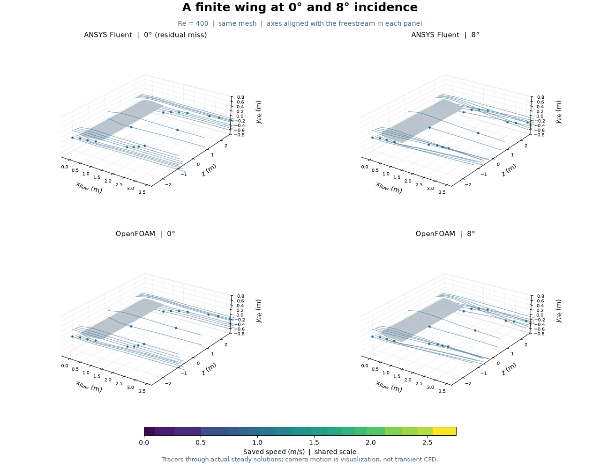
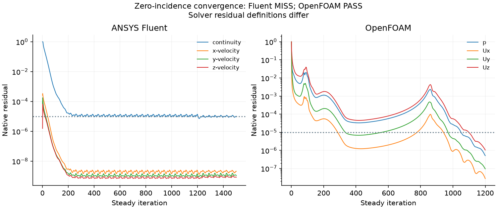
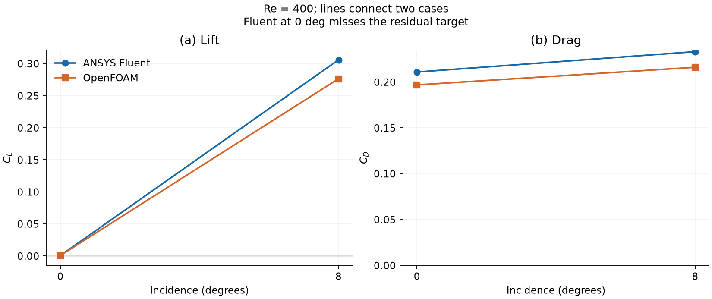
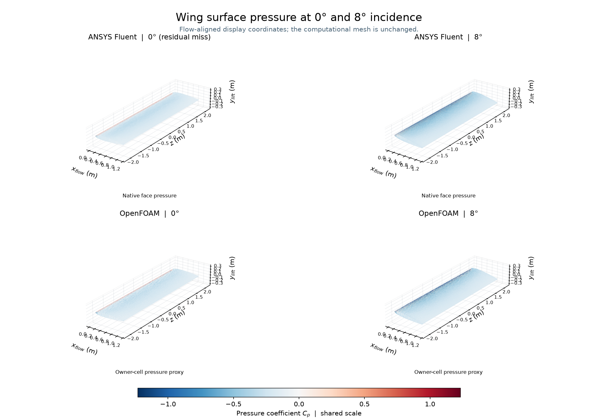

# 28. How incidence changes the flow around a finite wing

Both solvers predict nearly zero lift at 0 degrees and substantially greater
lift at 8 degrees. The new zero-incidence OpenFOAM run passes its numerical
checks. **The zero-incidence Fluent run misses its residual target** and is
retained as a diagnostic calculation. Both 8-degree cases are the preserved,
previously checked results from [model 27](../27-wing-convergence/README.md).

## Physical setup

The stationary full-span wing has chord 1 m, span 4 m, reference area 4 m2 and
aspect ratio 4. Its symmetric NACA 0012-like section has a rounded trailing cap;
it is not an exact NACA 0012. Density is 1 kg/m3, dynamic viscosity 0.0025 Pa s
and freestream speed 1 m/s, giving chord Reynolds number 400. Both codes solve
steady, incompressible, laminar flow on the same 169,800 tetrahedral cells.
The domain is x=-3..9 m, y=-4..4 m, z=-6..6 m; the wing is no-slip, inlet and
farfield prescribe velocity, and the outlet prescribes zero gauge pressure.

The original mesh and wing remain fixed at 8 degrees clockwise body pitch.
For **effective zero incidence**, the incoming velocity is aligned with its
chord: U=(0.9902680687415704,-0.13917310096006544,0) m/s. Lift is projected along
(0.13917310096006544,0.9902680687415704,0); drag is projected along U. The
8-degree reference uses U=(1,0,0). Force coefficients use 0.5*rho*U^2*S=2 N.
Changing the flow direction also changes its orientation relative to the box;
that domain effect has not been quantified.

## Methods and numerical checks

Fluent started from a uniform zero-incidence field, using coupled pressure and
velocity, pseudo-time off, Courant number 20, explicit relaxation 0.5,
second-order pressure and upwind momentum, and least-squares cell gradients.
The original 1,200-iteration run missed the continuity target at 1.35620e-5.
A separate preserved restart changed only Courant number to 5 for 300 more
iterations. The 1,400 checkpoint fell below the target, but the final 100-step
confirmation ended at **1.0096634273447894e-5**, above the unchanged **1e-5**
limit. The final state is used; an earlier passing checkpoint is not selected.
The repeated iteration-1200 monitor row was verified identical before joining
histories, leaving 1,500 distinct solved iterations.

OpenFOAM ran 1,200 steady iterations using consistent SIMPLE, one nonorthogonal
correction and velocity relaxation 0.7. Its inherited schemes and material
files were hash checked. Final residuals and every residual in the final 100
iterations are below 1e-5. Residual definitions differ between solvers, so their
magnitudes do not rank physical accuracy.

Both zero-incidence cases pass the 1e-4 relative boundary mass-imbalance limit:
Fluent 2.045e-11, OpenFOAM
2.205e-10. The denominator includes every
inward boundary face, including the farfield. Both pass final-100 force
stability: range/max(abs(mean),0.001) <=0.001. Fluent drag/lift ranges are
9.343e-09/2.788e-05;
OpenFOAM ranges are 2.467e-07/3.092e-04.

Minimum Fluent orthogonal quality is 0.106856. OpenFOAM's full topology and
geometry check reports Mesh OK, maximum nonorthogonality 53.0159 degrees and
maximum skewness 0.783516. Positive cell volumes and matching native geometry
were checked. These quality measures do not establish mesh independence.

## Computed forces

| Solver | Incidence (degrees) | Drag coefficient | Lift coefficient |
|---|---:|---:|---:|
| ANSYS Fluent | 0 | 0.21087623 | 0.00061100 |
| ANSYS Fluent | 8 | 0.23308526 | 0.30604115 |
| OpenFOAM | 0 | 0.19683275 | 0.00064295 |
| OpenFOAM | 8 | 0.21603658 | 0.27644356 |

Lines connect two computed cases, not a continuous aerodynamic polar. At zero
incidence, the drag difference is 7.13% relative to OpenFOAM; the small remaining
lift is subject to mesh, domain and iterative errors. The earlier 8-degree
drag/lift gaps of 7.89%/10.71% remain unresolved. No experimental validation,
mesh independence, aircraft performance or induced-drag decomposition is claimed.

## Reading the visuals

The 48 distinct frames animate tracers through four saved **steady** velocity
fields. They do not show a simulated transient, flapping or vortex shedding.
The same 18 seeds are defined in flow-aligned coordinates; RK4 follows native
volume-weighted nodal velocities through fluid tetrahedra, stopping at boundaries.
Only the display coordinates rotate to align with the incoming flow. Shared
speed and pressure scales are recorded in [visual checks](visual-checks.json).
The Fluent zero-incidence panel carries its residual-miss label.

Fluent colours use native face pressure; OpenFOAM uses the labelled adjacent
owner-cell pressure proxy. Cp uses rho=1, speed=1 and reference pressure zero.
[Native Fluent screenshot](fluent-pressure-native.png) is retained separately.

[Full checks](wing-zero-summary.json) | [Force comparison CSV](incidence-forces.csv)
| [Fluent force history](fluent-forces.csv) | [OpenFOAM force history](openfoam-forces.csv)
| [Compressed actual trajectories](actual-traces.json.gz)

## Reproduction and contributions

Use [the E: environment setup](../../docs/REPRODUCING.md) and add repository
`scripts` plus this model folder to PYTHONPATH. Native results stay outside Git.
The scripts use versioned project paths and refuse existing output directories;
for a new reproduction, update all dependent run paths together in fresh copies.
Verify licence, at least 4 GiB available RAM and 10 GiB free E: space before
launching. Use two processes, hidden Fluent and sequential solver sessions.

Generate the original wing and the model-27 coupled case first. Run
[wing_zero_fluent_v001.py](wing_zero_fluent_v001.py), followed by
[wing_zero_fluent_v002.py](wing_zero_fluent_v002.py); both preserved runs are
required for the audit. Then use
[prepare_wing_zero_openfoam_v002.py](prepare_wing_zero_openfoam_v002.py) and
[run_wing_zero_openfoam_v002.sh](run_wing_zero_openfoam_v002.sh) in WSL distro
CFD-Foundation14. The original mesh is under `0/polyMesh`; the new case copies
it to `constant/polyMesh`. Ordinary temporary files and caches use E:; MPI's
Linux IPC directory alone uses /dev/shm because the E: filesystem cannot host it.

[audit_wing_zero_v006.py](audit_wing_zero_v006.py) takes a fresh export-directory
argument and reads the saved results. Its exit code 2 deliberately reports the
retained numerical miss. It imports the audit in model 27.
[plot_wing_incidence_v002.py](plot_wing_incidence_v002.py) takes a fresh export
directory and the zero-incidence Fluent v002 run directory. It reuses the
repository's native wing reader and tetrahedral tracer implementation.

Fluent and OpenFOAM computed the fields and forces. This addition is saved locally and has not been uploaded.

The next focused check is a paired refined-mesh 8-degree wing comparison to
investigate the unresolved force gap before extending aircraft complexity.
