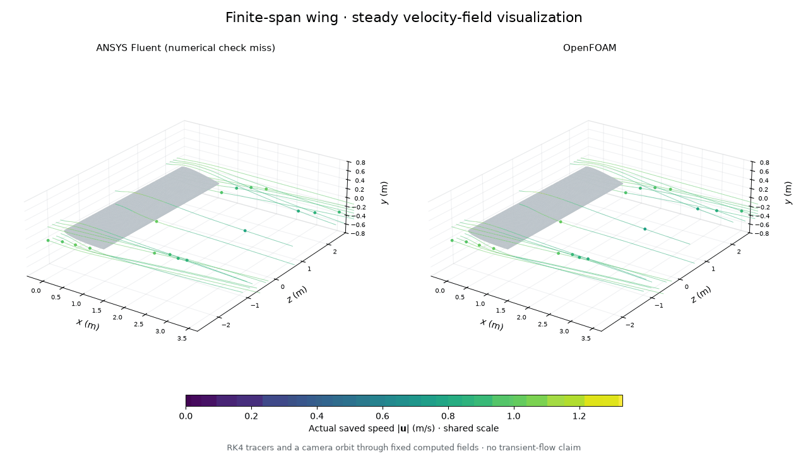
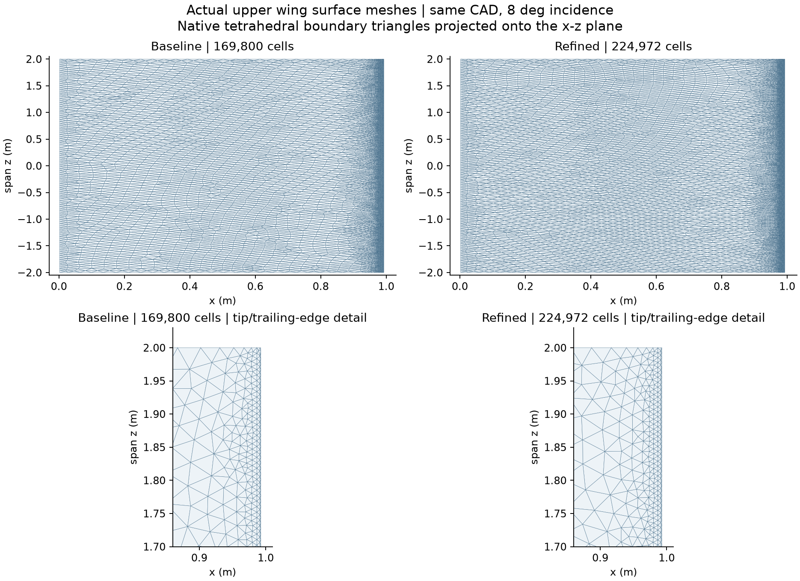
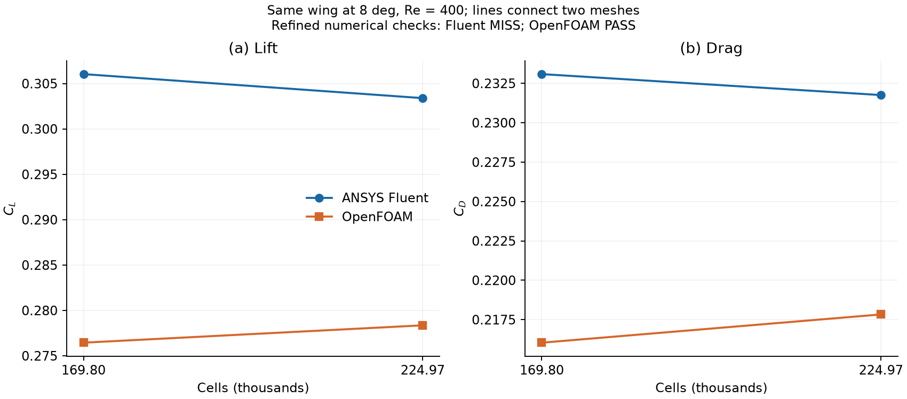
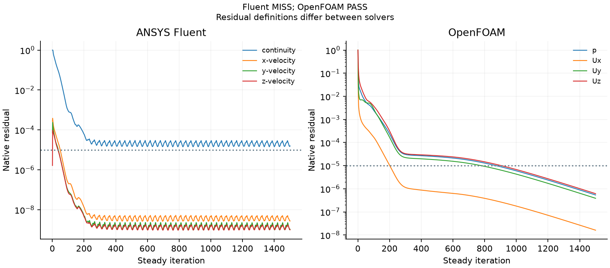
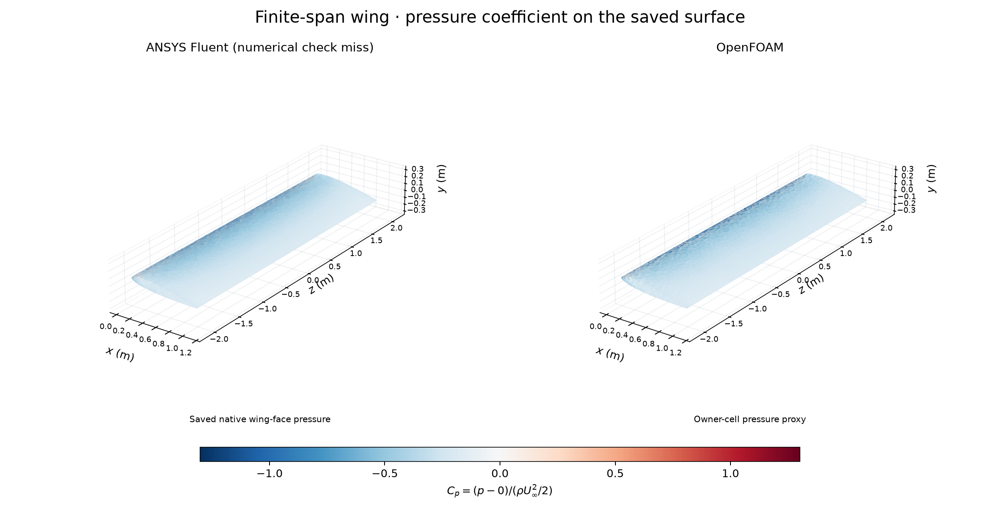
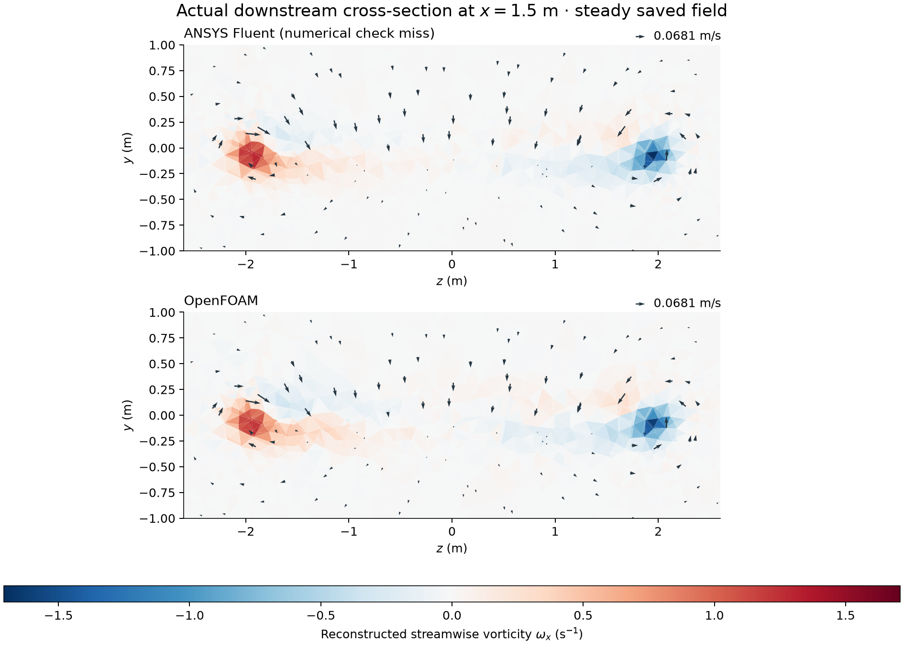

# 29. Does a finer mesh change the wing results?

The same 8-degree wing was computed on a finer common mesh in both solvers.
Refined numerical checks: **ANSYS Fluent MISS; OpenFOAM PASS**.
Every missed criterion remains recorded below. The animation follows tracers
through saved steady fields; it is not a simulated transient.

## Geometry, mesh and conditions

The [baseline wing](../27-wing-convergence/README.md) uses 169,800 tetrahedra.
Reducing all requested mesh lengths by a factor of 0.9 produced **224,972 cells**.
The CAD profile, 1 m chord, 4 m span, rounded trailing cap, 8-degree clockwise
pitch, pivot (0.25,0,0) and box x=-3..9, y=-4..4, z=-6..6 m are unchanged.
It remains a NACA 0012-like capped profile, not an exact NACA 0012.
The effective cell-count spacing ratio is only 1.0983.
These are independently generated unstructured meshes, not a nested refinement.

The first finer candidate contained one tetrahedron below the quality margin.
The existing bounded repair moved one interior node. Boundary coordinates and
connectivity stayed byte-identical to that finer candidate; the baseline and
failed candidate are both preserved. Fluent's native minimum orthogonal quality
is 0.107181; OpenFOAM reports Mesh OK,
maximum nonorthogonality 57.0300
degrees and skewness 0.703013.

Both codes use steady incompressible laminar flow, U=(1,0,0) m/s, density
1 kg/m3 and viscosity 0.0025 Pa s, hence Re=400. The wing is stationary no-slip.
Inlet and farfield prescribe U; the outlet prescribes zero gauge pressure.
Force reference area is 4 m2 and length 1 m. Drag and lift act along x and y.
The thermodynamic and aerodynamic assumptions do not model a full aircraft.

## Numerical method and results

Fluent uses coupled pressure/velocity, Courant 20, explicit pressure/momentum
relaxation 0.5, pseudo-time off, least-squares gradients, second-order pressure
and second-order upwind momentum. OpenFOAM uses consistent SIMPLE with one
nonorthogonal correction, U relaxation 0.7, least-squares gradients,
linear-upwind convection and corrected diffusion. Both start from uniform U
and zero pressure, run 1,500 fixed iterations and save every 300 iterations.
Each uses two processes; their flow solves run sequentially in the background.

| Solver | Cells | Drag coefficient | Lift coefficient |
|---|---:|---:|---:|
| ANSYS Fluent | 169,800 | 0.23308526 | 0.30604115 |
| ANSYS Fluent | 224,972 | 0.23175431 | 0.30339443 |
| OpenFOAM | 169,800 | 0.21603658 | 0.27644356 |
| OpenFOAM | 224,972 | 0.21782942 | 0.27835525 |

Relative to each solver's baseline, Fluent drag/lift change by
-0.5710%/-0.8648%; OpenFOAM
changes by 0.8299%/0.6915%.
The refined cross-code gaps, relative to OpenFOAM, are
6.3926% drag and 8.9954% lift.
These differences remain observations subject to the numerical checks, rather
than proof of accuracy or evidence that either code is the correct answer.

The original acceptance limits are unchanged: final residuals <=1e-5,
relative boundary mass imbalance <=1e-4, and final-100 coefficient range divided
by max(abs(mean),0.001) <=0.001. Fluent final continuity is
**1.575394542096e-05**; its check results are
`{"mesh": true, "settings": true, "uniform_initialization": true, "residuals": false, "mass": true, "force_stability": true}`. OpenFOAM checks are `{"mesh": true, "settings": true, "residuals": true, "mass": true, "force_stability": true}`.
Relative boundary mass imbalances are 1.234e-10 and
1.261e-10, respectively. Every physical
boundary face enters the mass check. Different residual definitions prevent
using residual magnitudes to rank the two codes' accuracy. Earlier passing
checkpoints are not substituted for the final state.

The CAD is unchanged, but a new surface triangulation changes its geometric
approximation slightly. Two modestly separated grids do not establish an
asymptotic trend, Grid Convergence Index, mesh independence or physical validation.
Domain, spatial discretization, iterative error and boundary-treatment effects
remain unresolved. The earlier zero-incidence Fluent miss also remains preserved.

## Actual field visualizations

[Figure methods](CAPTIONS.md) describe native tetrahedral matching, volume-weighted
velocity reconstruction, boundary-aware RK4 paths and shared colour scales.
Fluent pressure uses saved face values; the OpenFOAM panel labels its adjacent
owner-cell pressure proxy. The downstream curl is reconstructed from the saved
velocity field. Neither a dramatic roll-up nor a synthetic vortex is added.
The GIF has 48 distinct decoded frames; camera motion is a display effect.

[Native Fluent image](fluent-pressure-native.png) | [Numerical summary](wing-refinement-summary.json)
| [Force table CSV](mesh-forces.csv) | [Visual checks](visual-checks.json)
| [Actual pressure samples](actual-wing-pressure.csv.gz)

## Reproduction and provenance

Use [the project environment](../../docs/REPRODUCING.md). Add repository `scripts`
and this model folder to PYTHONPATH. Native meshes and case/data files stay on E:
outside Git; ANSYS remains on D:. Check licence, >=4 GiB available RAM, >=10 GiB
free E: space and absence of another solver before launching. Project caches
use E:/CFD-Learning-Lab/temp; Linux MPI IPC alone uses /dev/shm.

Run [wing_mesh_refined_v001.py](wing_mesh_refined_v001.py) into a fresh directory.
The original failed candidate is retained. The existing
[interior-node repair](../../scripts/wing_mesh_relocate_v003a.py) takes that
candidate as --source and a new --out directory. Its receipt must pass before
solving; it imports the existing wing_mesh_v002 helper. Check the repair witness,
profile preservation, native mesh quality and SHA-256 receipts.

[wing_fluent_refined_v001.py](wing_fluent_refined_v001.py) accepts --mesh and --out.
[prepare_openfoam_refined_v001.py](prepare_openfoam_refined_v001.py) accepts --mesh
and --case. In WSL CFD-Foundation14, use [run-openfoam.sh](run-openfoam.sh) first
with --prepare-only, then --run after Fluent closes and resources are rechecked.
Scripts intentionally bind versioned project paths; update all dependent paths
together in fresh copies for another reproduction.

[audit_wing_refined_v001.py](audit_wing_refined_v001.py) takes a fresh output folder,
imports model 27's native Fluent audit and the included 1,500-iteration OpenFOAM
reader, and compares with the unchanged baseline. Exit code 2 preserves any
numerical miss. [plot_refined_wing_v001.py](plot_refined_wing_v001.py) takes that
audit folder first, followed by the existing wing plotter arguments: --run,
--geometry, --openfoam-time 1500, --frames 48 and a fresh --out. It carries any
failed-check labels into the plotted panels. Source hashes are rechecked.

ANSYS Fluent and OpenFOAM computed the fields and forces. Owner reflection is unprovided; no independent owner implementation, research
novelty, aircraft validation or admissions claim is invented. Saved locally;
this addition has not been uploaded to GitHub.

## Refined-wing formulation investigation

The [completed investigation record](formulation-investigation-v001/README.md) preserves all five finite trial misses, actual retained-residual maps and the source-bound SIMPLEC/OpenFOAM comparison. Refined Fluent convergence remains **unresolved**; no confirmation or additional solver run is admitted. The separate zero-incidence miss remains open.
