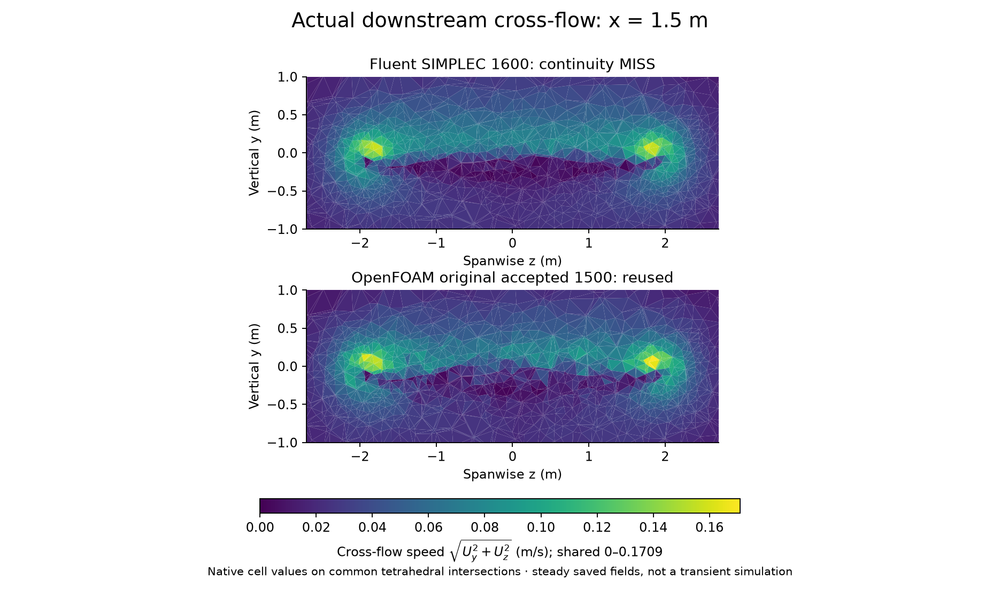
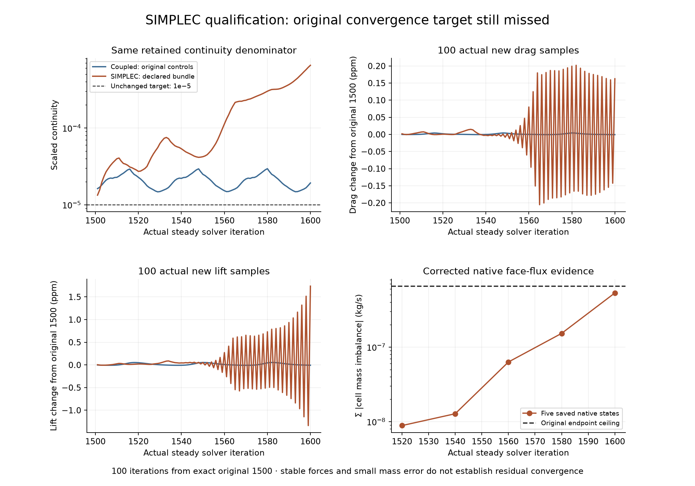
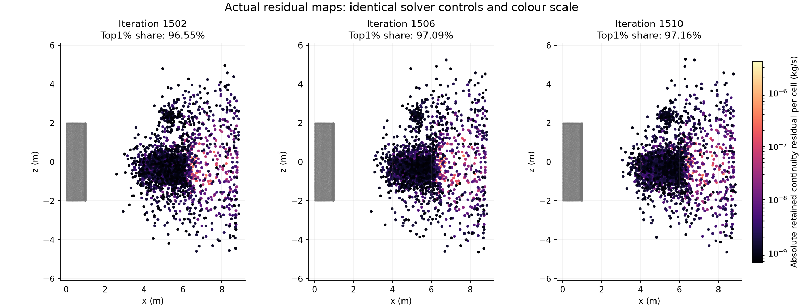
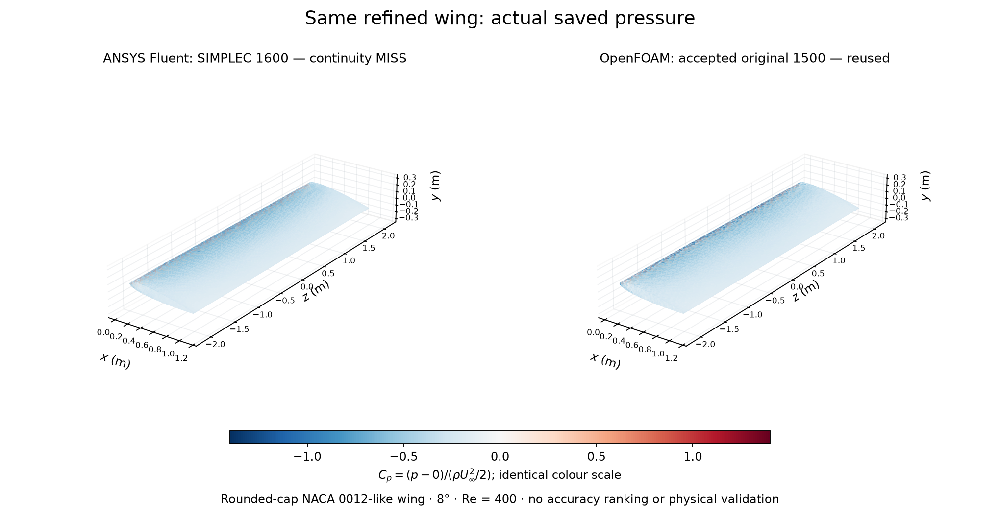

# Why stable forces are not enough: a wing convergence investigation

**Investigation finished; ANSYS convergence repair remains unresolved.** This adds evidence to existing study29, not a new model. The accepted refined OpenFOAM1500 result is reused. The original Fluent endpoint and all five finite100-iteration diagnostic trials miss the unchanged continuity requirement. No passing endpoint is selected and no confirmation is admitted.

The coloured cross-section shows actual native cell velocities at x=1.5m on the same tetrahedral mesh and colour scale. It is a saved steady field, not transient vortex evolution or a new OpenFOAM run. The physical question was whether the apparent residual floor was simply an insufficient inner solve, or involved the pressure/velocity solution architecture. The tests distinguish these possibilities without proving a unique root cause.

## What happened

| Case | Actual endpoint iteration | Scaled continuity | Original numerical result |
|---|---:|---:|---|
| Original Coupled 1500 | 1500 | 1.5753945e-05 | MISS |
| Coupled original controls | 1600 | 1.9194931e-05 | MISS |
| Coupled tighter AMG | 1600 | 1.9190142e-05 | MISS |
| Coupled Courant10 | 1600 | 1.3852283e-05 | MISS |
| Coupled relaxation0.25 | 1600 | 1.9601275e-05 | MISS |
| SIMPLEC declared bundle | 1600 | 6.5445253e-04 | MISS |

All five new100-iteration trials restart the **same original1500** fields in fresh directories. The original continuity scale2.2344914086503613 is retained; the target is1e-5. The table does not rank physical accuracy. Momentum residual scaling can change with the algorithm's active operator.

The SIMPLEC bundle completes1501..1600, but continuity grows to6.5445253e-4 and the required final20 rows also fail. Relative boundary mass error2.0849e-10, summed absolute corrected cell mass5.2971e-7kg/s and stable forces pass their separate criteria. Drag/lift100-sample relative ranges are4.0730e-7/3.0757e-6. Good mass closure and very small force changes cannot override the failed residual test. This is why a plausible image or steady force trace is insufficient for numerical acceptance.

## What the formulation investigation found

For400actual Coupled linear blocks and20saved checkpoints, printed initial continuity matches the raw HDF numerator, while terminal linear continuity matches corrected native face-flux cell imbalance. Tightening AMG reduces the inner error, but the assembled imbalance returns on the next steady iteration. This is a measured stage distinction for these logs, not a universal Fluent residual definition.

The diagnostic capture follows **1+1+8=10 actual steady iterations1501..1510**. The first1501probe did not export a usable cell map; that incomplete attempt is preserved. The corrected1502capture and eight-step continuation provide nine actual maps1502..1510. Across these, the largest1%of cells contains96.55–97.16%of absolute assembled continuity residual, downstream of the wing; wing-adjacent cells contribute0.000802–0.001357%. This finite persistence is not proof of mesh causation, a solver defect, physical unsteadiness or a full oscillation.

Two SIMPLEC capability sessions advanced **zero iterations**. The first rejected newly active native metadata; the corrected native-schema audit verified original fields/history exactly and inventoried all37changed leaves. The admitted numerical bundle uses SIMPLEC, one skewness correction, implicit pressure/momentum0.7, pressureAMG termination0.001 and native scalar defaults, with pseudo-time off and enhanced skewness correction disabled. It changes an algorithm bundle, not one isolated parameter. All physical, spatial, boundary and reference conditions remain fixed.

Live SIMPLEC captures at five checkpoints match native cells and U/p, but retained pressure-residual sums match neither HDF continuity numerator nor corrected cell flux sum within the declared association tolerance. Their stage remains **unidentified**. The Coupled stage interpretation is not transferred to SIMPLEC. No further algorithm or mesh experiment is admitted by this record.

## Conditions and limits

The224,972common tetrahedra describe a rounded-cap NACA0012-like wing, **not exact NACA0012**: chord1m,span4m,area4m²,AR4,8°clockwise pitch. U=(1,0,0)m/s,rho1kg/m³,mu0.0025Pa·s,Re400. The box is x−3…9,y−4…4,z−6…6m; steady incompressible laminar flow,no-slip wing,prescribed upstream/lateral velocity and downstream0gaugepressure. Force coefficients use2N normalization,dragx/lifty. Least-squares gradients, second-order pressure and second-order-upwind momentum are preserved.

Fluent uses **saved native wing-face pressure**. OpenFOAM uses an **owner-cell pressure proxy**, rather than an independently saved wall-face value; exact wall pressure is not claimed for that panel. The shared colour scale does not remove this sampling difference.

The accepted169,800-cell study27 remains unchanged. The separate zero-incidence Fluent miss in study28 is still open. The original refined cross-code force gaps,6.3926%drag and8.9954%lift relative to OpenFOAM, remain observations; convergence work does not explain them or validate either code. Mesh/time/domain independence, induced-drag decomposition, exact continuum pressure, aircraft validation and physical unsteadiness are not established. Native field/mass evidence in the100-step SIMPLEC trial is from five saved checkpoints, not100saved fields.

[Methods](METHODS.md) · [Reproduction and archive scope](REPRODUCING.md) · [Actual data](data/) · [Native audits and bindings](checks/) · [Executed code archive](code/) · [Preserved historical protocols](methods/history/)

ANSYS computed the new fields and OpenFOAM supplied its preserved accepted result. No novelty, admissions outcome or university submission is claimed. Native cases, environments, credentials and licence/private application files remain outside Git.

[Final technical review and closeout](REVIEW-CLOSEOUT.md): one Important pressure-source disclosure fixed,57tests pass; no remaining Critical/Important findings. This is an investigation/evidence review, not numerical convergence acceptance or physical validation.
