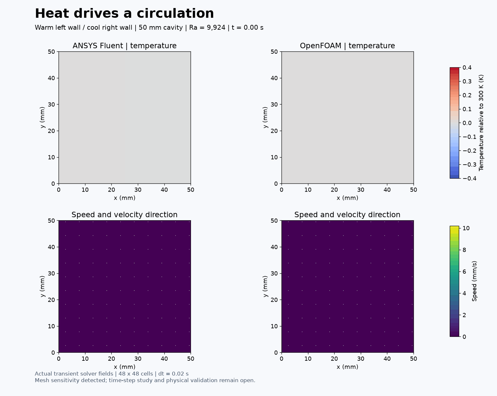
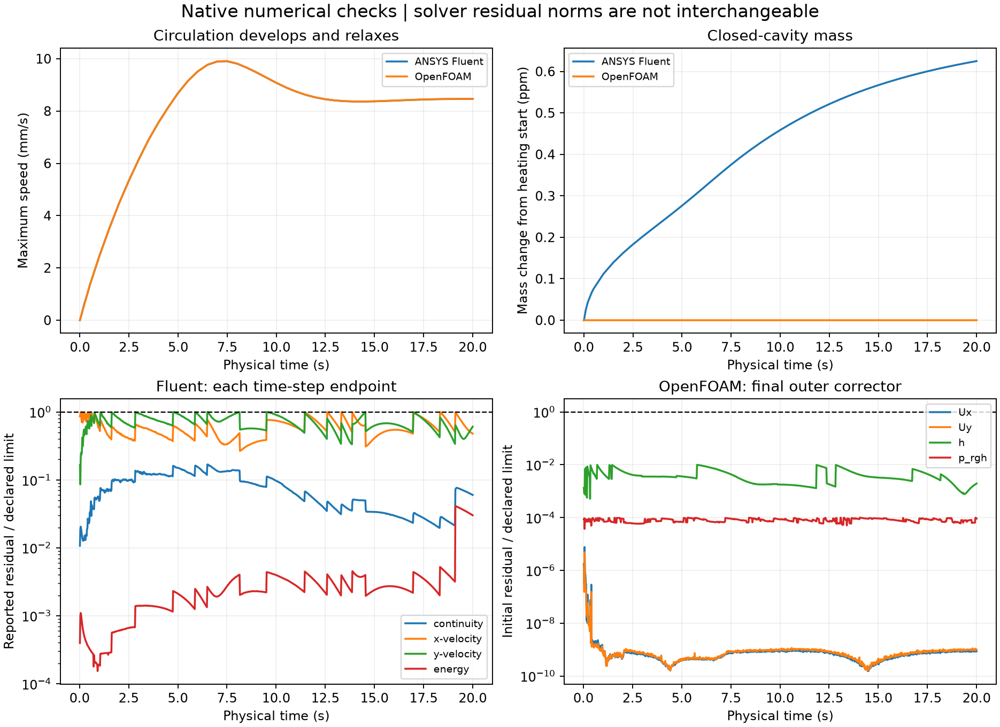
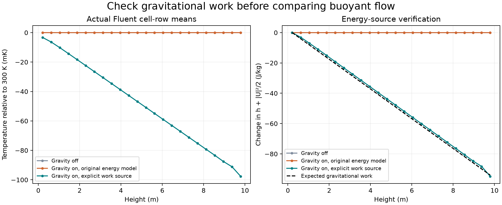

# 30. Heat drives a circulation

A warm left wall and a cool right wall drive a clockwise circulation in a sealed cavity. The fluid starts nearly at rest, speeds up and then relaxes. Both ANSYS Fluent and OpenFOAM computed **20 physical seconds**, using 2,304 cells and 1,000 time steps each. Both pass their stated numerical checks. This is an educational simulation, not physical validation.

## Conditions

The square is 50 mm high and wide. Initially, all walls and fluid are at 300 K. After the quiet-control calculation, the left wall is held at 300.4 K, the right at 299.6 K, and the top/bottom are adiabatic. All walls are stationary and no slip. Gravity acts downward at 9.81 m/s². Fluent uses a planar 2D mesh; OpenFOAM extrudes the same quads through 5 mm with empty front/back patches. Mass and heat reports are compared per unit depth.

Both use laminar, pressure-based ideal-gas flow with constant cp = 1005 J/(kg K), viscosity 1.8e-5 Pa s and conductivity 0.02547887324 W/(m K). Pr = 0.71 and nominal Ra = 9,923.83. This is not a strict Boussinesq model. The solvers' universal gas constants differ slightly; the molecular weights were selected to give the same specific gas constant, R = 287.0028467801174 J/(kg K).

Both use first-order implicit time advancement with dt = 0.02 s and second-order spatial convection. Fluent uses PISO with at most 200 inner iterations; OpenFOAM uses 16 PIMPLE outer correctors and two pressure correctors. Each solver ran on two processes, sequentially and in the background. ANSYS Student 2026 R1 remains installed on D:; project inputs, results and caches are on E:.

## Numerical evidence

| Check | ANSYS Fluent | OpenFOAM |
| --- | --- | --- |
| Physical steps meeting stated criteria | 1,000 / 1,000 | 1,000 / 1,000 |
| Saved states checked | 45 | 41 |
| Maximum relative closed-mass drift during heating | 6.25e-7 | 1.48e-12 |
| Temperature bounds and ideal-gas consistency | Pass | Pass |
| Mesh check | Minimum orthogonal quality 1.0 | Mesh OK |
| Hot-wall Nusselt number at 20 s | 2.24475 | 2.24375 |

Fluent's scaled limits are 1e-6 for continuity/momentum and 1e-9 for energy. OpenFOAM's final-outer initial-residual limits are 1e-6 for velocity/pressure and 1e-8 for enthalpy. These are different native residual definitions and are not used to rank solver accuracy. The maximum OpenFOAM Courant number was 0.215.

At 20 s, the maximum temperature difference between codes is 0.000264 K and the velocity-field L2 difference relative to Fluent is 0.234%. Native hot-wall heat transfer per depth is 0.045755 W/m in Fluent and 0.045735 W/m in OpenFOAM. For this square, Nu = Q_hot/(depth * k * temperature_difference). The small instantaneous net wall heat flux is recorded, but it is not treated as proof of steady state or a full transient energy balance.

The last half-second changes the velocity field by about 0.019% in Fluent and 0.022% in OpenFOAM. This shows late-time relaxation, not an experimentally validated steady solution.

## Mesh sensitivity and limitations

A same-time comparison at 1 s uses the corrected 24 x 24 and 48 x 48 cases. Each 2 x 2 group of fine cells is area-averaged into the matching coarse cell before comparison. Velocity L2 differences are **7.53% in Fluent and 7.55% in OpenFOAM**. Temperature-departure L2 differences are about 0.96% in both. The coarse OpenFOAM reference was repeated with 16 outer iterations so the comparison does not mix the earlier coupling miss with mesh refinement.

The startup is mesh-sensitive. Two meshes do not establish mesh independence. Time-step sensitivity, a third mesh and a matched-condition benchmark remain open. Agreement between solvers and small residuals do not establish physical accuracy. No Concorde or ornithopter validation follows from these results.

## Why an energy correction was needed

The [earlier startup pilot](../../results/natural-convection-qualification-v001/README.md) left gravitational work unresolved. The installed OpenFOAM fluid energy equation explicitly includes rho U dot g. A separate adiabatic vertical-flow diagnostic showed that the chosen Fluent pressure-based ideal-gas configuration held h + |U|²/2 approximately constant as gas rose. Adding the explicit source **-9.81 [m s^-2] * Density * Velocity.y** recovered the expected gravitational energy gradient.

The fitted corrected gradient is -9.8133 J/(kg m), versus -9.81 expected: a 0.034% slope difference. This diagnostic establishes the source's presence and sign for the tested configuration; it is not a mesh-converged validation of the entire vertical temperature profile. Pressure work and kinetic energy are enabled; viscous work is omitted in both energy formulations. The [Fluent heat-transfer theory](https://ansyshelp.ansys.com/public/views/secured/corp/v252/en/flu_th/flu_th_sec_hxfer_theory.html) describes those energy switches. Exact installed OpenFOAM source hashes and the native diagnostic hashes accompany this record.

Earlier files are preserved. Fluent's first fine-grid run completed all 1,000 steps but its native-image export failed; the image was recovered by reading the saved final case without advancing the solution. OpenFOAM's initial six-outer-iteration run missed its startup targets on six steps. The accepted sixteen-outer-iteration repeat passes all steps without loosening thresholds.

## Visuals and reproduction

The animation contains 41 actual saved states, at 0.5 s simulation intervals from 0 to 20 s. Each frame is displayed for 250 ms, giving 2x playback. No intermediate fields were invented. Streamlines are instantaneous curves, not particle trajectories. Both panels use fixed common temperature/speed limits, common vector scaling, labelled axes and units. Native cell vertices are mapped bijectively to the shared grid.

The executed drivers, readers and plotters are in code/. Add repository/scripts, code/production and code/qualification to PYTHONPATH after loading the project's local/Use-Project.ps1. The scripts retain their execution paths and refuse existing output directories; select fresh version directories before rerunning. The recorded dictionaries in openfoam-inputs/ are the accepted sixteen-outer-iteration settings. The initial six-outer preparation script is retained as provenance; applying the recorded correction changes only the outer-corrector count. Mesh generation and quiet controls precede heating.

Native locations under E:/CFD-Learning-Lab:

- native/meshes/natural-convection-cavity-48-v001: shared geometry and Fluent mesh.
- native/runs/natural-convection-cavity-48-v001/fluent: accepted 20 s Fluent data and time-step checks.
- native/runs/natural-convection-cavity-48-v001/openfoam-v002: accepted 20 s OpenFOAM data and native heat flux.
- native/runs/natural-convection-qualification-fluent-v005 and natural-convection-qualification-openfoam-v003/heated: corrected coarse references at 1 s.
- native/runs/vertical-energy-control-fluent-v002, v003 and v005: zero-gravity, original gravity-on and corrected energy diagnostic fields.
- exports/figures/2026-11-07-natural-convection-20s-paired-v001: full visual exports and audits.

Large native fields, installed dependencies, licence files and credentials stay outside the repository. The failed attempts are retained locally, not relabelled as successful calculations. The next bounded study is a time-step comparison at the same physical conditions.

## Contributions

The user requested interesting paired models, visual results and autonomous continuation. Codex selected and implemented the case, corrected the energy setup, ran the numerical checks and made the visualizations. ANSYS Fluent and OpenFOAM computed their own fields. No independent user execution or reflection is invented. This is a locally prepared learning record; this turn does not claim a GitHub upload.

## Cavity spatial comparison — 8 November 2026

The [paired 48/96-cell-per-side comparison](../31-convection-time-step/spatial-v001/README.md) retains dt = 0.01 s through 20 s, accepted numerical histories, actual native-field media and disclosed initialisation/energy limits. At 20 s the restricted velocity response is 0.63445% in Fluent and 0.60716% in OpenFOAM. This improves studies 30/31 without adding a model or claiming independence, physical validation or a new upload.
