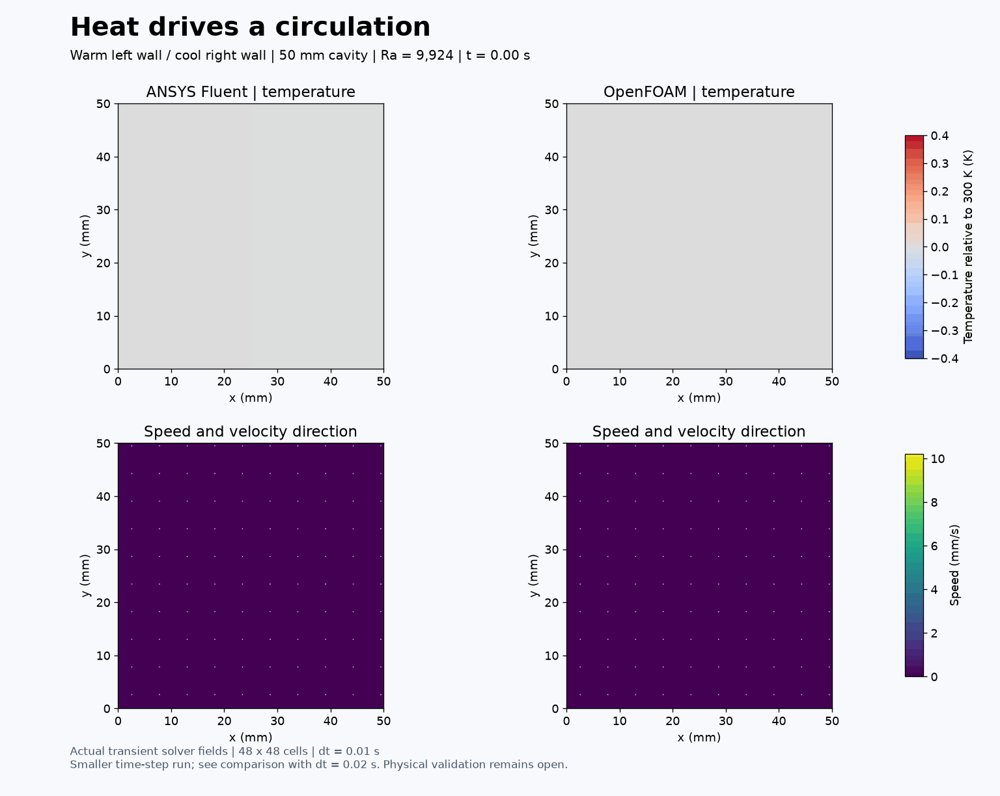
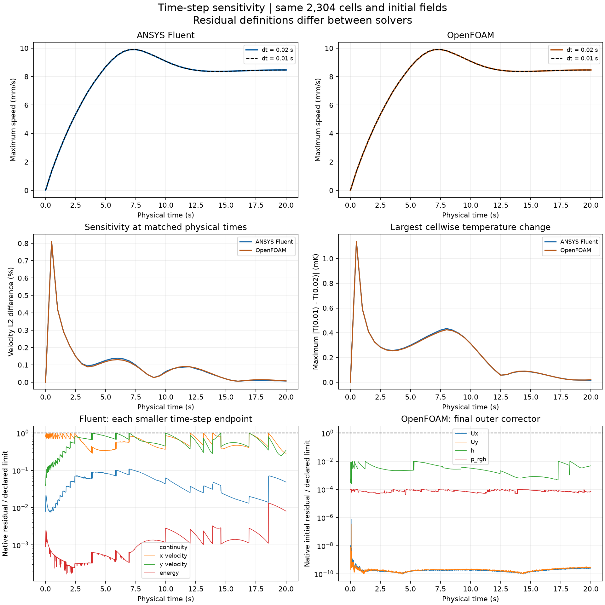

# 31. Does the animation change with a smaller time step?

This repeats [model 30](../30-natural-convection/README.md) from each solver's same saved initial fields and 2,304-cell mesh. The time step is halved from 0.02 to 0.01 s. Both ANSYS Fluent and OpenFOAM reach **20 physical seconds in 2,000 steps**, and every step passes its declared numerical criteria.

This is a time-step sensitivity study of the existing model, not a new geometry or physical validation.

## What changes?

| Quantity | ANSYS Fluent | OpenFOAM |
| --- | --- | --- |
| Velocity L2 change at 20 s | 0.00710% | 0.00756% |
| Maximum sampled velocity L2 change | 0.8119% at 0.5 s | 0.8118% at 0.5 s |
| Largest cell temperature difference at 20 s | 1.67591e-05 K | 1.95112e-05 K |
| Hot-wall Nu at 20 s, smaller step | 2.244784 | 2.243809 |
| Relative hot-wall Nu change | 0.00148% | 0.00249% |
| Maximum relative closed-mass drift | 6.08e-07 | 5.29e-13 |

Comparisons use all native cells at the same physical times. Velocity differences are divided by the L2 norm of the smaller-step velocity. The sampled maximum is over saved half-second states, not every internal time step. Two time steps quantify sensitivity; they do not establish asymptotic convergence or time-step independence. The earlier approximately 7.5% startup mesh sensitivity is still unresolved.

## Conditions and checks

The 50 mm square holds ideal-gas air initially at 300 K. Its left wall is 300.4 K and right wall 299.6 K; top and bottom are adiabatic. All walls are stationary and no slip. Gravity is downward. Nominal Ra = 9,923.83 and Pr = 0.71. The exact material properties, specific gas constant and explicit Fluent gravitational-work source are unchanged from model 30. This is a full variable-density ideal-gas model, not strict Boussinesq flow.

Both use first-order implicit time advancement and second-order spatial convection. Fluent retains PISO and at most 200 inner iterations. OpenFOAM retains 16 PIMPLE outer correctors and two pressure correctors. Only the time step and output step interval change; physical snapshots remain 0.5 s apart. Runs are sequential, with two processes each, in the background.

Fluent's limits remain 1e-6 for scaled continuity/momentum and 1e-9 for energy. OpenFOAM's final-outer initial-residual limits remain 1e-6 for velocity/pressure and 1e-8 for enthalpy. Their residual norms differ. Native Fluent minimum orthogonal quality is 1.0; OpenFOAM passes checkMesh. Temperature bounds, finite fields, ideal-gas consistency and closed-mass checks pass. Maximum OpenFOAM Courant number is 0.107447. Wall heat flux is reported at 20 s; a full transient global energy audit is not claimed.

## Preserved restart diagnostic

The first Fluent restart stopped at t = 0 because a strict settings equality check detected conductivity changing from 0.025478873239436622 to 0.02547887323943662 during case serialization. No flow was advanced. The accepted v002 restart checks settings recursively with relative numeric tolerance 1e-14; this last-digit conductivity rounding is its only difference. Initial fields and original input hashes are verified. The physical numerical acceptance limits were not relaxed. The stopped folder and original driver remain preserved.

## Visual provenance

The GIF contains 41 actual saved temperature/velocity fields at 0:0.5:20 s, played at two times physical speed. Colour scales are fixed across solvers and frames. Streamlines are instantaneous velocity curves, not particle trajectories. The [Fluent native image](fluent-native-temperature.png) was re-exported from the saved final solution with a readable decimal legend. That display-only session performed no iterations; source case/data hashes are unchanged. PDF and PNG plots, CSV histories, per-step residual checks and native-source hashes accompany the animation.

## Reproduce and contributions

Executed scripts are in [code](code/run_fluent_v002.py); actual small OpenFOAM dictionaries are in openfoam-inputs. The scripts retain original local paths. On this workstation, dot-source E:/CFD-Learning-Lab/local/Use-Project.ps1, use the existing Fluent Python environment, and include repo/scripts, local/natural-convection-production-v001 and local/natural-convection-cavity-v001 on PYTHONPATH. Use fresh versioned output paths: the scripts deliberately reject reuse. The Fluent baseline is native/runs/natural-convection-cavity-48-v001/fluent/heated-start.cas.h5 plus its data file. OpenFOAM starts from that model's accepted openfoam-v002/0, constant and system, changing only deltaT and writeInterval in controlDict. Large native solver files remain on E: outside GitHub content.

Accepted native output: E:/CFD-Learning-Lab/native/runs/natural-convection-dt001-v001/fluent-v002 and openfoam. Audit and rendering helpers launch no solver. Initial input-copy hashes, saved-field hashes and final numerical evidence are included here.

ANSYS Fluent and OpenFOAM computed their respective numerical fields. This study does not validate Concorde or ornithopter aerodynamics.

## Cavity spatial comparison

The [paired 48/96-cell-per-side comparison](spatial-v001/README.md) retains dt = 0.01 s through 20 s, accepted numerical histories, actual native-field media and disclosed initialisation/energy limits. At 20 s the restricted velocity response is 0.63445% in Fluent and 0.60716% in OpenFOAM. This improves studies 30/31 without adding a model or claiming independence, physical validation or a new upload.
