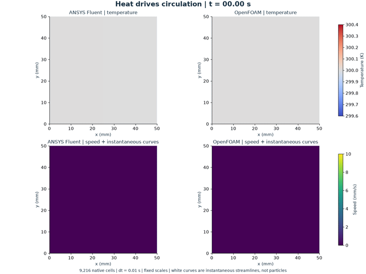
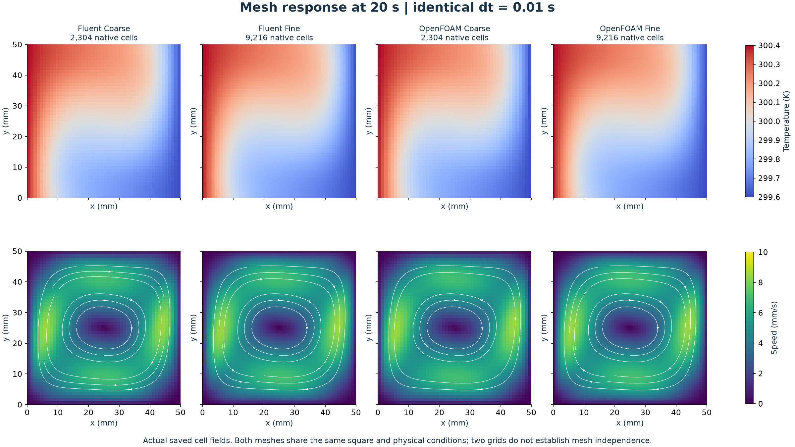
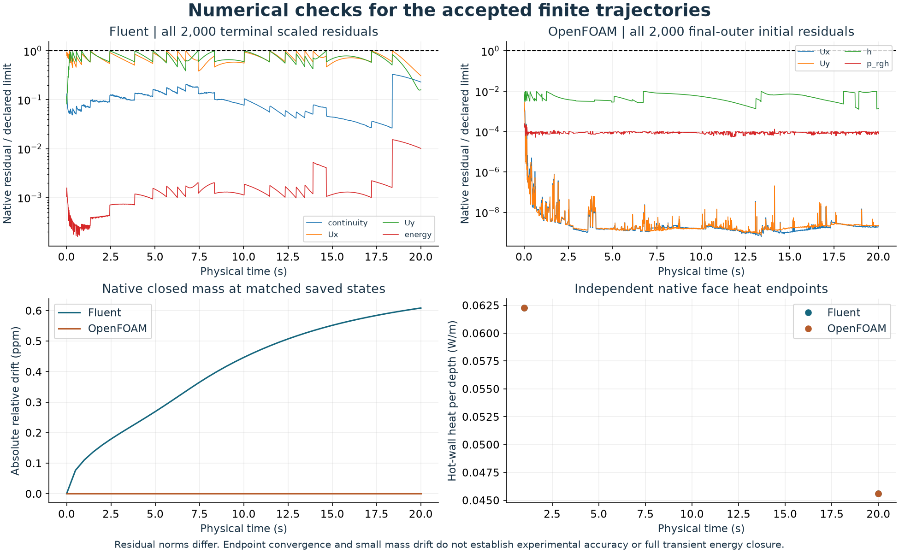
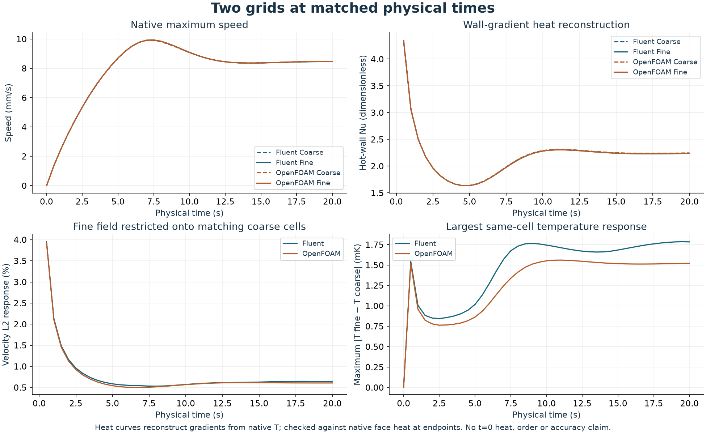

# How much does the cavity change on a finer mesh?

This improves existing studies **30/31**, comparing 48 × 48 and 96 × 96 cells at the same **0.01 s time step**, through **20 physical seconds**. Both ANSYS Fluent and OpenFOAM completed 2,000 accepted heating steps. It adds no numbered model.

Warm air rises along the left wall, crosses the top and descends beside the cold right wall. The changing temperature field drives a clockwise circulation. White curves show instantaneous streamlines, not tracked particles. [Full-resolution MP4](media/cavity-refined-development.mp4).

| At 20 s: coarse versus area-restricted fine field | ANSYS Fluent | OpenFOAM |
|---|---:|---:|
| Velocity L2 mesh response | 0.63445% | 0.60716% |
| Temperature-departure L2 response | 0.27810% | 0.22573% |
| Largest same-cell temperature difference | 1.78308 mK | 1.52037 mK |

The denominator is the coarse velocity norm or coarse (T − 300 K) norm. Each 2 × 2 fine-cell group is conservatively averaged onto its matching coarse cell. At the initial time only absolute comparisons are reported. These are measured two-grid responses, not proof of mesh independence, observed order or physical accuracy.

## Conditions and numerical evidence

The cavity is 50 mm square. Initially near-isothermal ideal-gas air at 300 K is in gravity equilibrium; heating sets the left wall to 300.4 K and the right to 299.6 K. Horizontal walls are adiabatic and every wall is stationary/no slip. Gravity is 9.81 m/s² downward. Properties are cp = 1005 J/(kg K), μ = 1.8e-5 Pa s, R = 287.0028467801174 J/(kg K), Pr = 0.71, k = 0.025478873239436622 W/(m K); nominal Ra = 9,923.83. This is the full variable-density ideal-gas formulation, not Boussinesq.

Fluent uses planar unit depth, PISO, first-order implicit time, second-order spatial convection and body-force-weighted pressure, with at most 200 inner iterations. OpenFOAM uses one 0.005 m extrusion centred on z = 0 with empty planes, Euler time, the original spatial schemes, 16 PIMPLE outer correctors and two pressure correctors. The time step is fixed at 0.01 s in both grids/codes. Old source nodes are preserved exactly and fine 2 × 2 areas partition each coarse cell exactly. Native quality and geometry/field mapping checks pass.

All 2,000 actual steps pass each code's original criteria: Fluent terminal scaled continuity/momentum ≤ 1e-6 and energy ≤ 1e-9; OpenFOAM final-outer initial velocity/pressure residuals ≤ 1e-6 and enthalpy ≤ 1e-8. Norms differ across codes. All saved states pass finite/positive fields, temperature bounds, ideal-gas consistency, closed mass and wall impermeability checks. Full OpenFOAM maximum native Courant number is 0.215003, below the predeclared 0.5 guard. [Complete merged step records and native audits](checks/).

## Heat transfer and energy scope

Heat/Nusselt histories reconstruct the wall-normal gradient from actual saved cell temperatures, square face geometry and constant conductivity. They are **not** a claim that native wallHeatFlux was saved at every time. The reconstruction agrees with independently audited native face heat at 20 s for all four cases and at 1 s for both fine cases; the maximum relative difference is 6.655e-8. The separate reconstruction consistency limit is 1e-6 relative plus 1e-10 W/m. Native face integration versus solver-report acceptance remains the original 1e-7 scaled tolerance plus 1e-10 W/m. No heat value is reconstructed at the discontinuous heating start.

Nu = Qhot / [k (Thot − Tcold)] for this square and unit depth; Q is positive into the fluid and reported in W/m. Native endpoint markers are shown without inventing a native time history. [Every field/derived-heat sample](data/field-and-heat-history.csv) and [every restricted response](data/mesh-response.csv) are included.

Fluent retains pressure/kinetic work and explicit gravitational work −9.81 [m s⁻²] × Density × Velocity.y; OpenFOAM retains its installed full-energy gravitational-work term. [Official OpenFOAM 14 energy implementation](https://github.com/OpenFOAM/OpenFOAM-14/blob/master/applications/modules/fluid/thermophysicalPredictor.C) and installed source hashes are recorded. Energy residuals, EOS, source settings and instantaneous face heat are checked. A full transient global energy/storage balance is **not** established.

## Initialisation, exact restarts and preserved attempts

Fine gravity controls were tightened before the long comparison: Fluent continued saved steady controls to 1,800 iterations, OpenFOAM to 1,200. These are **steady initialisation iterations, not heating seconds**. Fine/coarse initial fields are separately computed and their absolute differences are retained. A saved 600-versus-1,800-iteration Fluent comparison changes the 1 s velocity L2 result by 0.381728%; initialisation sensitivity is a disclosed confound, not erased evidence.

The accepted 100-step/1 s qualifications were reused exactly. Fresh native directories then continued each code's own saved 1 s checkpoint for 1,900 additional steps. Restart U/T/p/rho differences are zero. Merging excludes duplicate initial rows, giving 2,000 steps and 41 matched times 0:0.5:20 s; extra startup states remain external. Fluent's continuation directory contains 40 saved states (including 1.01 s); OpenFOAM's contains 39. These are saved-checkpoint continuations, not independent full reruns.

All earlier versions are preserved locally: the passing original-quiet Fluent pilot, tightened quiet misses, setup failure before heating, wrong extrusion-centre assumption before MPI, partially prepared OpenFOAM version, cellProc header-only decomposition mutation, and full-restart reference-zone selector mismatch before a new step. Corrections were checked against native data, not made by weakening residual/mass/thermal criteria. See the diagnostic records in [checks](checks/) and the versioned admission/addendum documents in [methods](methods/).

The first full render required a NumPy-scalar JSON metadata repair; no native calculation changed. Actual inspection then found streamline arrowheads piling up near the stagnant centre. Preferred figures apply a documented display-only mask below 0.5 mm/s (5% of the shared 10 mm/s colour limit) and filter quiet seeds; native fields and colour values are unchanged. Earlier visual versions remain external. The movie uses 41 actual saved states, fixed temperature/speed scales and 250 ms per frame; duration 10.25 s includes the final displayed frame. There is no synthesised intermediate fluid motion. Every MP4/GIF frame was decoded and compared with its PNG source.

## Reproduction, limits and contributions

Read [the specification](methods/SPEC.md), [plan](methods/PLAN.md), [full-interval admission](methods/FULL-INTERVAL-ADMISSION-v001.md), [postprocessing scope](methods/POSTPROCESSING-v001.md), [final display addendum](methods/DISPLAY-ADDENDUM-v003.md), [executed sources and retained versions](code/), and [numerical summary](data/summary.json). The 27 selected helper tests pass. This packet archives methods, sources, numerical records and figures; native meshes/checkpoints, installed dependencies and full logs stay outside Git. Source records use the documented E: layout; reproduction requires new versioned output paths/manifests and existing E: tools plus D: Fluent 261. Never rerun archived controllers over completed directories. [Environment and reproduction guide](../../../docs/REPRODUCING.md).

The earlier 24/48 startup and 0.02/0.01 s time-step studies remain historical evidence at their stated conditions. They do not form a matching three-grid order study with this new comparison. Two grids do not establish global mesh/time/domain independence, a unique discrepancy cause, experimental validation or complete steady flow. The local streamline mask changes presentation only. Initial fields differ across grids; near-start relative metrics are sensitive to small denominators. Thermal/velocity agreement does not establish aircraft validation.

The owner requested paired CFD comparisons and visuals and authorised improvement of existing work. Codex selected, scripted, ran, checked and documented this bounded study. ANSYS Fluent and OpenFOAM computed the native fields. Owner execution or reflection is not claimed; a personal reflection remains available for the owner to add. No research novelty, admissions outcome, university submission or new GitHub upload is claimed.
