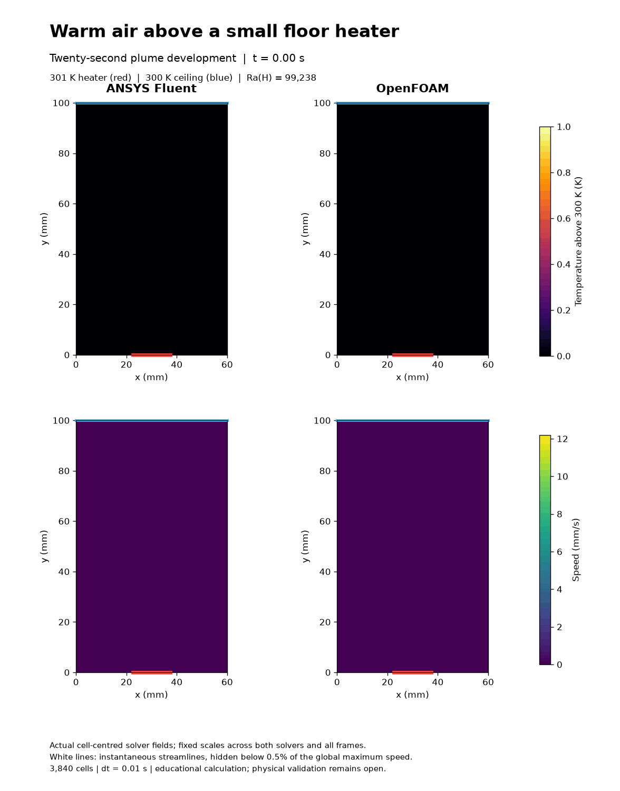
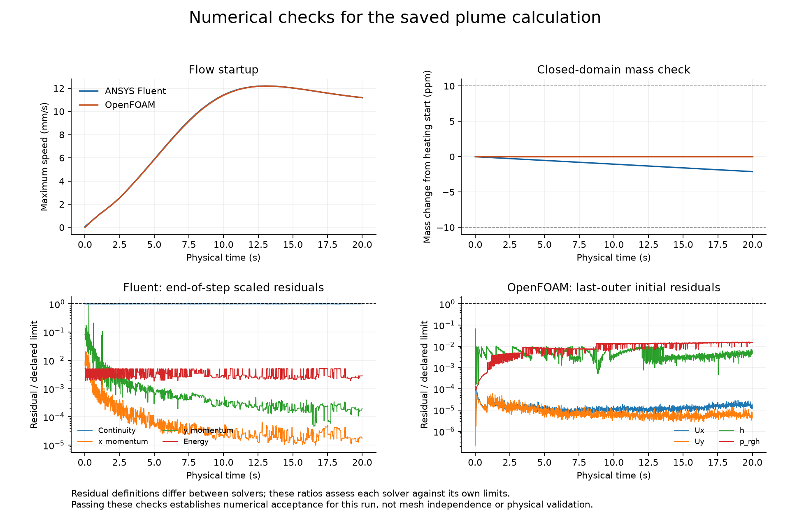

# 32. Heat above a localized floor heater

[Download the MP4](plume-development.mp4). The video contains the same 41 saved states, with every decoded frame checked against its source PNG; it adds no interpolated motion.

Both ANSYS Fluent and OpenFOAM computed **20 physical seconds**, with all **2,000 steps** passing their stated numerical checks. The reviewed start, midpoint and final frames show the warm plume rising from the floor patch and two approximately symmetric circulation cells in both solvers. Fixed scales, physical times, millimetre axes and legends are readable. The numerical histories show the startup speed peak and the subsequent gradual decline. The native Fluent image preserves its wrapped field label, while the paired plots provide fully readable labels.

This model changes the heat source and geometry from the side-heated square cavity. It is a finite-time educational calculation; the final frame is not assumed to be steady or fully developed.

## Geometry and physics

The closed cavity is 60 mm wide and 100 mm tall. A centered 15 mm floor patch, x = 22.5 to 37.5 mm, is held at 301 K. The ceiling stays at 300 K; the sides and remaining floor are adiabatic. All walls are stationary and no slip. Heating starts from each solver's saved near-isothermal gravity control at 300 K. The shared mesh contains 3,840 square cells (48 x 80), with 12 faces across the heater.

The laminar ideal-gas air uses R = 287.0028467801174 J/(kg K), cp = 1005 J/(kg K), viscosity 1.8e-5 Pa s, conductivity 0.0254788732394 W/(m K), Pr = 0.71 and downward gravity 9.81 m/s². Nominal Ra based on the 100 mm height and 1 K imposed temperature difference is 99,238. This is not a strict Boussinesq or smoke model. Fluent is planar with unit depth; OpenFOAM has one 5 mm extruded layer with empty front/back patches. Integral quantities below are normalized per depth.

Both solvers use first-order implicit time integration, dt = 0.01 s, and second-order spatial convection. The explicit Fluent gravitational-work energy source and native OpenFOAM term follow [model 30](../30-natural-convection/README.md). PISO pressure/momentum relaxation is 1.0, with at most 1,600 inner iterations. Fluent limits are 1e-8 for scaled continuity, 1e-6 for momentum and 1e-9 for energy. OpenFOAM uses 16 outer and two pressure correctors; last-outer initial-residual limits are 1e-6 for velocity/pressure and 1e-8 for enthalpy. These residual definitions differ. Runs used two processes each, sequentially in the background.

## Numerical evidence

| Quantity | ANSYS Fluent | OpenFOAM |
| --- | --- | --- |
| Accepted time steps | 2,000 | 2,000 |
| Maximum saved relative mass drift from heating start | 2.1083e-06 | 7.2298e-13 |
| Heater heat input at 20 s (W/m depth) | 0.04262828 | 0.04257173 |
| Mean heater heat flux at 20 s (W/m²) | 2.841885 | 2.838115 |
| Nu based on 15 mm heater width | 1.673083 | 1.670864 |
| Sum of absolute wall mass flux at 20 s (kg/(m s)) | 0 | 8.9011e-22 |

Nu = mean heater heat flux x heater width / (conductivity x imposed 1 K difference). Its length scale differs from the cavity-height Rayleigh number. Native heat fluxes are integrated over actual face geometry and independently compared with solver reports. Instantaneous net wall heat is recorded; a full transient global energy balance is not claimed.

At 20 s the largest cell temperature difference between solvers is 0.000623203 K and the velocity-field L2 difference relative to Fluent is 0.24934%. These are comparisons, not an accuracy ranking. Native Fluent minimum orthogonal quality is 1; OpenFOAM passes checkMesh. Saved fields pass finite-value, temperature-bound, mass-drift and ideal-gas checks.

## Visual provenance and limitations

The animation has 41 actual saved states from 0 to 20 s at 0.5 s intervals, displayed at 250 ms per state. It runs at twice physical speed, includes the endpoint and then loops. Scales are fixed across both solvers and all frames. White lines are instantaneous streamlines, not particle trajectories, and are hidden below 0.5% of the global maximum speed. Native time and cell geometry are checked before pairing. No flow states are synthesized. [The native Fluent image](fluent-native-temperature.png) comes from the saved final solver solution.

The [one-second startup qualification](../../results/hot-patch-plume-qualification-v001/README.md) preserves earlier convergence misses. Production tightens continuity from 1e-6 to 1e-8 and increases the iteration cap while retaining qualified PISO settings and the same physical initial fields. Separate floating-pressure, AMG and coupled-solver diagnostics did not demonstrate a better accepted method and remain preserved locally. The half-second checkpoint documents the effect of tighter convergence on mass drift and fields.

This new heater geometry has not established mesh or time-step independence. The earlier square-cavity sensitivity results do not automatically transfer to it. There is no matched experimental validation, aircraft validation or claim of research novelty.

## Reproduction and contributions

The native runs are E:/CFD-Learning-Lab/native/runs/hot-patch-plume-20s-v001/fluent and openfoam. Large native case/data files remain outside the repository. Code, actual small OpenFOAM dictionaries, input-copy receipts and source hashes accompany this record. Initial fields require the preserved hot-patch-plume-qualification-v001 native sources described in the qualification record; the repository alone is not a complete native restart archive.

On this workstation, dot-source E:/CFD-Learning-Lab/local/Use-Project.ps1 and use the project Python environment. PYTHONPATH needs repo/cfd-learning-lab/scripts, local/natural-convection-cavity-v001, local/hot-patch-plume-v001 and local/hot-patch-plume-production-v001. Reproduce into fresh versioned directories; drivers reject reuse. Check disk/RAM and licence admission; use one Fluent session at a time. The audit/render scripts launch no flow solver.

The owner chose the visual CFD direction and authorized continuation. Codex prepared, executed, checked and documented the work. ANSYS Fluent and OpenFOAM computed their respective fields. No independent owner execution or reflection is invented. This record is prepared locally; no new GitHub upload is claimed.
