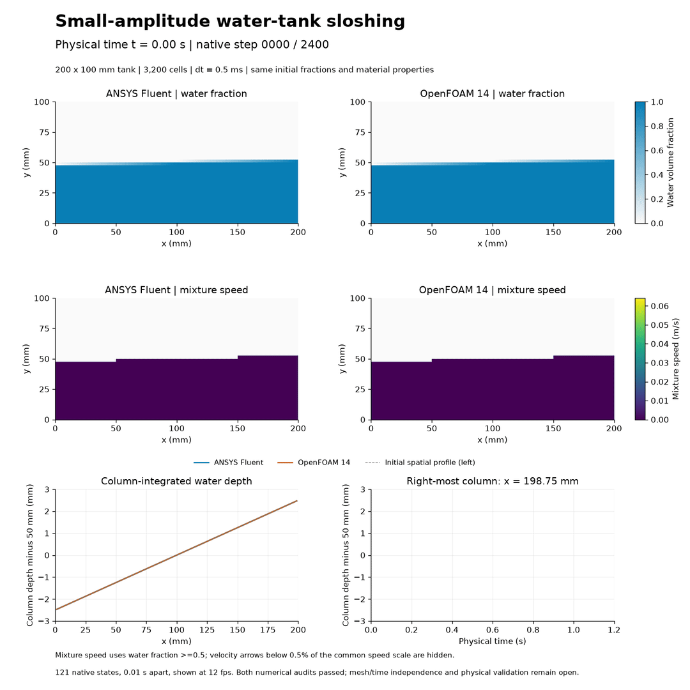
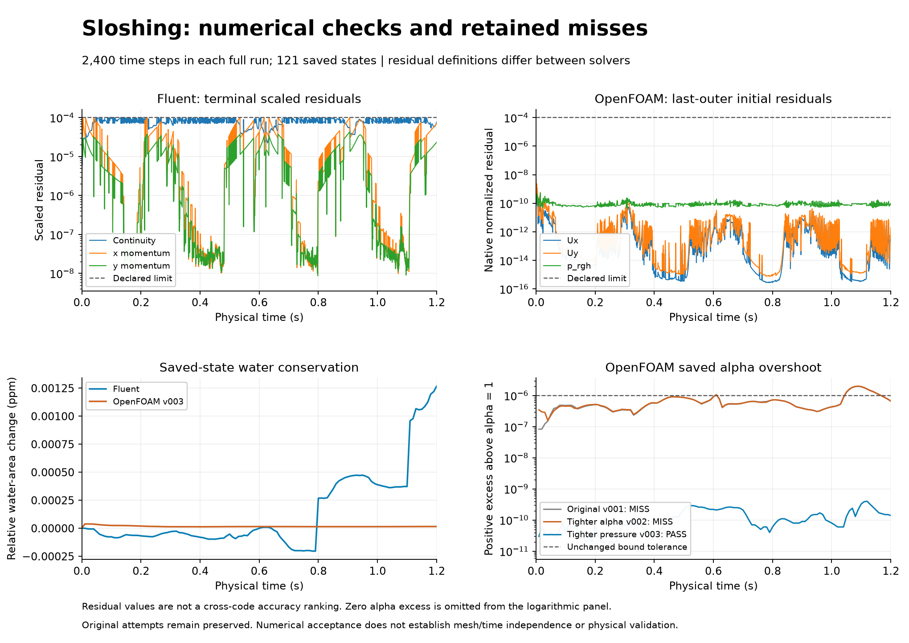

# 33. Water-tank sloshing

[Play/download the MP4](sloshing-development.mp4) · [Final frame](state-120.png) · [Numerical data](data/)

Both solvers computed **1.2 physical seconds** on the same 80 x 40 planar grid. All **2,400 time steps** meet their equation-residual criteria; all **121 saved states** pass their native-time, finite-field, water-fraction and water-area checks. The surface tilt reverses and returns, and the two solvers produce similar column-depth histories. This is a numerical comparison, not physical validation.

Gravity initially drives water from the high end toward the low end. Inertia carries it past level, producing the back-and-forth motion shown here. The depth plots measure column-integrated water volume rather than a traced interface point.

## Conditions and methods

The closed, stationary tank is 200 x 100 mm with no-slip walls. Water starts at rest beneath y = 0.05 + 0.025(x - 0.1) m, giving a mean depth of 50 mm and geometric end deviations of 2.5 mm. Each 2.5 mm square cell receives the same analytical fractional initialization in both solvers. Water cross-sectional area is 0.01000000 m².

The calculation is 2D, laminar, incompressible and isothermal. Gravity is (0,-9.81) m/s²; surface tension is omitted. Water density/viscosity are 998.2 kg/m³ and 0.001003 Pa s; air uses 1.225 kg/m³ and 1.7894e-5 Pa s. Fluent is planar with unit depth. OpenFOAM uses one 10 mm extruded layer with empty front/back patches; area and depth comparisons are normalized consistently.

Both runs use Euler time integration at dt = 0.0005 s. Fluent uses explicit VOF with Geo-Reconstruct, implicit body force, PISO, body-force-weighted pressure and second-order-upwind momentum. Its scaled continuity and momentum criteria are 1e-4, with a cap of 400 inner iterations; the largest actual count was 28. OpenFOAM uses incompressibleVoF, linear-upwind momentum, interfaceCompression vanLeer 1, two alpha correctors, eight outer and three pressure correctors. Final-outer initial residual limits are 1e-4 for Ux, Uy and p_rgh. The accepted repeat uses alpha linear tolerance 1e-11 and pressure tolerance 1e-10, with final pressure relTol = 0. MULES nIter = 10 and tolerance = 1e-2 remain unchanged. Residual normalizations differ between solvers; pressure and reduced-pressure variables are not directly compared.

## Numerical evidence

| Quantity | ANSYS Fluent | OpenFOAM v003 |
| --- | --- | --- |
| Steps meeting declared residual criteria | 2,400 | 2,400 |
| Saved states passing field and native-clock checks | 121 | 121 |
| Maximum saved relative water-area drift | 1.26774e-09 | 3.85114e-11 |
| Maximum reported VOF/interface Courant number | 0.0334874 | 0.03223479 |
| Saved water-fraction range | 0 to 1 | -6.62e-27 to 1 + 4.0e-10 |

The bound tolerance is 1e-6 and the maximum allowed relative water-area drift is 0.5%. Fluent native minimum orthogonal quality is 1; OpenFOAM passes checkMesh. OpenFOAM also passes the alpha-bound test at all 2,400 final outer iterations. Fluent's independent alpha checks cover the 121 saved states; its every-step checks cover equation residuals and reported VOF Courant values.

The maximum matched-time column-depth difference is **0.225297 mm** across all saved columns and times. At 1.2 s the column-depth RMS difference is **0.065317 mm**. These are cross-code differences, not uncertainty bounds or an accuracy ranking. The [CSV files](data/) allow the convergence, conservation and depth plots to be inspected without a solver installation.

## Preserved failures and corrections

The original full OpenFOAM run and an alpha-tolerance-only repeat both miss the unchanged alpha bound: their maximum saved values are about 1 + 2e-6. The tighter alpha solve improves water-area conservation; the subsequent pressure-only change removes the remaining bound exceedance in this controlled repeat. The [history records](history/) preserve both misses and the exact input differences. Values were not clipped to turn a miss into a pass.

The [qualification records](qualification/) retain initial register/patching problems and the original flat-control scaled-residual miss. The raw-residual quiet-control repeat gives identical saved physical fields at all 41 times. Explicitly disabling extra patch reconstruction/smoothing then makes every tilted initial cell fraction match the declaration before advancement. Both selected 40-step tilted qualifications pass.

## What the images establish

The MP4 and GIF contain 121 actual native states, 0.01 s apart, shown at 12 fps (about 10.08 s playback). There is no generated intermediate motion. Every decoded frame was checked against its source PNG; representative start, midpoint and final previews were visually reviewed. The GIF resets after the endpoint; this loop is not a periodic boundary condition.

Water-fraction and speed scales are fixed across solvers and times. White arrows are instantaneous mixture velocity in cells with water fraction >=0.5, not particle tracks. Arrows below 0.5% of the common speed maximum are hidden. Column depth is sum(alpha_water x cell height); the right-column trace is at x = 198.75 mm. The [PDF figures](state-120.pdf) retain vector labels.

The initial surface amplitude is one cell height. Near-wall shear layers and interface gradients are coarsely resolved. Mesh/time independence, damping accuracy, tank-impact loads and matched experimental validation remain open. This model does not validate Concorde, an ornithopter or any aircraft, and makes no research-novelty claim.

## Reproduction and contributions

See [the source/data guide](REPRODUCING.md), [executed code](code/), [small OpenFOAM inputs](openfoam-inputs/), [environment snapshot](environment.json), [Fluent audit](fluent-production-audit.json) and [OpenFOAM audit](openfoam-production-audit.json). Large native files remain outside Git; the repository is not a complete native restart archive. The exact executed Fluent driver v001 is retained; future reruns should use v002, which rechecks qualification hashes immediately before launch after any memory wait. A [dry-run regression](data/admission-regression.json) reproduces the old stale-input gap and confirms rejection in the corrected launcher. The completed numerical fields are unchanged.

The owner requested continued visual CFD models and authorized background operation. Codex selected, prepared, ran, diagnosed, checked and documented this model. ANSYS Fluent and OpenFOAM computed their respective fields. The owner's reflection has not been supplied. No independent owner execution is invented. This record is prepared locally; no new GitHub upload is claimed.

## Fine-grid sloshing time-step comparison — 8 November 2026

The [paired 0.50/0.25 ms comparison](../34-sloshing-mesh-sensitivity/time-step-v001/README.md) keeps the same 12,800 cells through 1.2 s and adds 4,800 accepted steps per smaller-step code, actual four-case video and native depth/phase evidence. Maximum native-column step-size responses are 0.046934 mm in Fluent and 0.047127 mm in OpenFOAM. This improves existing studies 33/34 without adding a model, claiming time independence or physical validation, or claiming a new upload.
