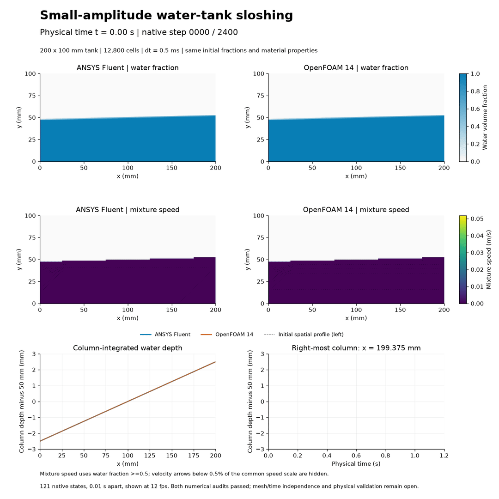
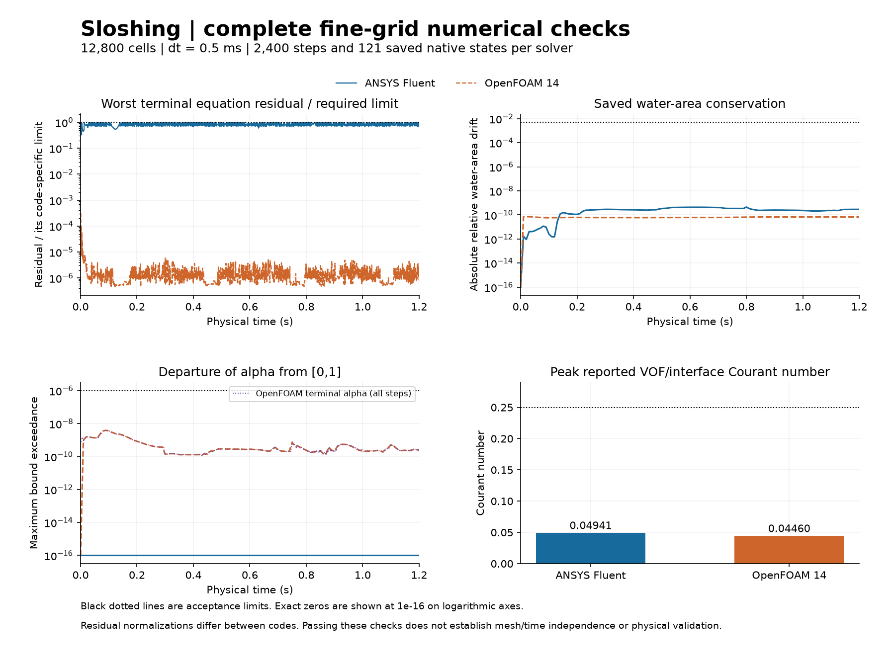
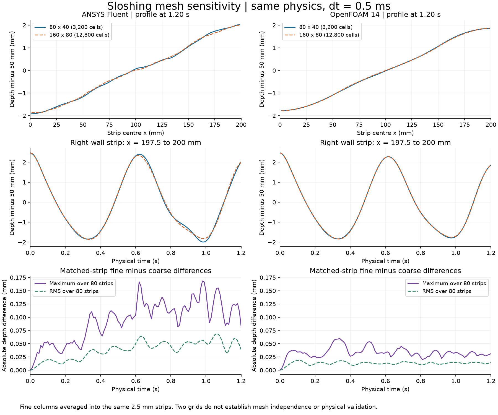

# 34. Sloshing mesh sensitivity

[Play/download the MP4](sloshing-development.mp4) · [Mesh comparison](mesh-sensitivity.png) · [Numerical CSVs](data/)

Both solvers computed **1.2 seconds on 12,800 cells**, four times the cell count of [model 33](../33-tank-sloshing/README.md). All **2,400 time steps and 121 saved native states per code** pass their declared numerical checks. The animation uses actual saved fields with fixed scales. This is a two-grid sensitivity study; mesh independence and physical validation remain open.

Gravity sends water from the high end toward the low end. Inertia carries it past level, producing the reversal and return shown in the video. The comparison asks how that computed motion changes with spatial resolution while retaining the same physics and time step.

## Fixed conditions and changed grid

The closed tank is 200 x 100 mm, with stationary no-slip walls, mean water depth 50 mm and initial surface `y = 0.05 + 0.025(x - 0.1)` m. Both fluids start at rest. The coarse grid is 80 x 40 at 2.5 mm; the fine grid is 160 x 80 at 1.25 mm. Fine native initial fractions average back to the coarse fractions within 4.67e-15; both codes' initial matched-strip water depths agree within 1.43e-14 mm.

Both grids use dt=0.0005 s, 2,400 steps and saves every 20 steps. Calculations are 2D, laminar, incompressible and isothermal, with gravity (0, -9.81) m/s² and no surface tension. Water density/viscosity are 998.2 kg/m³ and 0.001003 Pa s; air uses 1.225 kg/m³ and 1.7894e-5 Pa s. Fluent is planar; OpenFOAM uses one 10 mm layer with empty front/back patches. Area/depth comparisons account for this convention. OpenFOAM's pressure-reference point moves to the fine upper-right air-cell centre; this sets the pressure gauge rather than physical forcing.

Fluent retains PISO, explicit Geo-Reconstruct VOF, implicit body force, body-force-weighted pressure and second-order-upwind momentum. Its scaled continuity/momentum criteria are 1e-4 with a cap of 400 inner iterations; the largest actual count is 26. OpenFOAM retains Euler time integration, linear-upwind momentum, interfaceCompression vanLeer 1, two alpha correctors, eight outer/three pressure correctors, alpha linear tolerance 1e-11 and p_rgh tolerance 1e-10. Its final-outer initial Ux/Uy/p_rgh limits are 1e-4. Residual normalizations differ between codes and do not rank physical accuracy.

## Numerical evidence

| Quantity | Fluent | OpenFOAM |
| --- | --- | --- |
| Steps meeting declared residual limits |2,400|2,400|
| Checked saved native states |121|121|
| Maximum relative saved water-area drift |4.501e-10|7.212e-11|
| Maximum reported VOF/interface Courant |0.0494102|0.0445969|
| Maximum saved alpha departure from [0,1] |0|3.860e-9|

Limits are 0.5% relative water-area drift, 1e-6 alpha-bound tolerance and 0.25 reported Courant. Fluent minimum orthogonal quality is 1; OpenFOAM passes checkMesh. Native times/indices and finite alpha, velocity and pressure are checked. OpenFOAM also passes terminal alpha bounds at all 2,400 steps; Fluent's independent alpha-field checks cover the 121 saved states. Four 40-step flat/tilted qualifications passed before production. See [the audits](fluent-production-audit.json) and [qualification records](qualification/).

## What changes with resolution

Fine columns are averaged in pairs into the same 2.5 mm-wide physical strips as the coarse grid. The right-wall comparison strip is x = 197.5–200 mm, centred at 198.75 mm. The fine-only animation instead labels its last 1.25 mm column at 199.375 mm.

| Matched-time depth difference, fine versus coarse | Fluent | OpenFOAM |
| --- | --- | --- |
| Maximum over all 80 strips and 121 states |0.168348 mm|0.059781 mm|
| Space-time RMS |0.041598 mm|0.013269 mm|
| Final-profile RMS at 1.2 s |0.038769 mm|0.014211 mm|

On the fine grid the maximum code-to-code column-depth difference is 0.139582 mm, versus 0.225297 mm on the coarse grid. These are numerical differences, not error bars or an accuracy ranking. Two grids do not determine an observed convergence order or a continuum solution. Interface, wall-layer, damping and time-step sensitivity remain unresolved; there is no matching experimental validation or aircraft-validation claim.

## Images, sources and contributions

The MP4/GIF show 121 actual native states 0.01 s apart, at 12 fps (10.08 s playback). All frames were decoded and compared with their source PNGs. Start/midpoint/end images were visually reviewed. There is no generated intermediate motion. Fixed colour scales allow within-video comparison; white arrows show instantaneous mixture velocity in cells with α ≥ 0.5, not particle tracks. The GIF resets after the endpoint; that reset is not simulated motion.

See [REPRODUCING.md](REPRODUCING.md), [executed sources](code/), [small OpenFOAM inputs](openfoam-inputs/), [environment](environment.json) and [CSV histories](data/). Native solver files remain outside Git. An additional mapping check initially assumed a coarse geometry hash existed in its older audit; its preserved v002 correction instead proves the complete analytic/native geometry. No simulation fields or acceptance limits changed.

ANSYS Fluent and OpenFOAM computed their respective fields.

## Fine-grid sloshing time-step comparison

The [paired 0.50/0.25 ms comparison](time-step-v001/README.md) keeps the same 12,800 cells through 1.2 s and adds 4,800 accepted steps per smaller-step code, actual four-case video and native depth/phase evidence. Maximum native-column step-size responses are 0.046934 mm in Fluent and 0.047127 mm in OpenFOAM. This improves existing studies 33/34 without adding a model, claiming time independence or physical validation, or claiming a new upload.
