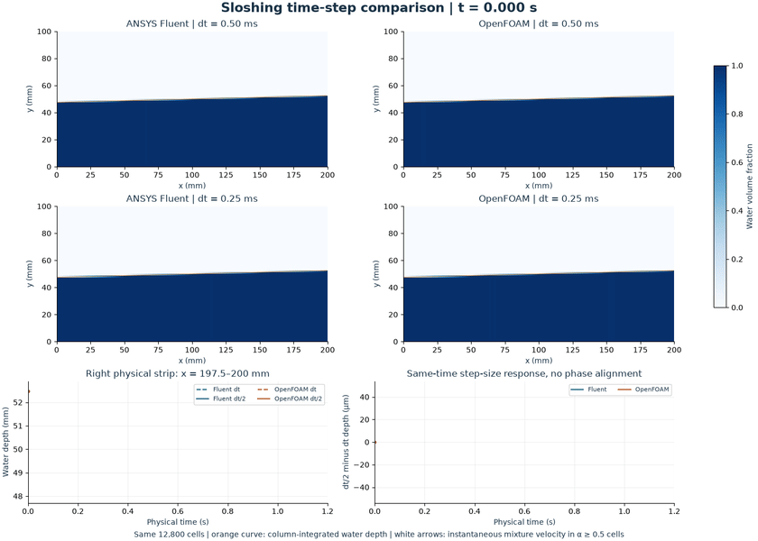
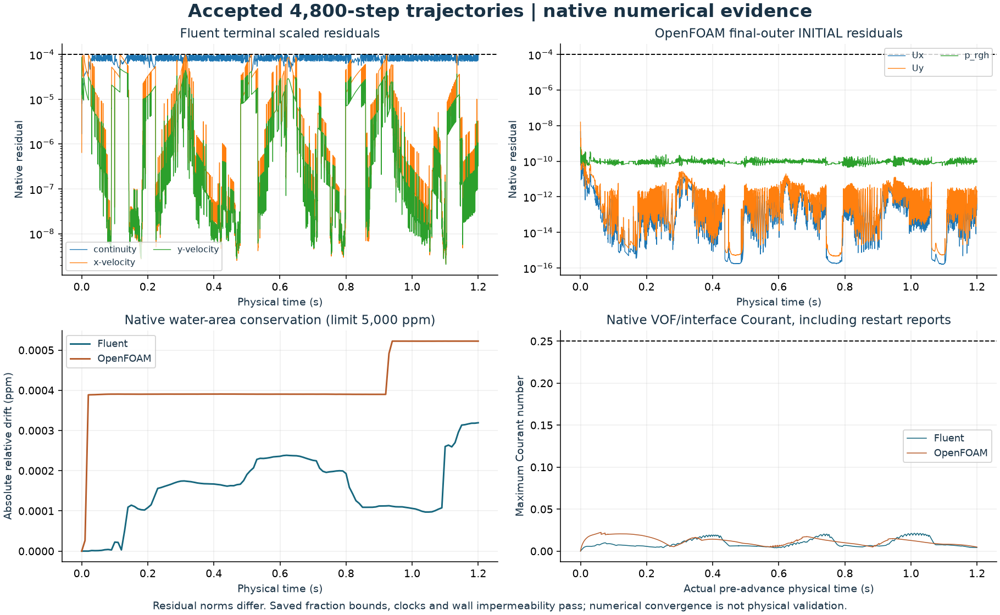
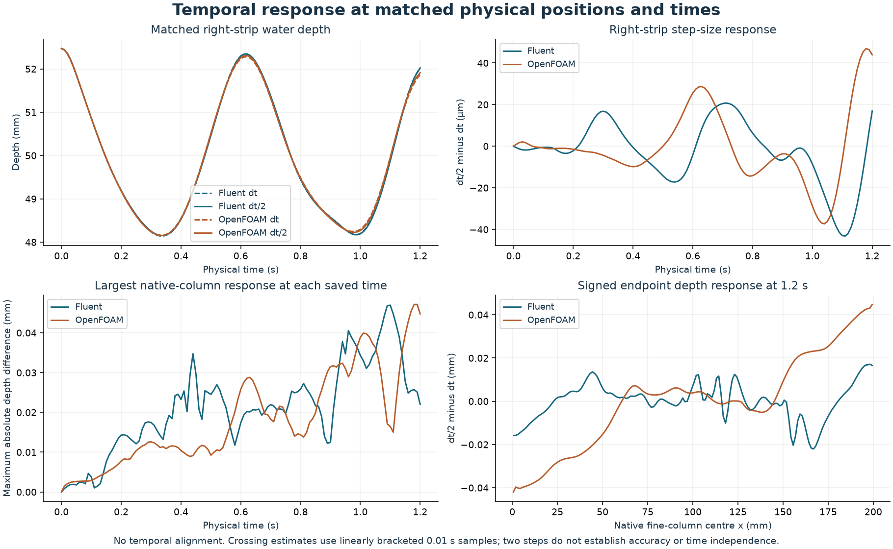

# Does sloshing change when the time step is halved?

This improves existing **studies 33/34**, keeping the same **160 × 80 grid (12,800 cells)** and comparing **0.50 ms against 0.25 ms** in ANSYS Fluent and OpenFOAM. Both smaller-step calculations reached **1.2 physical seconds with 4,800 accepted steps each**. It adds no numbered model.

[Full-resolution video](media/sloshing-time-step-comparison.mp4) · [Endpoint fields](figures/paired-endpoint.png) · [Depth and phase evidence](figures/depth-and-phase-evidence.png) · [Numerical checks](figures/full-numerical-evidence.png)

Gravity and inertia drive the water back and forth. The orange line integrates water volume in each column; it is not a traced exact interface point. White arrows show instantaneous native mixture velocity in cells with water fraction α ≥ 0.5. The lower panels follow the same physical right-hand strip in all four cases and show the unaligned time-step response.

| Saved-time depth response, dt/2 versus dt | ANSYS Fluent | OpenFOAM |
|---|---:|---:|
| Maximum over 160 native columns and 121 times | 0.046934 mm | 0.047127 mm |
| Native-column sample RMS over space and time | 0.010445 mm | 0.010593 mm |
| Native-column RMS at 1.2 s | 0.008353 mm | 0.021662 mm |
| Maximum over paired 2.5 mm strips and all times | 0.046446 mm | 0.046928 mm |

These are numerical differences, not error bars, an accuracy ranking or a time-independence result. Sample RMS weights the uniformly saved samples equally; it is not a continuous-time integral. The new smaller-step code-to-code maximum column-depth difference is 0.119796 mm, with endpoint RMS 0.034321 mm. No physical uncertainty follows from that agreement.

## What stayed fixed

The closed tank is 200 × 100 mm with stationary no-slip walls, a 50 mm mean depth and initial surface y = 0.05 + 0.025(x − 0.1) m. Water density/viscosity are 998.2 kg/m³ and 0.001003 Pa s; air uses 1.225 kg/m³ and 1.7894e-5 Pa s. Gravity is (0, −9.81) m/s². The model is laminar, incompressible, isothermal and two dimensional, with no surface tension. Fluent uses planar unit depth; OpenFOAM uses one 10 mm layer with empty front/back patches.

Each code reuses its exact accepted fine-grid native mesh and initial α/U/p fields. There is no repatching or reinitialisation. Fluent retains explicit Geo-Reconstruct VOF, implicit body force, PISO, body-force-weighted pressure, second-order-upwind momentum, first-order time and the 400-inner-iteration cap. OpenFOAM retains incompressibleVoF, Euler time, linear-upwind momentum, interfaceCompression vanLeer 1, two alpha correctors, eight PIMPLE outer and three pressure correctors, alpha linear tolerance 1e-11 and p_rgh tolerance 1e-10 with final relTol 0. MULES controls and the pressure gauge are unchanged. Only time step and finite output/end scheduling change in the physical/numerical inputs.

Both 80-step qualifications passed to 0.02 s and were inspected before the full interval was admitted. Fresh directories then continued the exact saved 0.02 s/step-80 checkpoint for 4,720 further steps. All available native partition restart flux/history fields, including phi and alphaPhi.water, were preserved. No solver counter was reset or decomposition repeated. The workflow is an 80 + 4,720-step checkpoint continuation, not an independent uninterrupted repeat. Fluent's continuation directory contains 120 states including an extra step-81 checkpoint; OpenFOAM's contains 119. The final 121 matched times use qualification states at 0/0.01/0.02 s and continuation states thereafter, excluding duplicate restart rows. No new flat control is claimed at the smaller step; the original accepted flat controls and exact unchanged initial fields remain bound to the record.

## Numerical evidence

Every actual step passes its original definition: Fluent terminal scaled continuity/momentum ≤ 1e-4; OpenFOAM maximum initial residual across all pressure corrections of the final eighth outer loop ≤ 1e-4 for Ux/Uy/p_rgh. Their norms differ and do not rank physical accuracy. Maximum observed values are 9.9999e-5 and 1.5916641e-8 respectively. Fluent's original 400-inner cap is checked from native printed budgets and iteration counters.

Every saved native field passes finite α/U/p and actual step/time/dt checks, α within 1e-6 of [0,1], and relative water-area drift ≤ 0.5%. Maximum saved relative area drift is 3.1923e-10 in Fluent and 5.2235e-10 in OpenFOAM; maximum saved alpha excess is zero and 9.0001e-10 respectively. OpenFOAM also checks terminal alpha bounds at every step. Fluent's independent fraction checks cover saved states, not every unsaved internal state. Native mesh quality/topology and cell mapping remain source-bound to the unchanged accepted fine geometry.

Maximum native VOF/interface Courant numbers are 0.021246 and 0.0223011, below the unchanged 0.25 guard. All reports are covered: 80 + 4,720 for Fluent and 81 + 4,721 for OpenFOAM, including both native initial/restart duplicates at their actual pre-advance times. No arbitrary time shift removes them. Native OpenFOAM phi is finite and its absolute tank-wall volumetric flux per depth passes the added 1e-12 m²/s impermeability guard. This supplements water-area conservation; it is not a new physical validation claim. [Full step and native audits](checks/) retain the evidence.

## What the phase comparison establishes

The primary trace uses the same x = 197.5–200 mm strip, centred at 198.75 mm, formed by averaging the final two fine columns. The native last column instead lies at 199.375 mm; those locations are not interchanged. Both time steps yield two positive-going crossings of the 50 mm mean depth and therefore **one complete bracketed cycle** in this saved interval.

Fluent's interpolated crossing delays for dt/2 are approximately 0.506 and 1.613 ms; OpenFOAM's are 0.136 and 0.193 ms. The bracketed periods are approximately 0.623634 versus 0.624742 s in Fluent and 0.623513 versus 0.623570 s in OpenFOAM. These sub-sample times use linear brackets from fields saved 10 ms apart. They are interpolation estimates, not certified phase accuracy. Extrema are sampled, no phase alignment or extrapolation is applied, and one cycle does not establish damping accuracy or asymptotic periodic development. Exact counts, brackets and sampled amplitudes are in [the numerical summary](data/summary.json).

## Images, provenance and reproduction

[Water-dominant native speed maps](figures/native-endpoint-speed.png) mask air-dominant cells only for display. All mixture fields remain in the native evidence. The maximum speed across the selected water-dominant cells/times is 0.051930 m/s; the all-mixture maximum is 0.266732 m/s. Local interface/air currents are numerical features, not proof of physically resolved motion. The alpha colour range is fixed at 0–1; tolerance-sized over/undershoots saturate colours only. Native values are never clipped for checks, depth or area calculations.

The animation uses 121 actual saved states at 12 fps, about 10.08 s playback, without generated intermediate motion. Axes, colour ranges and velocity-arrow scale remain fixed; arrows below 0.5% of the shared water-dominant speed peak are hidden. Orange curves are column-integrated water depth. The GIF loop resets to the initial state; that reset is not simulated periodic motion. Every MP4/GIF frame was decoded and compared with its source PNG. Initial/middle/end actual and decoded frames and all numerical figures were inspected. Preferred export version 002 corrects only OpenFOAM product-name capitalisation; version-001 numerical analysis and CSV bytes are unchanged and all earlier exports remain preserved.

Read [the specification](methods/SPEC.md), [plan](methods/PLAN.md), [finite full-interval admission](methods/FULL-INTERVAL-ADMISSION-v001.md), [postprocessing protocol](methods/POSTPROCESSING-v001.md), [executed and retained source versions](code/), [native column data](data/native-column-depths.csv), [field histories](data/field-history.csv) and [small OpenFOAM inputs](inputs/openfoam/). The 19 selected numerical/admission helpers pass. Source manifests and diagnostics record the original qualification cleanup wait, before-MPI interoperability import correction and prelaunch memory withhold. The existing final gate later admitted OpenFOAM automatically after fresh resource checks. No numerical criterion was relaxed; no accepted calculation was rerun.

This is a methods/execution archive, not a portable native restart bundle. Native meshes/checkpoints, full solver logs, installed dependencies, connection/licence files and credentials stay outside Git. Sources retain the documented E: layout and intentionally reject changed inputs/reused output folders. Reproduction needs new versioned paths/manifests, the existing E: environment and D: Fluent 261, two ranks and sequential hidden sessions, fresh source/parent/process/licence gates and RAM ≥ 4 GiB/E: free ≥ 10 GiB after imports and immediately before launch. [Project environment guide](../../../docs/REPRODUCING.md). Frozen plans/admissions are historical preparation snapshots; completed audits and selection bind the executed endpoints.

## Limits and contributions

Two time steps on one fine grid do not establish observed order, time/mesh/domain independence, damping validation, a continuum interface or experimental/aircraft accuracy. Interface, wall-layer and startup discretisation effects remain. The smaller-step trajectory includes the stated exact checkpoint restart; there is no independent uninterrupted-repeat or unique-discrepancy-cause claim. The original mesh study and all earlier failures remain preserved.

ANSYS Fluent and OpenFOAM computed the native fields. No research novelty, admissions outcome, university submission or new GitHub upload is claimed.
