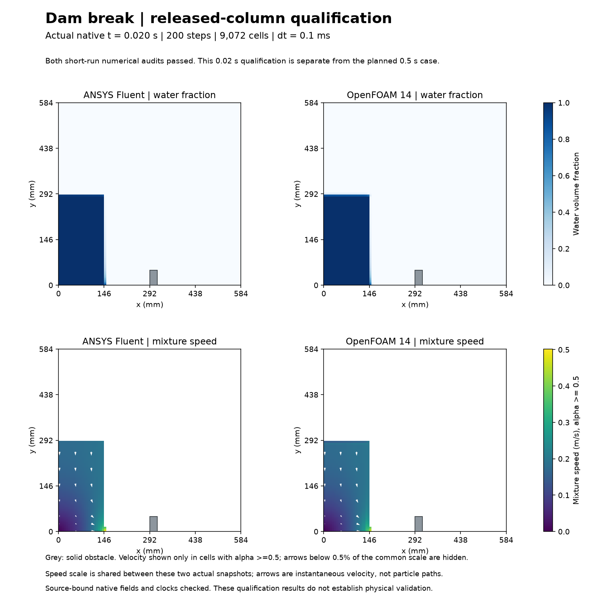
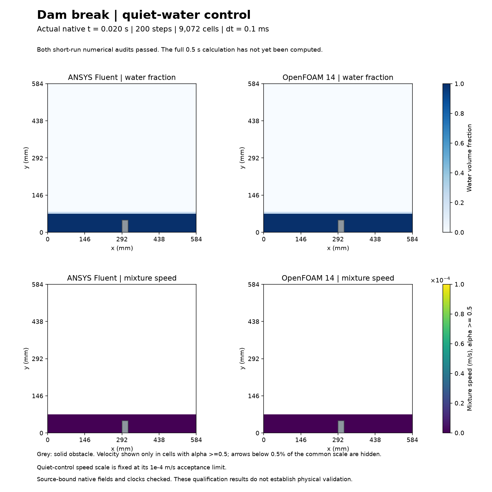

# 35. Dam break over an obstacle — in progress

Both solvers completed the **0.02-second released-column qualification** and the same-volume quiet-water control. All four runs pass their declared numerical checks: 200 steps and 21 saved states each. These images show the actual qualification fields, not a completed 0.5-second production calculation.

The longer ANSYS calculation had started when this record was captured; the full OpenFOAM extension and final paired video were still pending. See the [dated status snapshot](STATUS-SNAPSHOT.json). Do not interpret this page as a finished production result.

## Conditions and numerical checks

A 584 x 584 mm tank contains an initially stationary 146.1 x 292 mm water column. A 24 mm-wide, approximately 48 mm-high obstacle sits on the floor. The top admits air at static zero gauge pressure; other walls are stationary and no-slip. Both codes use 9,072 nonuniform quadrilateral cells, dt = 0.1 ms, gravity and surface tension. [Exact coordinates, materials and methods](CONDITIONS.md).

The mesh excludes the solid obstacle; integrals use each cell's actual area. Fluent is planar with unit depth. OpenFOAM uses one 14.6 mm empty-direction layer; native fluxes are converted to the same per-unit-depth convention.

| Released-column qualification | ANSYS Fluent | OpenFOAM 14 |
| --- | ---: | ---: |
| Time steps | 200 | 200 |
| Checked native states | 21 | 21 |
| Peak reported VOF/interface Courant | 0.00862903 | 0.0125351 |
| Maximum relative mixture-mass closure | 1.763e-10 | 6.280e-10 |

The atmosphere is open: conservation compares inventory change with the integrated, signed native mass flux. Water leaving the domain is not automatically a conservation error. Residuals, native times, finite fields, alpha bounds and report coverage were checked. [All four qualification audits](qualification/) retain the detailed evidence.

The quiet-water speed colour scale is fixed at its 1e-4 m/s acceptance limit. The tiny velocities are numerical noise, not visibly developing flow. White arrows on the released-column figure are instantaneous velocity in water-dominated cells, not particle tracks. Each figure has its own declared shared speed scale.

## Sources, limitations and reproduction

This adapts the [official OpenFOAM Foundation 14 dam-break tutorial](https://doc.cfd.direct/openfoam/user-guide-v14/dambreak). It replaces the tutorial's total-pressure atmosphere with a matched static-pressure condition and changes spatial resolution and time controls. It is not an exact benchmark replay.

[Executed code](code/), [small OpenFOAM inputs](openfoam-inputs/) and [input/correction provenance](provenance/) are included. Large native meshes, case/data files and working directories remain on E: outside Git. The recorded scripts use the original E: layout and existing repository helpers; they are an execution archive, not a fresh-machine installation bundle. Preserve the hash-bound originals and use a new output version for future reruns.

The code expects the recorded project environment and repository scripts on PYTHONPATH. The dependency helpers wing_fluent_v001.py and analyse_nozzle_fluent_v005.py are in the repository's scripts directory. Source receipts intentionally refer to the original preserved native paths; copying the code alone does not reproduce all hash-admission prerequisites.

Fluent setup attempts that stopped before any time step are retained in the local originals and summarized in the correction provenance. No failed attempt is counted as a converged simulation. Mesh/time independence, turbulent impact loads and experimental validation remain open. This work does not validate an aircraft.

The owner requested and authorized visual CFD work. Codex prepared, executed, checked and documented these qualifications; ANSYS Fluent and OpenFOAM computed their respective fields. No independent owner execution, reflection or research novelty is invented.
