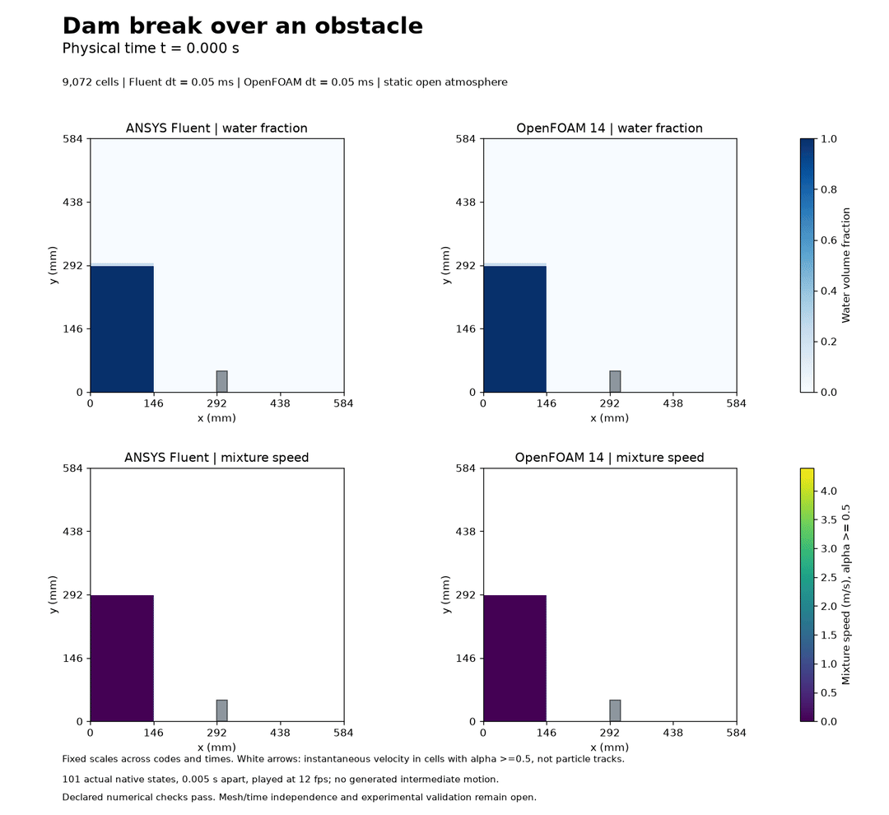
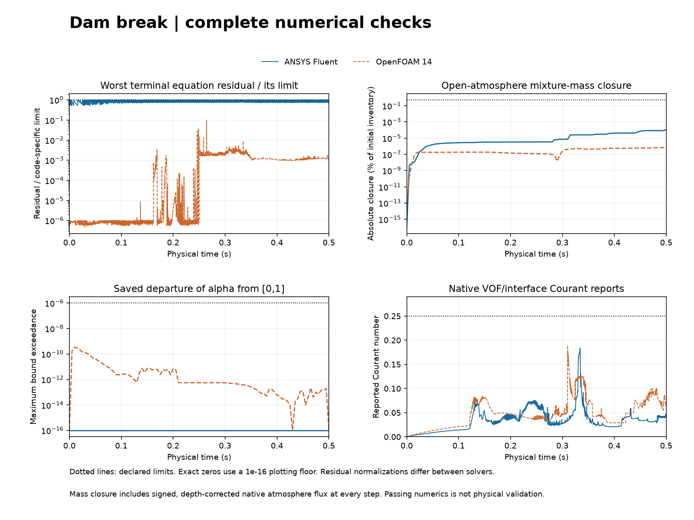

# Full paired dam-break calculation

[MP4 video](dam-break-development.mp4) · [Numerical checks](numerical-checks.png) · [Pressure](pressure-final.png) · [Methods](METHODS.md) · [CSV histories](data/)

Both selected calculations cover **0.5 s, 10,000 physical steps and 101 native states**, on 9,072 nonuniform quadrilateral cells at dt = 0.05 ms. All selected steps and saved states pass the declared numerical checks. This is an educational numerical calculation; physical validation and mesh/time independence remain open.

Gravity drives the released water column toward the low obstacle. The jet rises after crossing it, meets the far wall and fragments. The two solvers produce different jet/drop details on this coarse mesh. Those differences remain visible; agreement is not assumed or treated as an accuracy ranking.

## Selected methods and numerical evidence

Fluent uses Coupled pressure/velocity with explicit Geo-Reconstruct VOF. OpenFOAM uses PIMPLE with eight outer/three pressure correctors. Its accepted trajectory is a **saved-state continuation**: the first 5,000 steps to 0.25 s are preserved from the parent calculation; 5,000 further steps use momentum-equation relaxation 0.7. It is not an independent full rerun from zero.

| Quantity | ANSYS Fluent | OpenFOAM |
| --- | ---: | ---: |
| Selected physical steps meeting the unchanged criteria | 10,000 | 10,000 |
| Checked native states | 101 | 101 |
| Peak native VOF/interface Courant | 0.183625 | 0.188794 |
| Maximum absolute relative mixture-mass closure | 1.106e-6 | 6.813e-9 |

Limits remain 1e-4 for terminal Fluent scaled continuity/momentum and OpenFOAM final-outer initial Ux/Uy/p_rgh residuals, 0.25 for native Courant, 1e-6 alpha-bound tolerance and 0.5% mixture-mass closure. Residual normalizations differ between codes.

The atmosphere is open. Conservation compares inventory change with the **signed native mass flux at every step**, accounting for OpenFOAM's 14.6 mm extrusion. Water leaving the top is not automatically a mass error. Both native initial Courant reports at the OpenFOAM restart are retained: 10,002 raw reports over 10,001 unique physical times. The duplicate restart initial flux row is excluded from time integration.

## What the images establish

The MP4/GIF contain 101 actual saved fields, 0.005 s apart, at 12 fps. Every encoded frame was decoded and compared with its source PNG. Start, quarter, midpoint, three-quarter and endpoint fields, pressure and numerical plots were visually inspected. There is no generated intermediate fluid motion. The GIF resets after the endpoint; that reset is not simulated motion.

Water-fraction and water-dominated mixture-speed scales are fixed across both solvers and all frames. White arrows are instantaneous velocity in cells with alpha >= 0.5, not particle tracks. The speed scale is deliberately restricted to those cells; larger velocities elsewhere in the mixture remain in the native audits. Pressure is reconstructed as physical gauge pressure from each solver's own fields.

The model is 2D, laminar and incompressible, with constant phase properties and no wall adhesion. Small droplets, air-pocket compression, wetting, turbulence and impact-load accuracy are unresolved. Cellwise pressure maps do not establish resolved impact loads. This does not validate an aircraft or claim research novelty.

[Preserved failures and correction history](history/README.md) · [Reproduction and storage](REPRODUCING.md) · [Source/copy provenance](provenance/) · [Executed code](code/)

ANSYS Fluent and OpenFOAM computed their own fields.

[Fresh technical review](data/technical-review.json) found no Critical or Important issue. One deferred minor clarifies that OpenFOAM Courant timestamps are step-associated report times, rather than distinct native state-sampling times; maxima, acceptance and mass integration are unaffected.
