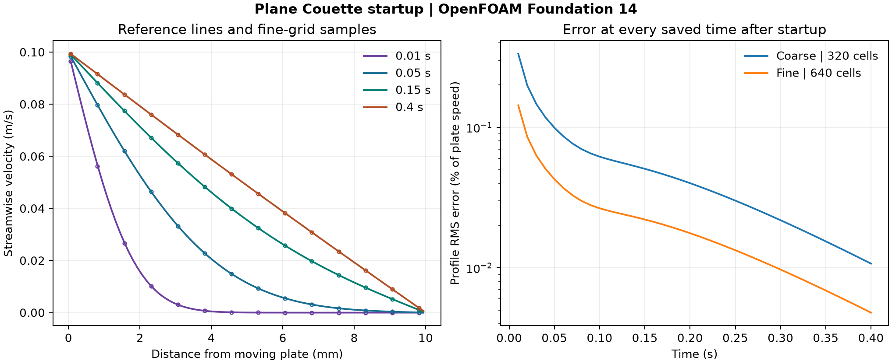

# 37. Startup of plane Couette flow

How quickly does a moving wall set the fluid between two plates in motion? OpenFOAM Foundation 14 was run at two space and time resolutions, starting with fluid at rest. At the first saved time, the velocity is concentrated near the moving plate. By 0.4 s it is close to the linear steady profile across the gap.



Both calculations reached 0.4 s and passed the declared numerical checks. Refining space and time together reduced the maximum saved profile RMS error from **0.334% to 0.143% of plate speed**. The error is measured against the analytical cell averages at the saved times, 0.01 s apart.

| Quantity | Coarse | Fine |
| --- | ---: | ---: |
| Cells | 320 | 640 |
| Time step (ms) | 0.50 | 0.25 |
| Actual steps | 800 | 1,600 |
| Saved states, including the initial state | 41 | 41 |
| Maximum profile RMS error (% of plate speed) | 0.334 | 0.143 |
| Largest cell velocity error (% of plate speed) | 0.954 | 0.411 |
| Largest reported local continuity error | 2.31 × 10⁻¹⁸ | 1.08 × 10⁻¹⁸ |

[Figure PDF](data/couette-profiles-and-errors.pdf) · [Profiles](data/profiles.csv) · [Error history](data/errors.csv) · [Numerical checks](data/checks.json) · [Case inputs](case-inputs/)

## Model and reference

The plates are 10 mm apart. The lower plate moves at 0.1 m/s from time zero, the upper plate is fixed, and the kinematic viscosity is 0.0001 m²/s. The fluid starts at rest. The streamwise boundaries form an 8 mm periodic pair with zero imposed pressure gradient. A 1 mm extrusion uses empty front and back patches.

The laminar incompressible solver uses first-order Euler time integration, orthogonal diffusion, one outer correction and two pressure corrections per step. The meshes use 8 × 40 and 8 × 80 uniform cells. The reference solves ∂u/∂t = ν ∂²u/∂y² for the same stationary and moving walls. The comparison integrates the Fourier sine series over each cell height and averages the OpenFOAM velocities across the eight cells at each height. The 200-term series is evaluated at all positive saved times. The reference at time zero is the rest initial condition. [Analytical derivation, §7.4](https://academicweb.nd.edu/~powers/ame.30332/notes.pdf)

## Numerical checks and scope

An 80-step run to 0.02 s qualified the setup before the two full runs. The audit reads the native OpenFOAM clock, mesh centres and every saved velocity field. It checks linear solver and continuity reports at every step, bounds on velocity, negligible transverse motion and uniform streamwise profiles at each height. The acceptance limits were 0.6% RMS profile error and 2% maximum absolute profile error, both normalized by plate speed, with lower maximum RMS error required for the fine case.

This is a verification exercise for an idealized laminar flow. The two runs change space and time resolution together, so their error difference measures the combined refinement response. Experimental validation and separate spatial and temporal convergence rates remain open.

## Reproduction

Copy each of the [coarse](case-inputs/coarse/) and [fine](case-inputs/fine/) input folders into a writable OpenFOAM Foundation 14 workspace. In each case folder, run the commands below.

```sh
blockMesh > mesh.log 2>&1
checkMesh > check-mesh.log 2>&1
foamPostProcess -func writeCellCentres -time 0 > centres.log 2>&1
foamRun > solver.log 2>&1
```

From the study folder, use [the audit script](audit_couette.py) with NumPy and Matplotlib. Pass the directory containing both runs, the [input hashes](case-inputs/input-sha256.json), and a new output directory.

```sh
python audit_couette.py /path/to/runs case-inputs/input-sha256.json --export /path/to/new-output
```

OpenFOAM computed the fields.
