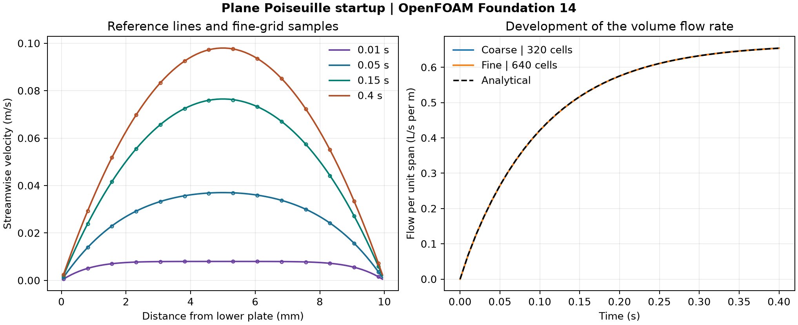

# 38. Startup of pressure-driven channel flow

A constant pressure gradient is applied to a resting fluid between two fixed plates. The velocity profile grows toward a parabola as wall friction develops. Both OpenFOAM Foundation 14 resolutions passed the numerical checks through 0.4 s.

| Quantity | Coarse | Fine |
| --- | ---: | ---: |
| Cells | 320 | 640 |
| Time step (ms) | 1.0 | 0.5 |
| Actual steps | 400 | 800 |
| Saved states | 41 | 41 |
| Maximum saved profile RMS error (% of steady peak speed) | 0.107 | 0.059 |
| Maximum flow-rate error (% of steady analytical flow rate) | 0.113 | 0.073 |

[Figure PDF](data/poiseuille-profiles-and-flow.pdf) · [Profiles CSV](data/profiles.csv) · [Error history](data/errors.csv) · [Numerical checks](data/checks.json) · [Case inputs](case-inputs/)

The 10 mm gap has fixed no-slip plates, an 8 mm periodic streamwise length and a 1 mm empty extrusion. Kinematic viscosity is 0.0001 m²/s. A uniform acceleration of 0.8 m/s² in the streamwise momentum equation represents the imposed pressure gradient divided by density. The reference solves the diffusion equation with this constant source and zero velocity at both plates. Its odd sine modes are integrated over each cell height. Integrating the resulting profiles across the gap gives the volume flow per unit span. [Analytical reference](https://web.mit.edu/10.34/www/ch4_Poiseuille_startup.htm)

A 40-step smoke run preceded the accepted runs. The first central-advection attempt missed the 10⁻⁹ m/s streamwise uniformity threshold on the fine grid at 0.22 s. The preserved replacement uses upwind momentum advection on both grids, with the same physical inputs and thresholds. The accepted runs met the profile, flow-rate, symmetry, residual and continuity checks in the [protocol](PROTOCOL.md). Both mesh and time step change between resolutions, so the result describes their combined effect.

## Reproduce the comparison

Copy the coarse and fine input folders into a writable OpenFOAM Foundation 14 directory. In each case run `blockMesh > mesh.log`, `checkMesh > check-mesh.log`, `foamPostProcess -func writeCellCentres -time 0 > centres.log` and `foamRun > solver.log`. Run [the audit script](audit_poiseuille.py) with NumPy and Matplotlib, passing the parent directory of the two runs, [the input hashes](case-inputs/input-sha256.json), and `--export` with a new output directory.

The project owner directed the portfolio expansion. Codex prepared and checked the cases, ran the workflow and produced the figures. OpenFOAM computed the fields.
