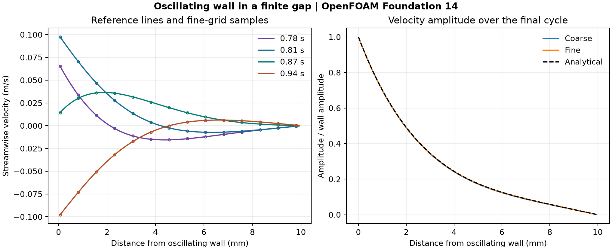

# 39. How an oscillating wall drives flow

A wall moves sinusoidally at 4 Hz beneath a 10 mm gap. Viscosity transmits that motion through the fluid, while the far wall remains stationary. The saved velocity profiles show both a drop in amplitude and a change in phase with distance from the moving wall.

| Quantity | Coarse | Fine |
| --- | ---: | ---: |
| Cells | 320 | 640 |
| Time step (ms) | 1.0 | 0.25 |
| Actual steps through 1 s | 1,000 | 4,000 |
| Saved states | 101 | 101 |
| Maximum saved profile RMS error (% of wall amplitude) | 0.194 | 0.049 |
| Maximum final-period amplitude error (% of wall amplitude) | 0.242 | 0.060 |
| Maximum final-period phase error (degrees) | 0.814 | 0.208 |

Phase error is evaluated where the reference amplitude reaches at least 10% of the wall amplitude. [PDF](data/oscillating-wall-comparison.pdf) · [Profiles](data/profiles.csv) · [Error history](data/errors.csv) · [Checks](data/checks.json)

OpenFOAM Foundation 14 solved incompressible laminar flow with viscosity 0.0001 m²/s, an 8 mm periodic streamwise span and a 1 mm empty extrusion. The fluid starts at rest. The lower wall has a 0.1 m/s amplitude and the upper wall stays fixed. The analytical comparison solves diffusion between the two walls. It combines the complex harmonic response with decaying sine modes that enforce the rest initial condition. Reference values are averaged over the native cell heights. The final-period fit uses 25 saved samples. [Background on oscillatory Couette flow](https://arxiv.org/abs/2107.12894)

The first fine run at 0.5 ms missed the streamwise uniformity limit. The replacement uses 0.25 ms, preserving the coarse run’s viscous diffusion number. Both accepted runs passed the [predeclared checks](PROTOCOL.md). The comparison changes space and time resolution together.

To reproduce, use the [case inputs](case-inputs/) with OpenFOAM Foundation 14. In each writable case run `blockMesh > mesh.log`, `checkMesh > check-mesh.log`, `foamPostProcess -func writeCellCentres -time 0 > centres.log` and `foamRun > solver.log`. Run [the audit script](audit_oscillation.py) with NumPy and Matplotlib, passing the directory containing the two runs, [the input hashes](case-inputs/input-sha256.json), and `--export` with a new output directory.

The project owner directed the portfolio expansion. Codex prepared the cases, ran and checked the workflow, and produced the figures. OpenFOAM computed the fields.
